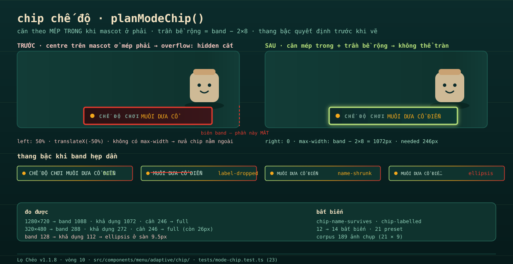
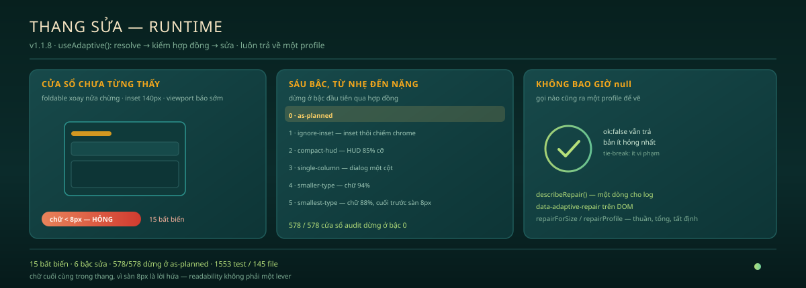
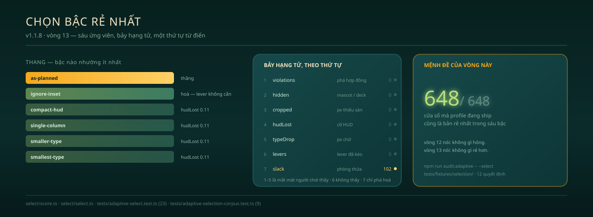
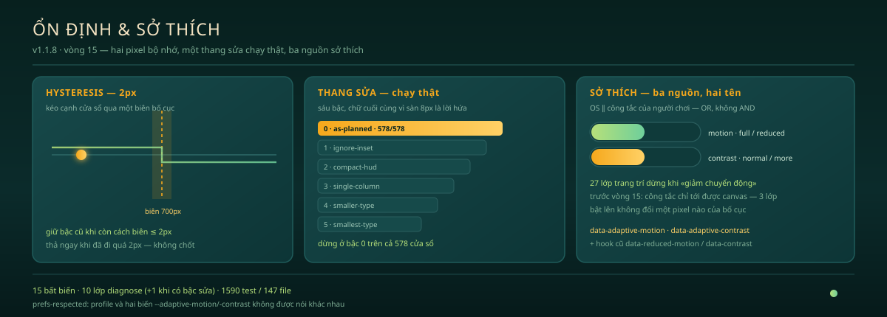
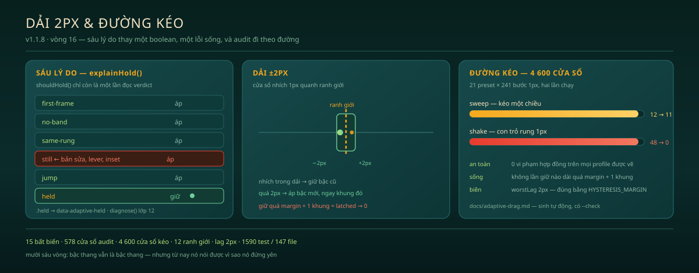
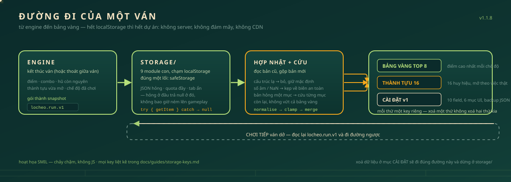
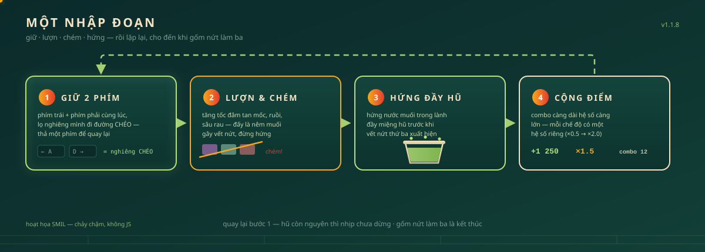

<div align="center">



# LỌ CHÉO — PICKLED JAR SHOWDOWN

### 🫙 Vietnamese pickle arcade running 100% in the browser — one self-contained HTML file, offline-first
### 🌐 In-game UI in 7 languages — Tiếng Việt · English · 中文 · 日本語 · 한국어 · Español · Français

[🇻🇳 Tiếng Việt](README.md) · [🇬🇧 English](README.en.md) · [🇨🇳 中文](README.zh.md) · [🇯🇵 日本語](README.ja.md) · [🇰🇷 한국어](README.ko.md) · [🇪🇸 Español](README.es.md) · [🇫🇷 Français](README.fr.md) · [🇹🇭 ไทย](README.th.md) · [🇩🇪 Deutsch](README.de.md) · [🇵🇹 Português](README.pt.md)

[](docs/releases/v1.1.8.md)
[](#-changelog-tiers--one-colour-per-tier)
[](#-quality-gates)
[](https://github.com/standardizeparadigm/LoCheoIO/actions/workflows/ci.yml)
[](LICENSE)
[](#-install--run)
[](#production-build)
[](#-switching-languages)
[](CONTRIBUTING.md)


</div>

---

## 🥒 About the project

> Lọ Chéo — Pickled Jar Showdown: a pickle arcade that runs 100% in the browser, packed into a single self-contained HTML file, offline-first — no CDN, no server. The ceramic jar only knows how to move DIAGONALLY: hold two keys to slant, boost and shred moulds, flies and caterpillars, then fill the jar before the ceramic cracks in three. **9 game modes · 14 ingredients · 16 achievements · TOP 8 leaderboard · UI in 7 languages.**

This is a **single-screen action arcade** inspired by Vietnam's humble pickled vegetables. No linear levels, no cluttered menus — just the jar, an endless downpour of produce, and your blazing reflexes.

## 🆕 What's new in v1.1.8

> The **final patch** before 1.2.0. No new game mode, no balance change, no save-format change. This last round does one thing: **the hero measures the window and picks its own layout** — at every size with a fit (356px and up), without scroll or clipping. The deck band is gone, the 21 existing SVGs are redrawn — and round nine adds the HUD-band diagram.

### 📐 One unmanaged addition — and four bugs at once

The screenshot reported four problems, but they had exactly **one** cause. The corner panel row and the ticker used to be `shrink-0` flex siblings of the hero, so they took their height first and only the leftover went to the hero:

```
720px window
├── 415px   GAME/INFO panel row   (as tall as its content, shrink-0)
├──  55px   ticker                (as tall as its text, shrink-0)
└── 250px   hero                  ← the remainder, out of ~430px needed
```

| Symptom in the screenshot | Why |
| --- | --- |
| `LỌ` clipped at the top edge | 250px hero, 430px of content |
| `CÀI ĐẶT` spilling out of the panel | panel sized by content, not by the window |
| Copyright line sliced in two | ticker needed 55px, was granted 48px |
| The `×` of «How to play» floating mid-screen | the accordion holding it had scrolled away |

The fix was not to add a few pixels of slack, but to **declare the height once and have everything read it back**: `layout/metrics.ts` owns every number, `layout/fit.ts` returns a pure `MenuPlan`, `MenuChrome` is a single `absolute inset-x-0 bottom-0` band, and the hero reserves its space with a `padding-bottom` computed by the **same** function.


### 🌀 The scroll bug: a scroll container inside a scroll container

The bottom stood still while the top still scrolled up and down — exactly as reported. v1.1.7 wrapped the hero content in an `overflow-y-auto` box and centred it with `min-h-full` + `justify-center`. That only works while the content is **shorter** than the box; once it is **taller**, `justify-center` pushes it up and its top sits *above the scroll origin* — no scroll position can reach it.

Now the whole screen is **one** scroll container (`.menu-scroll`), content anchored to the top, never vertically centred. The three CSS classes that caused it — `flex-1 overflow-y-auto`, `min-h-full`, `justify-center` — are banned from coming back by `tests/menu-layout.test.ts`.

### 🎯 Hero: `LỌ CHÉO` centred, lifted a little

- The wordmark is **horizontally centred** and then **lifted**, as asked, with its size capped against *both* width and height so a short window cannot overflow the glyph.
- The ceramic jar moved to the right, surrounded by **three halo rings on 18s / 26s / 34s** — the old single 14s ring read as a loading spinner.
- **Fourteen decorations** (stars, sparks, rings, bubbles, chilies, lime leaves, flies, fish-sauce drops) in two bands above and below the title, each with its own duration and delay — replacing the complaint that *"the wordmark and the jar alone are too little"*.
- The coordinates are **data** in `scene/decor.ts` with a collision helper, so `tests/menu-decor.test.ts` can pin both position and count.

### 📖 How-to-play moved into the GAME menu

The six rules and the control legend no longer live in the hero — opening them used to push the `LỌ` wordmark off the screen. They are now **a row in the GAME panel** that opens a modal (`HowToModal`), so the layout does not move whether the modal is open or closed. The stray `×` disappeared together with the accordion that produced it.

### 🗂️ The project grew more folders again

```
src/components/menu/
├── layout/          metrics.ts · fit.ts · useMenuPlan.ts       ← NEW: every number in one place
├── scene/           decor.ts · DecorGlyph · HeroDecor · JarHalo ← NEW: the decorated hero
├── ticker/          keys.ts · MenuTicker           ← NEW: the strip as a module
├── howto/           rules.ts                                    ← NEW: 6 rules + key legend
├── background/      layers.ts · MenuBackground                  ← 8 background layers as data
└── MenuChrome.tsx · HowToModal.tsx                              ← NEW: the bottom band + modal
```

### 🐛 Fixes

| # | Bug | Fix |
| --- | --- | --- |
| 1 | The top still scrolled while the bottom stood still | drop the nested scroll box — **one** top-anchored `.menu-scroll` |
| 2 | `LỌ` clipped at the top edge | hero keeps a 342px scene instead of being squeezed to 250px |
| 3 | `CÀI ĐẶT` spilling out of the GAME panel | `CornerPanel.height` is now **required**: 318px (compact) / 458px (rich) |
| 4 | Copyright line sliced in two | fixed 48px ticker, copyright inside the marquee block |
| 5 | The `×` of «How to play» floating mid-screen | accordion → modal, nothing `absolute` on a box that has scrolled away |
| 6 | Panel height followed translation length (German/Thai overflowed first) | declared height, independent of content |
| 7 | One 14s halo ring read as a spinner | three rings on 18s / 26s / 34s that almost never align |
| 8 | Docs/SVGs/launchers lagging behind the version | full sweep of 10 READMEs + docs + 19 SVGs → 1.1.8 |

→ Full details: [docs/releases/v1.1.8.md](docs/releases/v1.1.8.md) · Previous release: [docs/releases/v1.1.7.md](docs/releases/v1.1.7.md)

### 🪟 Two screenshots, one window, 260 pixels apart

The last two screenshots of this round are **the same app**: `1920×1080` fullscreen and `1920×820` windowed. The width did not change by a single pixel. But in the second, the lower half of the hero sits **underneath** the two corner panels and the `CHẾ ĐỘ CHƠI` chip is sliced in half.

The cause is not a lack of height. It is the wrong question:

| What decides the layout | Knows | Does not know |
| --- | --- | --- |
| `sm:` · `lg:` in CSS | **width** | **height** |
| `plan.minimal` | **height** (under 220px) | width, and only after it is too late |
| `heroLayout()` (new) | **both**, from the same number the chrome uses | — |

A decision that depends on *two axes* cannot be expressed as a one-axis media query. So the hero layout left CSS and became a pure function:

```ts
export function heroLayout({ scene, width, minimal }: HeroInput): HeroLayout {
  if (minimal) return { sideBySide: false, halo: false, badgeRow: false, mascot: false, liveBadge: false };

  const sideBySide = width >= WIDTH_FOR_SIDE_BY_SIDE && scene >= HEIGHT_FOR_SIDE_BY_SIDE;

  return {
    sideBySide,
    halo:       scene >= HEIGHT_FOR_HALO,
    badgeRow:   scene >= HEIGHT_FOR_BADGE_ROW,
    mascot:     true,          // never hide the logo
    liveBadge:  scene >= HEIGHT_FOR_BADGE_ROW,
  };
}
```

`scene` is the hero height `planMenuLayout()` assigned — **the exact number** the chrome is reserving. It cannot drift, because both read from one function.

#### Three thresholds, all three derived

There is not one round number here. Each constant equals the real height of the thing it gates:

| Constant | Value | Derived from |
| --- | --- | --- |
| `HEIGHT_FOR_BADGE_ROW` | **232** | wordmark 150 + badge 40 + live badge 22 = 212, plus 20px of air |
| `HEIGHT_FOR_HALO` | **300** | lockup 150 + halo ring 240 − overlap 90 |
| `HEIGHT_FOR_SIDE_BY_SIDE` | **300** | the taller column: mascot 192 + chip 24 + padding |

`232` is a **bug that got caught**. The first draft set it to `210` — below the very 212px lockup it gates. A 210px band then drew a 212px lockup and the record line was clipped. Exactly the class of bug this round is fixing, produced by the fix itself.

`tests/menu-adaptive.test.ts` sweeps **1,682 viewports** — every combination of 15 real widths × 13 real heights, then a stride across `320..3840` × `150..700` — and asserts `heroContentHeight(layout) ≤ scene` at every sample.

#### The fourth event that was missing

The user produced those two screenshots by **pressing the fullscreen key**. The app listened for `resize` and `orientationchange`. Firefox fires neither on a fullscreen toggle; older Safari fires only `webkitfullscreenchange`.

So the window changed height, the hero kept its old plan, and the chip stayed cut until the next resize.

```ts
export const VIEWPORT_EVENTS = [
  "resize",
  "orientationchange",
  "fullscreenchange",
  "webkitfullscreenchange",
  "mozfullscreenchange",
  "MSFullscreenChange",
] as const;
```

The list lives in one place, because `useMenuPlan()` and `useViewportWidth()` **both** need it — and each used to register its own copy, which is two copies that can describe two different windows.

### 🗑️ The divider band in image 12 — and the deck that went with it

The third image is a `1443×180` strip cropped from the middle of the screen: a `🎮` marker, a gold rule, then three headings `GAME / TODAY'S CHALLENGE / RULE OF THE DAY`. That is the **deck** — three columns of prose inside a fixed-height band.

It cannot live there, and the other two screenshots say why: at `1920×1080` its right column was clipped **mid-sentence**, at `1920×820` the whole row was underneath the panels. A band tall enough for a 200px wordmark is not also tall enough for three paragraphs.

Nothing the deck said is lost:

| What the deck said | Where it lives now |
| --- | --- |
| the mode you are about to play | the chip under the mascot; the full list is in GAME |
| **today's challenge** | one line in the INFO panel — `mode · target` |
| the rule of the day | one line of the how-to modal, which was always the full version of those six rules |

The date maths did **not** leave with it. `challengeFor()` and `tipIndexFor()` moved to `src/game/daily/` — they are pure functions of the local day, unrelated to display. All 21 tests moved with them, keeping their names.

The empty band under the wordmark is now **deliberate**. That is the price of a hero that fits at every size.

### 🏷️ Changelog tiers — one colour per tier

| Tier | Label | Colour | Meaning | Example |
| --- | --- | --- | --- | --- |
| `major` | **MAJOR** | 🩷 pink `#ff5fb0` | a big release — new systems | 1.0.0 |
| `minor` | **UPDATE** | 🟡 gold `#f5a81c` | an upgrade — new content | 1.1.0 |
| `patch` | **PATCH** | 🟣 violet `#9d6bff` | fixes and cleanup | 1.1.1 → **1.1.8** |

The tier is **derived from SemVer** by `tierFor(version)`, never typed by hand. The panel gained a **filter**: ALL · MAJOR · UPDATE · PATCH with per-tier counts.


### 🔟 Round nine: the HUD becomes a plan — and `diagnose()` says *why*

Round 8 gave the whole menu one profile. Exactly **one** thing was still drawn by
hand: the HUD in `engine.ts` — a chain of `fillText` calls with accumulating
offsets, correct at 1280×720 and wrong everywhere else.

`planHud()` gives every readout a **band** (the real glyph box, `baseline −
0.72 × size`), fixes the left and right columns, prints the centre column as a
flow from the clock, and when it does not fit it drops the least informative item
first — `chips → combo bar → jars → best` — then compresses the whole scale in
0.02 steps to a floor of 0.55.

A sweep of 1 500 boards: the old formula produced **4 004** overlapping pairs, the
plan produces **0** on every playable board. Below `playable()` the remaining
overlaps are *reported* (`traceHud().collisions`), not hidden.

Also this round: **21 presets** ordered by size (320×480 → 3840×2160), **12
invariants** in `constraints.ts` — one list for the suite, for `check:adaptive`
and for the docs — and `diagnose()`, which answers the question a screenshot
always brings:

```
$ npx vite-node scripts/check-adaptive.ts --explain 1280x720
6 · type   89.5px     ↳ lockup capped by the band
8 · board  hud ×1.029 ↳ item scale follows height
trade-offs: none — this window gets the full layout
```


### 1️⃣1️⃣ Round ten: the mode chip keeps its right side

The screenshot said the classic mode "loses its right side". The cause was not a
wrong number but a wrong assumption: the chip was `absolute; left: 50%;
translateX(-50%)` inside the mascot column, with no `max-width`.

```
STACK layout   mascot centred in the band  →  chip centred on it  →  correct
ROW layout     mascot at the right edge    →  half the chip outside the band
                                            .menu-hero { overflow: hidden }  →  CUT
```

The longest name — «MUỐI DƯA CỔ ĐIỂN», 19 characters — was the only one long
enough to be visibly cut, which is why the bug read as "the classic mode is
broken" while every name was losing a little.

The chip now has **two separate guarantees**: CSS holds the box (align to the
inner edge in the row layout, hard `max-width`), and `planModeChip()` holds the
ladder (`full → label-dropped → name-shrunk → ellipsis`). A 6% error in the text
estimate only ever picks a smaller chip, never a clipped one.

Also in this round: `heroBandWidth()`, **two new invariants** (12 → **14**) and a
**third corpus** — 189 snapshots (21 presets × 9 modes).



### Round 11 — Vietnamese tone marks are no longer clipped

This screenshot was not "half the chip is gone" but **"the marks are gone"**: the
chip read «MUỐI DƯA CỔ ĐIÊN», the **Ể** lost its circumflex while the **Ổ** kept
its own. It was a **regression from round 10**: `truncate` does not only cut
horizontally — `overflow: hidden` clips the **line box**, and Vietnamese stacks a
tone mark on top of a circumflex (`Ố Ổ Ể Ấ Ự`) ~**0.35em** above the cap height.

Three layers were fixed, and none of them overlaps another:

| Layer | Before | After |
| --- | --- | --- |
| String | CSS ellipsis | `planModeChip()` cuts the string and appends `…` |
| Line box | 1.2em | **1.5em** (`MODE_CHIP_LINE_HEIGHT`) |
| Clip box | `truncate` on the name span | **no `overflow` at all** |

Plus **`.clip-safe`** — the replacement for `truncate` on any translatable text:
`padding-block: .24em` moves the clip box away from the ink, `margin-block: -.24em`
gives the space back to the layout, so nothing moves and the marks survive. Six
call sites use it now. And `chipBoxHeight()` replaces a guessed constant: the chip
grew 3.3px, which is `heroContentHeight()`'s business, so it reads a measured
number instead of a remembered one.

Details: [docs/releases/v1.1.8.md §18](docs/releases/v1.1.8.md#18-vòng-11--dấu-tiếng-việt-bị-css-cắt).


### Round 12 — the whole window space, audited — and a repair ladder

Each of the last three rounds added **one** corpus. None of them answered the
question a maintainer asks before a release: *across **every** playable window,
what does the layout do, how often, and is anything broken?*

Now `npm run audit:adaptive` does: **578** windows (21 presets plus a 25 × 23 grid
around every breakpoint, deduplicated), resolved once and folded into a single
`AuditReport`.

| | |
| --- | --- |
| Windows | **578** |
| Contract violations | **0** — each window runs all 14 invariants |
| Wordmark-only | 101 (17%) |
| Hero row / stack | 170 / 408 |
| Scene | 140px (320×320) … 1 642px (3840×2160) |

`docs/adaptive-audit.md` is the report's **generated** copy, and
`audit:adaptive --check` runs inside `npm run check` — so moving a breakpoint or a
type floor **shows up as a diff** in the very commit that caused it. That is the
"check the neighbours when you upgrade something" rule, handed to a machine.

Alongside it, a **repair ladder** in `repair/`: six rungs — `as-planned →
ignore-inset → compact-hud → single-column → smaller-type → smallest-type`. The
order is the principle: **type last**, because the 8px floor is a promise. The app
stops at rung 0 on all 578 windows; the ladder exists so that it *can* be used, and
the test hands it a stricter contract to prove it really walks.

And a **fourth corpus**: 14 windows that were each the subject of a screenshot
report, from round 1 to round 12 — every file carrying a `symptom` and a `guard`,
so a failure reads as a sentence about the shop instead of two numbers.

Details: [docs/releases/v1.1.8.md §19](docs/releases/v1.1.8.md#19-vòng-12--kiểm-toán-cả-không-gian-và-thang-tự-sửa) ·
guide: [docs/guides/adaptive-audit.md](docs/guides/adaptive-audit.md).




### Round 13 — not just *right*, but *cheapest*

Round 12 built an audit that answers a yes/no question: **does any invariant
break?** But every time a screenshot arrives, a second question goes unanswered:
**is there a cheaper layout?**

This round answers it. `select/` gives each profile **seven terms** and compares
them **lexicographically** — not as a weighted sum, because a weighted sum would
let 40px of slack buy back a lost mascot if the weights happened to add up that way:

| # | Term | What the player loses |
| --- | --- | --- |
| 1 | `violations` | nothing — a broken layout is not a candidate |
| 2 | `hidden` | mascot, deck, tagline |
| 3 | `cropped` | px short of its own floor |
| 4 | `hudLost` | share of the HUD's scale |
| 5 | `typeDrop` | px of type, summed over the scale |
| 6 | `levers` | how many things moved — invisible to the player |
| 7 | `slack` | spare room — not a loss, only a tie-breaker |

Two details separate "a scoreboard" from "a comparison that is actually right":

- **`hidden` and `cropped` are measured against the base profile.** A 320×320
  window *is* wordmark-only and *is* cropped before any lever is pulled — that is
  the window, not a sacrifice. Raw flags would report "hidden 1" for the profile
  the app already ships.
- **`levers` counts from the profile, not from the overrides.** `ignoreInset` on a
  window with no inset changes nothing, so it does not count as pulled — which is
  why **ties are real**, and why the tie-break is ladder position rather than
  whatever order `sort` happened to see.

The claim this round buys, and can check:

```
npm run audit:adaptive -- --select
  shipped profile wins   578 / 578
```

> across every playable window, the shipped profile is the cheapest of the six.

Round 12 said "nothing is broken"; round 13 says "nothing is cheaper". A stronger
claim is easier to get wrong, so it has its own **fifth corpus**:
`tests/fixtures/selection/` — 12 windows, each recording the *decision* rather than
the layout: the full six-rung ranking, the runner-up, and why each rung lost. When a
threshold moves, the diff shows a **decision** changing — the thing a reviewer
actually needs to approve.

Details: [docs/releases/v1.1.8.md §20](docs/releases/v1.1.8.md#20-vòng-13--không-chỉ-đúng-mà-rẻ-nhất) ·
guide: [docs/guides/adaptive-selection.md](docs/guides/adaptive-selection.md).



A third place, same shape: **the `crop` rung was a dead end.** 25 of the audit's 578
windows report `fit: "crop"` (all 25 at 320px tall). Three invariants exempt that rung —
rightly, there is no arrangement that fits — but `.menu-pane` is `overflow: clip`, so the
part of the column that overruns was **unreachable**: the bottom of both panels and the
START button, with no invariant saying a word. Now `[data-adaptive-fit="crop"] .menu-pane`
is the one vertical scroll container in the menu; every window **356px** tall or more
still seats exactly, to the pixel.

### Round 14 — bug fix: the chip's contract has to count all seven languages

Nothing new was added. This round went looking for a place where a promise was
stated more broadly than the thing that checked it.

The chip was measured with Vietnamese literals in **four** places
(`CHIP_LABEL = "CHẾ ĐỘ CHƠI"`, `CHIP_NAME = "MUỐI DƯA CỔ ĐIỂN"`) — and Vietnamese
is the **shortest** of the seven languages:

| | label | widest mode name |
| --- | --- | --- |
| vi | `CHẾ ĐỘ CHƠI` (11) | `MUỐI DƯA CỔ ĐIỂN` (19) |
| es | `MODOS DE JUEGO` (14) | `60 SEGUNDOS DE LOCURA` (21) |
| fr | `MODES DE JEU` (12) | `FESTIVAL DES COMBOS` (19) |

So `chip-labelled` claimed *"the label survives on every playable window"* while
Spanish drops it at 320px and 360px and French at 320px — and the audit reported
**0 violations**.

Now `chip/probes.ts` derives the probes from `localeTable()` + `MODE_LIST`, and
`chip-labelled` states something checkable: **the chip never takes two rungs at
once**. The audit reports what actually happens: **439 full · 101 hidden · 38
label-dropped**.

Three smaller bugs of the same shape went with it: `scoreProfile()` returned its
violation list unsorted (so the final tie-break depended on insertion order),
`isFiniteProfile()` never looked at `playfield`/`modal`, and `slackOf()` rounded
differently from `constraints.ts` on the same lockup box. And `--select` stopped
printing a number that does not exist: it multiplied 18 × 36 and called the product
"648 windows" while the audit sweeps 578 — now `578 / 578`, the same list.

No new features, no layout change, no version bump. Just **1 412 tests over 137
files** instead of 1 398, and a contract that says what it checks.


## 📐 Adaptive layout — how the hero picks its shape

The start screen does not use media queries to decide its layout. It **measures** the window and chooses from five capabilities: `sideBySide`, `halo`, `badgeRow`, `mascot`, `liveBadge`.

The flow has two stages, both pure:

```
planMenuLayout(viewport) → { scene, reserve, … }    scene + reserve = height
            │
            └─ scene is the exact number the chrome reserves
                        │
    heroLayout({ scene, width }) → 5 booleans
```

| Flag | On when | What disappears when off |
| --- | --- | --- |
| `sideBySide` | width ≥ 1024 **and** hero ≥ 300px | the mascot moves under the wordmark |
| `halo` | hero ≥ 300px | the ring around the jar |
| `badgeRow` | hero ≥ 232px | the «HŨ DƯA ĐẠI CHIẾN» plate and the record line |
| `mascot` | almost always | — (hidden only in the minimal economy) |
| `liveBadge` | hero ≥ 232px | the LIVE FROM THE KITCHEN line and version |

The three thresholds are **not round numbers** — each equals the real height of the thing it gates:

```ts
HEIGHT_FOR_BADGE_ROW    = 232  // 150 wordmark + 40 badge + 22 live + 20 air
HEIGHT_FOR_HALO         = 300  // 150 lockup + 240 ring − 90 overlap
HEIGHT_FOR_SIDE_BY_SIDE = 300  // taller column: 192 mascot + 24 chip + padding
```

`tests/menu-adaptive.test.ts` sweeps **1,682 viewports** and asserts `heroContentHeight(layout) ≤ scene` at every sample — so a wrong threshold is a red test, not something a player finds. On resize, both hooks listen for **six** events and update in one animation frame.

### 🧠 Round fifteen: the adaptive system tunes itself, without flinching

No new windows this round. It closes four gaps round fourteen left behind — places
where a promise existed in the docs and no code path existed behind it:

| | before round 15 | after round 15 |
| --- | --- | --- |
| 「Reduce motion」 switch | reached the canvas only — **3** CSS layers stopped | resolved into `profile.prefs`, reaches the menu — **27** layers stop |
| `prefers-contrast: more` | read by `App.tsx` to set one attribute | the sixth `Environment` signal; panel borders and heads lift |
| The six-rung repair ladder | a tested library **nobody called** | `useAdaptive()` runs it at runtime; `data-adaptive-repair` names the rung |
| Dragging an edge across a breakpoint | re-laid-out the screen on every mouse move | `stabilize()` holds the rung for **2px** — 60px of drag changes it ≤ 2 times |

- **Three sources, two names.** `preferencesFor(env, settings.reducedMotion)` OR-s the OS
  and the player's switch rather than AND-ing them: an app does not get to overrule the
  OS with a default.
- **The fifteenth invariant, `prefs-respected`**, forbids a profile that says "reduced
  motion" while its CSS variables say "full".
- **`diagnose()` grew two rows**: `10 · prefs` always, `11 · repair` only on a profile the
  hook painted — a pure `resolveAdaptive()` never walks the ladder, so it has no rung.

Turning both preferences on **changes no pixel** of the layout: 578 / 578 windows stay
`as-planned` with 0 violations, and a test compares `plan` / `type` / `density` between
the two profiles to keep that promise.

Details: [docs/releases/v1.1.8.md §24](docs/releases/v1.1.8.md#24-vòng-15--hệ-tự-chỉnh-và-hai-pixel-bộ-nhớ) ·
folders: [`adaptive/preferences/`](src/components/menu/adaptive/preferences/README.md) ·
[`adaptive/hysteresis/`](src/components/menu/adaptive/hysteresis/README.md).



### 🎚️ Round sixteen: the two-pixel band can say *why* it is standing still

No new stabilising mechanism this round. Three things done to the one round fifteen
left behind: explain it, measure it, and fix a bug it was hiding.

| | before round 16 | after round 16 |
| --- | --- | --- |
| "Why is this profile 2px stale?" | paste five conditions into a REPL | `explainHold()` returns **six named reasons**; `shouldHold()` is a read of it |
| The rung changes and the window does **not** move | held — and held *forever*, because the next frame is identical | its own reason, `still`, applied at once: the repair ladder's fix paints on frame one |
| A deliberate lag | invisible to people and tools | `data-adaptive-held` on the DOM · `diagnose()` layer `12 · hold` |
| The audit | a table of 578 windows, every row true at every moment | plus a **drag audit**: 21 × 241 steps, 4 600 windows, two replays |

- **Six reasons:** `first-frame` · `no-band` · `same-rung` · `still` · `jump` · `held`.
  Only `held` keeps the rung; the other five are five ways a rung change is *not* jitter.
- **`still` is a real bug:** the old condition — "both boxes within 2px" — is also true
  when the boxes are *identical*. A repaired profile changes `plan.fit` on the same box,
  so it was held, and `last.current` never advanced: *the fix was never painted*.
- **The audit walks a path, not just points.** `docs/adaptive-drag.md`:

| gesture | raw | held | what the band buys |
| --- | --- | --- | --- |
| **sweep** — a one-way drag of ±120px (4 600 windows) | 12 | 11 | 1 (8%) — each boundary is crossed once |
| **shake** — a pointer moving 1px at each boundary | 48 | **0** | **48 (100%)** — this is what the band is for |

Three properties of a drag: **safety** (0 contract violations on every painted profile),
**liveness** (no hold longer than `margin + 1` frames), **bound** (`worstLag` = 2px).

And one thing outside the adaptive system, same round: the prose-count gate («26 SVGs» in
four files) now runs **inside** `npm run check`, not only in CI — the rules moved to
`scripts/lib/prose-counts.mjs` and the test runs the *same* rules, not a copy.



### 🧱 Round eight: six layers, one profile

Round six taught the hero to measure its own window. Everything else still
guessed: the modal was `86vh` with no cap, the game-over headline was a fixed
`text-6xl`, the panels called `cornerRowHeight()` themselves, and
`engine.resize()` computed the jar radius on its own. **Six readers, six reads** —
and two reads can land on two different frames.

v1.1.8 round eight collapses them into **one pure function of one box**:


| Layer | File | Decides |
| --- | --- | --- |
| 1 · Box | `adaptive/viewport.ts` | `w, h, inset, dpr` — clamps `NaN`, 1×1, inverted range |
| 2 · Tier | `adaptive/tiers.ts` | `xs`…`xxl` from the short side; `handset`…`cinema` |
| 3 · Plan | `layout/fit.ts` | `scene`, `reserve`, `fit`, four economies |
| 4 · Density | `adaptive/density.ts` | five pixel tables: rows 54/34/26px, panels 318/458→234 |
| 5 · Hero | `adaptive/hero.ts` | row or stack, which flags, lockup fits the band |
| 6 · Type | `adaptive/typeScale.ts` | 17 `--type-*` vars, none below 8px |
| 7 · Modal | `ui/modalPlan.ts` | width × height × columns, `86vh` **with** a ceiling |
| 8 · Board | `game/adaptive/playfield.ts` · `game/adaptive/hud.ts` | `itemScale` · `hudScale` · HUD bands |

`resolveAdaptive()` is total: `NaN`, a 1×1 window, a 500px inset and an inverted
range each produce a coherent profile with finite numbers. `useAdaptive()` reads
the window **once** per frame and every consumer reads fields of the same object,
so they cannot disagree.

**The eighth bug, caught by this round itself:** the new invariant
`panel + margin ≤ reserve` fails at `844×390` — an iPhone in landscape, the size
from the report. `reserveFor()` subtracts 30px when the panel draws no footer,
but `panelHeightForPlan()` only looked at the density and drew the full height:
a 234px panel in a 216px band, **18px of its base off the bottom of the screen**.

**A corpus of 1 620 snapshots** keeps it that way:

| Corpus | Size | Answers |
| --- | --- | --- |
| `tests/fixtures/adaptive-matrix/` | **1 110** windows (45 × 32), one file each | what this window is given |
| `tests/fixtures/hero-bands/` | **510** (width, band) pairs | what the hero does with exactly N pixels |

One file per window is deliberate: when a threshold moves, `git diff --stat`
**names** the windows whose behaviour changed. And `npm run check:adaptive`
prints a 21-row table and asserts six invariants — no browser required.

### 🌍 The second layer: environment, not just size

The window height is not the usable height. On an iPhone the address bar and the
home indicator eat part of it; when the page is zoomed, `visualViewport` is
smaller than `innerHeight`. So there is a separate, pure, React-free layer that
reads it (`src/components/menu/adaptive/environment.ts`):

```ts
type Environment = {
  dpr: number;            // clamped to [1, 4]
  landscape: boolean;
  coarse: boolean;        // a finger, not a mouse
  insetTop / Right / Bottom / Left: number;
  reducedMotion: boolean;
};
```

Four things that are easy to get wrong, and what was done instead:

1. **`env()` cannot be read from `getComputedStyle`.** You need an element that
   *uses* `env(safe-area-inset-*)` before its computed padding means anything.
   The first version created **four** probe elements (one per edge) — four forced
   layouts on every resize. Now it is **one** element with four paddings, removed
   in a `finally` block so a throw cannot leak it.
2. **`pointer: coarse` can flip with no `resize` at all.** A hybrid laptop
   switches between mouse and finger constantly. The hook subscribes to **both**
   media queries, not only `resize`.
3. **Inset `0` is legitimate.** The `sane()` helper used by every other numeric
   field floors at 1 — reusing it for the inset turns “no notch” into “a 1px
   notch”.
4. **The inset is subtracted from the usable height, never from the scene.**
   `usableHeight(h, inset) = clamp(h − inset, 1, ∞)`, and both `planFits` and
   `occupiesExactly` go through it, so the two can never disagree.

`tests/environment.test.ts` covers `saneDpr` (including `NaN`, `−1`, `7`),
`parseInset`, `verticalInset` and `isHandheld`; `tests/use-environment.test.ts`
builds fake `window` and `document` objects (no jsdom) so it can also cover a
`matchMedia` that **throws** and a document with **no body**.

### ⚠️ One known limitation — recorded, not hidden

At **844×600**, a window with no inset gives the hero 222px; adding a 10px inset
gives it **268px**. A smaller window gets a 46px taller hero. The cause is that
the total height is divided by discrete thresholds, and a small inset pushes the
total across one of them, which changes the economy.

This is a **real, small, pre-existing** defect. It was attacked with an
eight-economy search for maximum `scene` — that **fails**: at 1920×1080 it strips
the ticker and the tall rows, which is exactly what a player sees. It was
reverted. Instead `tests/layout-inset.test.ts` **asserts the measured numbers**
(222 → 268, +46) as a passing test: whoever fixes it breaks the test and has to
update it, and until then it is at least written down. Beside it sits the
invariant that does hold: inside *one* economy, `scene + reserve ===
usableHeight` (252 combinations asserted).

## ✨ Highlights

| Group | Details |
| --- | --- |
| 🎮 **9 game modes** | **CLASSIC PICKLE** (balanced) · **ZEN** (no hazards, ×0.5) · **INFERNO CHILI** (+35% speed, ×1.5) · **60-SECOND RUSH** (time-attack 60s, ×1.25) · **GOLD RUSH** (gold loot ×2.6 spawn) · **PICKLE RAIN** (~1.4× denser, ×0.75) · **THIN CERAMIC** (one crack is fatal, ×2.0) · **COMBO FESTIVAL** (combo window ×2, ×1.15) · **GRAND FEAST** (~×2 dense rain, jar bonus ×2.5, ×0.6) |
| 🌐 **In-game i18n** | Tiếng Việt · English · 中文 · 日本語 · 한국어 · Español · Français — `src/i18n/` (pure module + React bridge), `t()` with interpolation, syncs `<html lang>`, locale-aware numbers (vi-VN / en-US / zh-CN / ja-JP / ko-KR / es-ES / fr-FR) |
| 🕹️ **Signature SLANT mechanic** | Hold 2 keys/axes diagonally — the jar boosts, glows and shreds hazards. Dedicated stamina bar with anti-flicker hysteresis |
| 🥬 **14 ingredients** | Eggplant, chili, garlic, ginger, salt, greens, **GOLD GREENS** (fills the jar fast) · GOLD SALT/GARLIC · FIERY CHILI · ICE · MOULD, FLY, **CATERPILLAR** (hazards) |
| 🧄 **Gold Garlic shield** | Power-up: stack up to **2 shield charges** that absorb cracks; a rotating halo orbits the jar |
| 🏆 **16 achievements** | Persist **across runs** (localStorage), with a "NEW ACHIEVEMENT!" toast on the game-over screen |
| 🔊 **Hand-built audio** | 11 synthesized Web Audio API effects (zero files) + pentatonic score that shifts with level; mute with `M` |
| 💾 **TOP 8 leaderboard** | Local storage, validated & normalised on read, auto upper-case names, highlight for freshly set records |
| 🎨 **60fps graphics** | Canvas 2D, 460-particle budget, DPR cap 2, pre-rendered offscreen tile floor, star twinkle + menu aurora |
| 📴 **Truly offline-first** | Self-hosted fonts (latin + vietnamese subsets, woff2), no CDN, no API — double-click `dist/index.html` and play |
| 🧪 **Quality gates** | 1618 unit tests (vitest) for modes / achievements / storage / i18n / settings — `npm run check` is the CI gate |


### 💾 Storage & the golden board — one run's journey

Data never leaves the machine: the engine packs a finished run into a snapshot, `storage/` (9 modules) touches localStorage through the single `safeStorage` gate, a broken save is rescued item by item, and only then do the TOP 8 board, 16 achievements and settings appear — and «CONTINUE» runs this same path in reverse.



## 🌐 Switching languages

Lọ Chéo ships with **7 UI languages**, applied instantly — no reload, no lost run:


| Language | Where | Stored in |
| --- | --- | --- |
| 🇻🇳 Tiếng Việt | **VI** button (default; follows browser locale when unset) | `locheo.lang.v1` |
| 🇬🇧 English | **EN** button | `locheo.lang.v1` |
| 🇨🇳 中文 | **中** button | `locheo.lang.v1` |
| 🇯🇵 日本語 | **日** button | `locheo.lang.v1` |
| 🇰🇷 한국어 | **한** button | `locheo.lang.v1` |
| 🇪🇸 Español | **ES** button | `locheo.lang.v1` |
| 🇫🇷 Français | **FR** button | `locheo.lang.v1` |

- Switch language in **Settings → LANGUAGE** (a grid of 7 flag buttons) — one place only, no more floating widget over the menu.
- Every user-facing string lives in `src/i18n/locales/{vi,en,zh,ja,ko,es,fr}.ts` — canvas engine, screens, HUD, popups, ticker, hints.
- Missing key? `t()` falls back to Vietnamese — the seven locale key sets (and their placeholders) are enforced by tests.

## 🕹️ Controls

| Action | Keyboard | Touch |
| --- | --- | --- |
| Move | `W` `A` `S` `D` or `← ↑ ↓ →` | Drag anywhere (floating joystick) |
| **Slant (CHÉO)** | Hold **2 keys at once** (e.g. `A`+`W`) | Drag at **45°** — joystick ring turns gold |
| Jar slam (shockwave + vacuum) | `Space` | Red **SLAM** button, bottom-right |
| Pause / resume | `P` or `Esc` | Pause button, top-right |
| Instant restart | `R` (even while paused/game-over) | “Pickle again” button |
| Start / confirm | `Enter` | **ENTER THE KITCHEN** button |
| Mute / unmute | `M` | Speaker button, top-right |
| Switch language | — (use VI/EN/中/日/한/ES/FR buttons) | VI/EN/中/日/한/ES/FR buttons on menu / pause |



One cycle, seen from the machine: holding two keys is step 1, every beat after that repeats — as long as the jar holds, the rhythm doesn't stop; three cracks end it.

## 🚀 Install & run

### Play right away (no build)

```bash
# every release ships a single self-contained file:
open dist/index.html      # macOS
xdg-open dist/index.html  # Linux
start dist/index.html     # Windows
```

### Production build

```bash
npm install        # install dependencies (Node ≥ 20.19)
npm run build      # → dist/index.html (one self-contained file)
```

> `vite-plugin-singlefile` inlines all JS/CSS/fonts/images into **one** `dist/index.html` (~952 KB, gzip ~430 KB). No server, no network.

### Development

```bash
npm run dev        # dev server with HMR (http://localhost:5173)
npm run preview    # serve the production build locally
npm run typecheck  # tsc --noEmit (strict, noUnusedLocals…)
npm run test       # vitest — 1618 unit tests (modes / achievements / storage / i18n / settings)
npm run check      # typecheck + test + build (CI quality gate)
```

## 🗂️ Project structure

```
lo-cheoio/
├─ index.html              # entry, SEO/OG meta (no CDN)
├─ package.json            # lo-cheoio v1.1.8, scripts dev/build/test/check
├─ .gitattributes          # *.bat/*.cmd → CRLF · posix scripts → LF · binaries
├─ vite.config.ts          # vite + react + tailwind v4 + singlefile
├─ tsconfig.json           # strict; includes src + tests
├─ favicon.ico             # web icon (multi-size 16→256)
├─ public/                 # favicon.ico/png/svg served at web root
├─ assets/
│  ├─ banner.svg           # README banner (SMIL animation)
│  ├─ demo.svg             # gameplay simulation (SMIL animation)
│  ├─ items.svg            # the 14 ingredients (SMIL animation)
│  ├─ modes.svg            # the 9 modes (SMIL animation)
│  ├─ languages.svg        # the 7 in-game languages (SMIL animation)
│  ├─ new-modes.svg        # the 2 new v1.1.4 modes (SMIL animation)
│  ├─ corner-menu.svg     # corner GAME/INFO panels (SMIL animation, v1.1.5)
│  ├─ settings-sections.svg # 6-section settings tour (SMIL, v1.1.6)
│  ├─ wordmark-crop.svg    # LỌ nặng dấu — crop trước/sau (SMIL, v1.1.8)
│  ├─ menu-anatomy.svg     # hero anatomy: 14 món trang trí (SMIL, v1.1.8)
│  ├─ diagonal-motion.svg  # chuyển động chéo của hero (SMIL, v1.1.8)
│  ├─ no-scroll-steps.svg  # bốn bậc vá lỗi cuộn (SMIL, v1.1.8)
│  ├─ layout-fix.svg       # trước/sau vá bố cục 250→342px (SMIL, v1.1.8)
│  ├─ test-matrix.svg      # ma trận test + 9 cổng (SMIL, v1.1.8)
│  ├─ mode-chip.svg        # chip chế độ trước/sau (SMIL, v1.1.8 r10)
│  ├─ adaptive-layers.svg  # sáu lớp adaptive một profile (SMIL, v1.1.8 r8)
│  ├─ hud-bands.svg        # HUD thành kế hoạch (SMIL, v1.1.8 r9)
│  ├─ diacritics-clip.svg  # dấu Việt dưới overflow (SMIL, v1.1.8 r11)
│  ├─ adaptive-audit.svg   # kiểm toán 578 cửa sổ (SMIL, v1.1.8 r12)
│  ├─ adaptive-repair.svg  # thang sửa sáu bậc runtime (SMIL, v1.1.8 r12)
│  ├─ adaptive-select.svg  # chọn bậc rẻ nhất (SMIL, v1.1.8 r13)
│  ├─ adaptive-stability.svg # ổn định + sở thích (SMIL, v1.1.8 r15)
│  ├─ adaptive-hold.svg    # dải 2px + drag audit (SMIL, v1.1.8 r16)
│  ├─ divider.svg          # sparkle divider (SMIL animation)
│  ├─ license.svg          # animated AGPL-3.0 copyleft seal (SMIL animation)
│  └─ favicon.svg          # favicon (SMIL animation)
├─ scripts/
│  ├─ play-mac.command     # macOS launcher — double-click, full colored menu
│  ├─ play-windows.bat     # Windows launcher — CRLF + UTF-8 BOM, 7 languages
│  ├─ play-linux.sh        # Linux launcher — double-click, full colored menu
│  └─ README.md            # launcher guide for non-terminal folks
├─ docs/
│  ├─ README.md            # docs index (v1.1.5)
│  ├─ DESCRIPTION.md       # multi-language project blurbs (vi/en/zh + SEO)
│  ├─ design/              # menu-corners / save-format / settings-format specs
│  ├─ guides/              # engine overview · a11y · performance · storage keys · release playbook…
│  └─ releases/
│     ├─ v1.0.0.md         # first release notes
│     ├─ v1.1.0.md         # v1.1.0 release notes
│     ├─ v1.1.1.md         # v1.1.1 release notes
│     ├─ v1.1.2.md         # v1.1.2
│     ├─ v1.1.3.md         # v1.1.3 release notes
│     ├─ v1.1.4.md         # release notes (1.1.4)
│     ├─ v1.1.5.md         # release notes (1.1.5)
│     ├─ v1.1.6.md         # release notes (1.1.6)
│     └─ v1.1.8.md         # current release notes (1.1.8)
├─ README.md               # 🇻🇳 Tiếng Việt
├─ README.en.md            # 🇬🇧 English (this file)
├─ README.zh.md            # 🇨🇳 中文
├─ README.ja.md            # 🇯🇵 日本語
├─ README.ko.md            # 🇰🇷 한국어
├─ README.es.md            # 🇪🇸 Español
├─ README.fr.md            # 🇫🇷 Français
├─ README.th.md            # 🇹🇭 ไทย
├─ README.de.md            # 🇩🇪 Deutsch
├─ README.pt.md            # 🇵🇹 Português
├─ src/
│  ├─ main.tsx             # React root, StrictMode
│  ├─ App.tsx              # phase machine menu/playing/paused/gameover
│  ├─ version.ts           # APP_VERSION = "1.1.8" (single source of truth)
│  ├─ index.css            # tailwind v4 theme + all animation/gradient
│  ├─ assets/fonts/        # woff2 subsets (Be Vietnam Pro ×6, Bungee)
│  ├─ styles/fonts.css     # @font-face + unicode-range, 100% offline
│  ├─ i18n/
│  │  ├─ i18n.ts           # pure module: detect, persist, t() + interpolation
│  │  ├─ useI18n.ts        # React hook: useI18n/useLanguage
│  │  └─ locales/          # vi.ts (key source) · en · zh · ja · ko · es · fr
│  ├─ components/
│  │  ├─ GameCanvas.tsx    # canvas + floating joystick + keyboard + visibility
│  │  ├─ StartScreen.tsx   # menu: hero + layered animated scene + corner panels
│  │  ├─ menu/              # corner GAME/INFO panels + modals + icons/
│  │  │  └─ background/     # 8 background layers as data (v1.1.8)
│  │  ├─ ModeSelector.tsx  # 9 mode cards (classic… hardcore · combo · feast)
│  │  ├─ AchievementsPanel.tsx  # locked/unlocked badge wall
│  │  ├─ GameOverScreen.tsx     # JAR SHATTERED! + score + new achievements
│  │  ├─ PauseScreen.tsx        # PAUSED + run stats
│  │  ├─ settings/           # six-section settings module + controls (v1.1.6)
│  │  └─ ui/               # eight primitives, one file each (v1.1.8 — split from ui.tsx)
│  ├─ game/
│  │  ├─ engine.ts         # entire simulation + canvas rendering (~2260 lines)
│  │  ├─ modeTypes.ts      # ModeId · ModeConfig (types-only, v1.1.8)
│  │  ├─ modes/            # 9 balance records — classic.ts … feast.ts (v1.1.8)
│  │  ├─ modesIndex.ts     # MODES · MODE_LIST · isModeId (v1.1.8)
│  │  ├─ modeMath.ts       # multiplierForCombo · jarBonus · comboWindowFor… (v1.1.8)
│  │  ├─ modes.ts          # barrel — keeps every old import working
│  │  ├─ achievements.ts   # 16 badges + pure checker (pure)
│  │  ├─ storage.ts        # localStorage: top 8, progress, achievements
│  │  ├─ audio.ts          # Web Audio synth: sfx + pentatonic music
│  │  ├─ changelog/          # in-game changelog (v1.1.8 — split from one file)
│  │  │  ├─ types.ts        #   ChangelogEntry · ReleaseTier · copyFor()
│  │  │  ├─ tiers.ts        #   tierFor() · TIER_ORDER · TIER_LABEL_KEY
│  │  │  ├─ entries/        #   1 file per release — v1_0_0.ts … v1_1_7.ts
│  │  │  └─ index.ts        #   ordered list + 5 helpers
│  │  ├─ runSave.ts         # suspended-run persistence
│  │  ├─ settings.ts        # settings schema, defaults, normalize
│  │  ├─ settingsIO.ts      # backup/restore codec (v1.1.6)
│  │  ├─ settingsPresets.ts # four quick presets (v1.1.6)
│  │  └─ audioLevels.ts     # pure gain math (v1.1.6)
│  └─ utils/
│     ├─ cn.ts             # clsx + tailwind-merge
│     └─ useFocusTrap.ts   # modal focus containment (v1.1.6)
└─ tests/                  # vitest — 149 files · 1618 tests (modes · achievements · storage · i18n · runSave · settings · presets · audio…)
```

## 🧱 Architecture & performance


- **Game loop** on `requestAnimationFrame` with delta-time clamped to `1/20s`, multiplied by `timeScale` (ICE slow-mo) and a short **hit-stop** freeze on each catch for that “punch”.
- **Canvas HUD** drawn directly each frame; React only renders screens per `phase` — no React re-renders in the hot loop; on language change the HUD picks up the new dictionary on the very next frame.
- **Layered i18n**: `src/i18n/i18n.ts` is a pure module (no React), `useI18n` merely bridges re-renders via the `locheo:languagechange` event; `t()` supports `{param}` interpolation and falls back to Vietnamese.
- **Data-driven modes**: each mode is a record in `src/game/modes.ts` (scoreMult/speedMult/hazardMult/spawnMult + optional timeLimit/goldMult/maxCracks/**comboWindowMult**/**jarBonusMult**) — adding a mode never touches the engine.
- **Tile floor** pre-rendered once to an offscreen canvas (with vignette + light pools); star twinkle and bubbles are computed in real time — very cheap.
- **Budget**: ≤460 particles, ≤70 items, ≤34 popups, DPR ≤ 2; hitbox collision sweep; pickle splats on the floor clean themselves up.
- **localStorage** with input validation/normalisation — one bad record never corrupts the board; when storage is blocked (Safari private mode) the game keeps playing in memory; the language choice lives separately in `locheo.lang.v1`.
- **Motion chill**: `prefers-reduced-motion` disables aurora/shimmer/spin; both the background stars and screen shake respect media queries.

## ✅ Quality gates

Every change must clear **five gates** before it reaches `main` — one command runs them all:

```console
$ npm run check        # typecheck + every test
$ npm run check:readme # 10 READMEs in version + release-link sync
$ npm run check:i18n   # 7 locales × 327 keys, nothing missing or extra
$ npm run check:assets # 31 SVGs — no orphans, no broken references
$ npm run smoke        # SSR smoke: every menu/modal renders
```

| Gate | Scope | 1.1.8 status |
| --- | --- | --- |
| `typecheck` | `src/` + `tests/` (TypeScript strict) | ✅ |
| `vitest run` | **1618 tests / 149 files** | ✅ |
| `smoke-ssr` | StartScreen, 11 modals, all 6 settings sections, and 4 in-run screens (pause · game over · mode picker · achievements) — **20 entries** | ✅ |
| `check-readme-sync` | 10 READMEs × badge/link/SVG | ✅ |
| `check-i18n` | 7 locales × 327 keys | ✅ |
| `check-assets` | 31 SVGs, references checked both ways | ✅ |
| `build` | `dist/index.html` ~952 KB · gzip ~430 KB | ✅ |

The 1.1.8 highlight is **`tests/menu-layout.test.ts`**: 32 tests pin the whole height addition and forbid the three CSS classes that caused the scroll bug — `flex-1 overflow-y-auto`, `min-h-full`, `justify-center`. Also new: **`tests/changelog-tiers.test.ts`** locks the `tierFor()` mapping (junk input included), demands **≥5 bullets** per release, rejects duplicate bullets and enforces a **strictly ordered date timeline** — that test is what caught 1.1.5 and 1.1.6 sharing a day.

## ❓ FAQ

**Can I play without a network?**
Yes — 100%: open `dist/index.html` and everything works, fonts and audio included. There is not a single network request.

**Ads or telemetry?**
None. No tracking, no analytics — your scores never leave your localStorage.

**Does switching language lose my progress?**
No. Scores, achievements, progress and mode selection are all independent of `locheo.lang.v1`.

**Where are the TOP 8 scores stored?**
`locheo.scores.v1` (scores), `locheo.progress.v1` (lifetime runs/jars/shreds), `locheo.achievements.v1` (badges) — wiping storage wipes them, so cherish the jar!

**Want to add another language?**
Add `src/i18n/locales/xx.ts` mirroring `vi.ts` key set, update `LANGUAGES` + tests, open a PR — see [CONTRIBUTING.md](CONTRIBUTING.md).

**The Windows launcher complains about Vietnamese characters?**
Fixed in v1.1.4: `play-windows.bat` is CRLF + UTF-8 BOM with `chcp 65001` and the Vietnamese diacritics are fully intact — the `'Ọ' is not recognized...` error is gone for good. If you edit the `.bat` with another editor, keep the CRLF & BOM (`.gitattributes` enforces this automatically).

**Not comfortable with a terminal?**
Double-click [`scripts/play-mac.command`](scripts/play-mac.command) (macOS), [`scripts/play-windows.bat`](scripts/play-windows.bat) (Windows) or [`scripts/play-linux.sh`](scripts/play-linux.sh) (Linux) — a colored menu appears; pick `1` to build & play instantly, `2` for the dev server, `L` to switch language (7 available). Details: [scripts/README.md](scripts/README.md).

**Will my saves survive a game update?**
Yes. Storage keys stay the same across releases; on read, data is merged and rescued item by item — one broken entry doesn't drag the whole board down with it.

**Do big and small screens play differently?**
The rules don't change. A single adaptive profile picks the layout for each viewport (audited across 578 windows, 0 violations) — HUD, hero and dialogs rearrange themselves, the game stays one game.

## 📦 Releases & changelog

| Version | Tier | Date | Notes |
| --- | --- | --- | --- |
| [v1.1.8](docs/releases/v1.1.8.md) | 🟣 **PATCH** | 2026-11-17 | **The start screen no longer overflows**: one bad height addition left the hero only 250px and clipped `LỌ` · **scroll bug** (nested scroll box + `justify-center`) fixed with a single top-anchored `.menu-scroll` · **how-to-play moved into the GAME menu** as a modal · panels declared at **318px/458px** instead of sizing to content · 48px ticker · **14 hero decorations** + **3 halo rings** · `src/components/menu/{layout,scene,ticker,howto}/` · **1618 tests / 149 files** |
| [v1.1.7](docs/releases/v1.1.7.md) | 🟣 **PATCH** | 2026-11-12 | **Menu background un-fogged** (four compounding overlays: `blur 64→22px`, corner vignette instead of full-screen, CRT frame 140→90px, floor 45→70%) · **tiered colour changelog** · **96 new description bullets** for 8 older releases · dates re-sequenced · `src/game/changelog/` split · 10 READMEs rebuilt · **256 tests** |
| [v1.1.6](docs/releases/v1.1.6.md) | 🟣 **PATCH** | 2026-11-10 | **Six-section settings** (presets · audio · display · language · backup · data) · 0–100 volumes · shake level · visual quality · auto-pause on blur · language moved into Settings · 4 presets · JSON export/import · layered animated menu scene · looping gradient on the author card · modal focus trap · music-after-reload fix · **150 tests** |
| [v1.1.5](docs/releases/v1.1.5.md) | 🟣 **PATCH** | 2026-11-09 | **Corner GAME/INFO menus** (Play · Continue · Modes · Leaderboard · Achievements · Settings / About · Changelog · Quit) · **save & resume suspended run** (`locheo.run.v1`) · in-game settings (SFX/music/shake/reduced motion) · modal shortcut-leak fix · prefers-reduced-motion everywhere · **113 tests** |
| [v1.1.4](docs/releases/v1.1.4.md) | 🟣 **PATCH** | 2026-11-06 | **9 modes** (Combo Festival · Grand Feast) · **16 achievements** · **7 languages** (ES/FR added) · play-windows.bat fix (CRLF+BOM) · 7-language launchers · 61 tests |
| [v1.1.3](docs/releases/v1.1.3.md) | 🟣 **PATCH** | 2026-11-04 | 7 modes · 14 achievements · 5 languages · favicon · multilingual launchers · 55 tests |
| [v1.1.2](docs/releases/v1.1.2.md) | 🟣 **PATCH** | 2026-11-02 | 5 modes (60-Second Rush · Gold Rush) · 12 achievements · combo flames · double-click launchers · README in 10 languages · 49 tests |
| [v1.1.1](docs/releases/v1.1.1.md) | 🟣 **PATCH** | 2026-10-30 | In-game i18n VI/EN/ZH · README in 7 languages · full bug sweep · 45 tests |
| [v1.1.0](docs/releases/v1.1.0.md) | 🟡 **UPDATE** | 2026-10-29 | 3 game modes · Gold Garlic shield · Caterpillar · Gold Greens · 10 achievements · self-hosted fonts |
| [v1.0.0](docs/releases/v1.0.0.md) | 🩷 **MAJOR** | 2026-10-26 | First release: complete engine, 11 ingredients, JAR SLAM, ×9 combo |

See also [CHANGELOG.md](CHANGELOG.md).

## 🗺️ Roadmap (draft — subject to change with feedback)

| Milestone | ETA | Ideas |
| --- | --- | --- |
| **v1.2.0** | 2026 Q1 | Procedural soundtrack per mode · visual regression tests (Playwright) in CI · deeper font subsetting to shrink the bundle |
| **v1.3.0** | 2026 Q1–Q2 | 10th game mode (candidate: **FLY SWARM** — flies only, survive by slashing) · seeded mode for daily challenges |
| **v1.4.0** | 2026 Q2 | **Opt-in** online leaderboard (serverless, encrypted) — offline-first stays the default |
| Backlog | — | Ghost replay of your best run · photo mode (hide HUD, export PNG) · Thai (ไทย) locale under consideration |

*A roadmap is not a promise — priority order is always: stability → easier to play → more content.*

## 📚 Further reading & dev docs

Design notes and deeper technical docs:

| Doc | What it covers |
| --- | --- |
| [docs/releases/v1.1.8.md](docs/releases/v1.1.8.md) | Release v1.1.8 — four layout bugs from one height addition, the nested scroll bug, how-to-play in the GAME menu, 14 hero decorations |
| [docs/releases/v1.1.7.md](docs/releases/v1.1.7.md) | Release v1.1.7 — background un-fogged (four-layer diagnosis), tiered changelog, 96 new bullets |
| [docs/releases/v1.1.6.md](docs/releases/v1.1.6.md) | Release v1.1.6 — six-section settings, presets, backup, layered menu scene |
| [docs/releases/v1.1.5.md](docs/releases/v1.1.5.md) | Release v1.1.5 — corner menus, save/resume, settings, fixes |
| [docs/design/menu-corners.md](docs/design/menu-corners.md) | Corner GAME/INFO menu design — principles, a11y, responsive |
| [docs/design/save-format.md](docs/design/save-format.md) | Spec `locheo.run.v1` — suspended-run snapshot (schema + lifecycle) |
| [docs/design/settings-format.md](docs/design/settings-format.md) | Spec `locheo.settings.v1` — game settings (schema + wiring) |
| [docs/guides/troubleshooting.md](docs/guides/troubleshooting.md) | Common issues — black screen · audio · Continue · launcher |
| [scripts/smoke-ssr.tsx](scripts/smoke-ssr.tsx) | Headless render smoke test (full menu/modal tree) |
| [.github/workflows/ci.yml](.github/workflows/ci.yml) | CI: npm ci → npm run check (Node 22) |
| [docs/decisions/README.md](docs/decisions/README.md) | Architecture decision records — why one file, why SMIL, why `modeConfigFor()` |

## 🤝 Contributing

1. Fork the repo, branch with the `arena/<name>` or `feat/<name>` convention.
2. `npm run check` must be green before opening a PR (typecheck + 1618 tests + build).
3. Avoid new runtime dependencies unless truly necessary — philosophy: **one file, no network, playable forever**.
4. In your PR, note the screens/modes affected and attach a clip if gameplay changes.

## 📄 License & author


- **AGPL-3.0-only** © 2026 [Standardize Paradigm](mailto:standardizeparadigm@donuco.com) — see [LICENSE](LICENSE) & [assets/license.svg](assets/license.svg).
- Fonts: [Be Vietnam Pro](https://fonts.google.com/specimen/Be+Vietnam+Pro) & [Bungee](https://fonts.google.com/specimen/Bungee) — SIL Open Font License 1.1 (self-hosted woff2 subsets).
- To every pickled jar on every Vietnamese rice tray — cheers. 🫙🇻🇳
