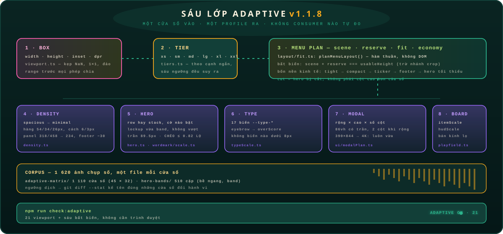
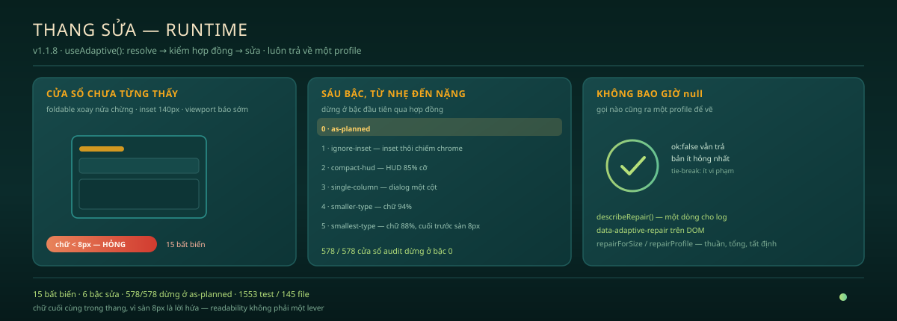
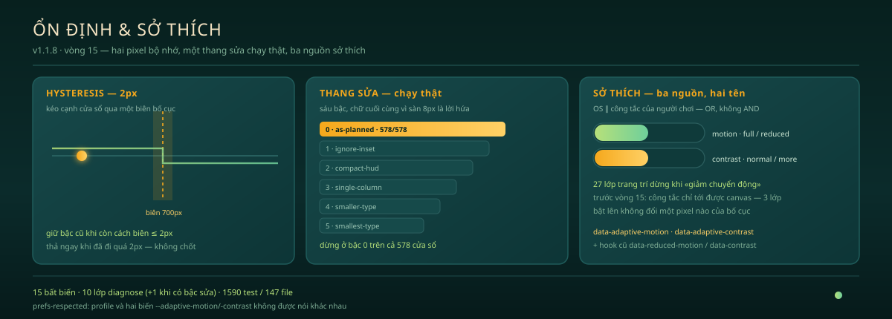
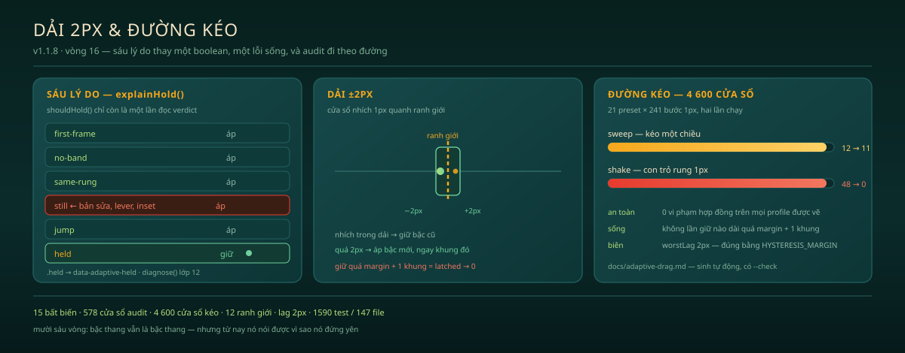
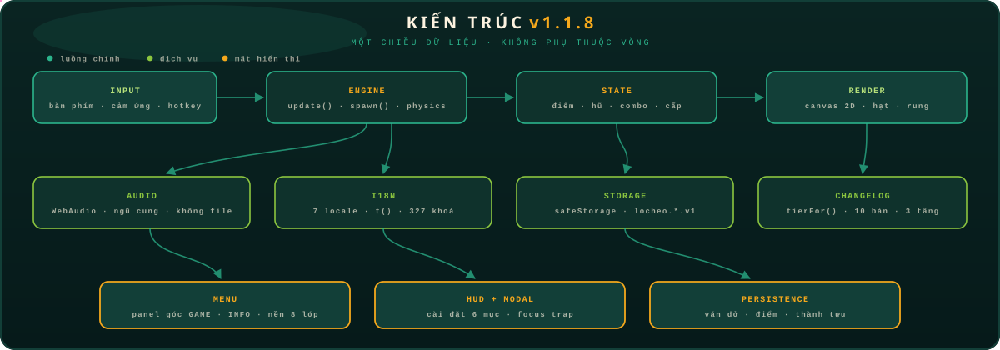
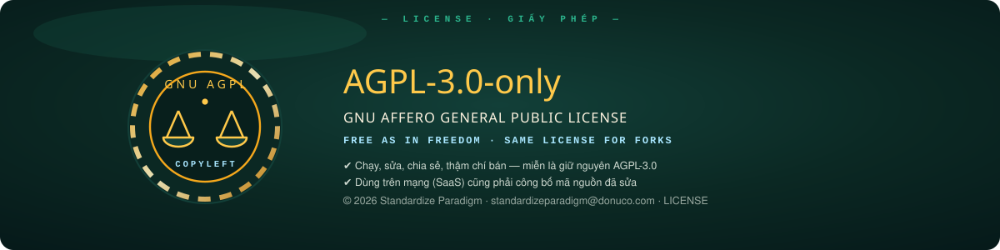

<div align="center">


# LỌ CHÉO — LA GRAN GUERRA DE LA ORZA

### 🫙 Arcade vietnamita de encurtidos que corre 100% en el navegador — un único HTML, offline-first
### 🌐 UI del juego en 7 idiomas — Tiếng Việt · English · 中文 · 日本語 · 한국어 · Español · Français

[🇻🇳 Tiếng Việt](README.md) · [🇬🇧 English](README.en.md) · [🇨🇳 中文](README.zh.md) · [🇯🇵 日本語](README.ja.md) · [🇰🇷 한국어](README.ko.md) · [🇪🇸 Español](README.es.md) · [🇫🇷 Français](README.fr.md) · [🇹🇭 ไทย](README.th.md) · [🇩🇪 Deutsch](README.de.md) · [🇵🇹 Português](README.pt.md)

[](docs/releases/v1.1.8.md)
[]
[]
[](https://github.com/standardizeparadigm/LoCheoIO/actions/workflows/ci.yml)
[](LICENSE)
[](#-instalación-y-ejecución)
[](#build-de-producción)
[](#-cambiar-de-idioma)
[](CONTRIBUTING.md)





</div>

---

## 🥒 Sobre el proyecto

> Lọ Chéo — La Gran Guerra de la Orza: un arcade de encurtidos que corre 100% en el navegador, empaquetado en un único archivo HTML autocontenido, offline-first — sin CDN, sin servidor. La orza de cerámica solo sabe moverse en **diagonal**: mantén dos teclas para zigzaguear, acelerar y despedazar moho, moscas y orugas; llena la orza antes de que la cerámica se raje en tres. **9 modos · 14 ingredientes · 16 logros · ranking TOP 8 · UI en 7 idiomas.**

Es un **arcade de acción de pantalla única** inspirado en los humildes encurtidos vietnamitas. Sin niveles lineales ni menús recargados: solo la orza, una lluvia infinita de verduras y tus reflejos en llamas.


## 🆕 Novedades de v1.1.8

> El **parche final** antes de 1.2.0. Sin modo nuevo, sin cambios de balance, sin cambios en el formato de guardado. Esta última ronda hace una cosa: **el hero mide la ventana y elige su propio diseño** — en todos los tamaños con solución (desde 356px), sin scroll ni recortes. La banda del deck desaparece, los 29 SVG incluyen los diagramas de bandas del HUD (ronda nueve), el informe de auditoría (ronda doce) y la figura de estabilidad (ronda quince), más un cuarto corpus de incidencias y una escalera de reparación de seis peldaños.

### 📐 Una suma que nadie vigilaba — y cuatro errores a la vez

La captura informaba de cuatro problemas, pero tenían **una** sola causa. La fila de paneles de esquina y el ticker eran hermanos flex con `shrink-0`, así que tomaban su altura primero y al hero solo le llegaba lo que sobraba:

```
ventana de 720px
├── 415px   fila de paneles GAME/INFO  (alto según el contenido, shrink-0)
├──  55px   ticker                     (alto según el texto, shrink-0)
└── 250px   hero                       ← el resto, cuando necesita ~430px
```

| Síntoma en la captura | Por qué |
| --- | --- |
| `LỌ` cortado en el borde superior | hero de 250px, contenido de 430px |
| `CÀI ĐẶT` desbordando el panel | el panel se dimensionaba por contenido, no por la ventana |
| La línea de copyright partida en dos | el ticker necesitaba 55px y recibía 48px |
| La `×` del «Cómo jugar» flotando en mitad de la pantalla | el acordeón que la contenía ya había salido de la vista |

La solución no fue añadir unos píxeles de holgura, sino **declarar la altura una vez y hacer que todo la vuelva a leer**: `layout/metrics.ts` guarda cada número, `layout/fit.ts` devuelve un `MenuPlan` puro, `MenuChrome` es una sola banda `absolute inset-x-0 bottom-0`, y el hero reserva su espacio con un `padding-bottom` calculado por la **misma** función.


### 🌀 El error de scroll: un contenedor de scroll dentro de otro

La parte inferior se quedaba quieta y la superior seguía subiendo y bajando — exactamente como se describió. v1.1.7 envolvió el contenido del hero en una caja `overflow-y-auto` y lo centró con `min-h-full` + `justify-center`. Eso solo funciona mientras el contenido es **más bajo** que la caja; cuando es **más alto**, `justify-center` lo empuja hacia arriba y su borde superior queda *por encima del origen del scroll* — ninguna posición de scroll puede alcanzarlo.

Ahora toda la pantalla tiene **un** contenedor de scroll (`.menu-scroll`), con el contenido anclado arriba y sin centrado vertical. Las tres clases que causaron el fallo —`flex-1 overflow-y-auto`, `min-h-full`, `justify-center`— están prohibidas por `tests/menu-layout.test.ts`.

### 🎯 Hero: `LỌ CHÉO` centrado y subido un poco

- El logotipo queda **centrado en horizontal** y luego **subido**, como se pidió, con el tamaño limitado por **ancho y alto** a la vez, para que una ventana baja no desborde el glifo.
- El tarro de cerámica se movió a la derecha, rodeado de **tres anillos de halo a 18s / 26s / 34s** — el anillo único de 14s se leía como un spinner de carga.
- **Catorce adornos** (estrellas, chispas, aros, burbujas, chiles, hojas de lima, moscas, gotas de salsa de pescado) en dos franjas arriba y abajo del título, cada uno con su duración y retardo — la respuesta a *«solo la palabra y el tarro es muy poco»*.
- Las coordenadas son **datos** en `scene/decor.ts` con una función de colisión, así que `tests/menu-decor.test.ts` fija posición y cantidad.

### 📖 El «Cómo jugar» se muda al menú GAME

Las seis reglas y la tabla de teclas ya no viven en el hero — abrirlas empujaba el `LỌ` fuera de la pantalla. Ahora son **una fila del panel GAME** que abre un modal (`HowToModal`), de modo que el diseño no se mueve ni abierto ni cerrado. La `×` perdida desapareció junto con el acordeón que la generaba.

### 🗂️ El proyecto gana más carpetas

```
src/components/menu/
├── layout/          metrics.ts · fit.ts · useMenuPlan.ts       ← NUEVO: cada número en un sitio
├── scene/           decor.ts · DecorGlyph · HeroDecor · JarHalo ← NUEVO: el hero decorado
├── ticker/          keys.ts · MenuTicker           ← NUEVO: la banda como módulo
├── howto/           rules.ts                                    ← NUEVO: 6 reglas + tabla de teclas
├── background/      layers.ts · MenuBackground                  ← 8 capas de fondo como datos
└── MenuChrome.tsx · HowToModal.tsx                              ← NUEVO: la banda inferior + modal
```

### 🐛 Correcciones

| # | Error | Corrección |
| --- | --- | --- |
| 1 | La parte de arriba seguía haciendo scroll con la de abajo quieta | fuera la caja anidada: **un** `.menu-scroll` anclado arriba |
| 2 | `LỌ` cortado en el borde superior | el hero conserva una escena de 342px y no se comprime a 250px |
| 3 | `CÀI ĐẶT` desbordando el panel GAME | `CornerPanel.height` pasa a ser **obligatorio**: 318px (compacto) / 458px (rico) |
| 4 | Línea de copyright partida en dos | ticker fijo de 48px, copyright dentro del bloque del marquesina |
| 5 | La `×` del «Cómo jugar» flotando | acordeón → modal, nada `absolute` sobre una caja ya desplazada |
| 6 | La altura del panel dependía del idioma (alemán y tailandés desbordaban antes) | altura declarada, independiente del contenido |
| 7 | Un anillo de 14s se leía como spinner | tres anillos a 18s / 26s / 34s que casi nunca coinciden |
| 8 | Documentación/SVG/lanzadores desfasados | barrido de 10 README + docs + 19 SVG → 1.1.8 |

→ Detalles completos: [docs/releases/v1.1.8.md](docs/releases/v1.1.8.md) · Versión anterior: [docs/releases/v1.1.7.md](docs/releases/v1.1.7.md)

### 🪟 Dos capturas, una ventana, 260 píxeles de diferencia

Las dos últimas capturas de esta ronda son **la misma aplicación**: `1920×1080` a pantalla completa y `1920×820` en ventana. El ancho no cambió ni un píxel. Pero en la segunda, la mitad inferior del hero queda **debajo** de los dos paneles de esquina y el chip `CHẾ ĐỘ CHƠI` aparece cortado por la mitad.

La causa no es falta de altura. Es la pregunta equivocada:

| Qué decide el diseño | Sabe | No sabe |
| --- | --- | --- |
| `sm:` · `lg:` en CSS | el **ancho** | el **alto** |
| `plan.minimal` | el **alto** (bajo 220px) | el ancho, y solo cuando ya es tarde |
| `heroLayout()` (nuevo) | **ambos**, desde el mismo número que usa el chrome | — |

Una decisión que depende de *dos ejes* no se puede escribir como una media query de un eje. Así que el diseño del hero salió del CSS y se volvió una función pura:

```ts
export function heroLayout({ scene, width, minimal }: HeroInput): HeroLayout {
  if (minimal) return { sideBySide: false, halo: false, badgeRow: false, mascot: false, liveBadge: false };

  const sideBySide = width >= WIDTH_FOR_SIDE_BY_SIDE && scene >= HEIGHT_FOR_SIDE_BY_SIDE;

  return {
    sideBySide,
    halo:       scene >= HEIGHT_FOR_HALO,
    badgeRow:   scene >= HEIGHT_FOR_BADGE_ROW,
    mascot:     true,          // el logo nunca se oculta
    liveBadge:  scene >= HEIGHT_FOR_BADGE_ROW,
  };
}
```

`scene` es la altura que `planMenuLayout()` asignó al hero — **el número exacto** que el chrome reserva. No puede desviarse, porque ambos leen de una sola función.

#### Tres umbrales, los tres derivados

Aquí no hay un solo número redondo. Cada constante es la altura real de lo que controla:

| Constante | Valor | Derivada de |
| --- | --- | --- |
| `HEIGHT_FOR_BADGE_ROW` | **232** | wordmark 150 + badge 40 + live badge 22 = 212, más 20px de aire |
| `HEIGHT_FOR_HALO` | **300** | lockup 150 + anillo 240 − solape 90 |
| `HEIGHT_FOR_SIDE_BY_SIDE` | **300** | la columna más alta: mascota 192 + chip 24 + relleno |

`232` es un **error que se atrapó**. El primer borrador lo puso en `210` — por debajo del mismo lockup de 212px que controla. Una banda de 210px dibujaba un lockup de 212 y la línea de récord quedaba cortada. Exactamente la clase de error que esta ronda corrige, producido por la propia corrección.

`tests/menu-adaptive.test.ts` recorre **1.682 viewports** — cada combinación de 15 anchos reales × 13 altos reales, y luego un paso por `320..3840` × `150..700` — y verifica `heroContentHeight(layout) ≤ scene` en cada muestra.

#### El cuarto evento que faltaba

El usuario produjo esas dos capturas **pulsando la tecla de pantalla completa**. La app escuchaba `resize` y `orientationchange`. Firefox no dispara ninguna de las dos al alternar pantalla completa; Safari antiguo solo dispara `webkitfullscreenchange`.

Así que la ventana cambió de alto, el hero conservó su plan viejo, y el chip siguió cortado hasta el siguiente resize.

```ts
export const VIEWPORT_EVENTS = [
  "resize",
  "orientationchange",
  "fullscreenchange",
  "webkitfullscreenchange",
  "mozfullscreenchange",
  "MSFullscreenChange",
] as const;
```

La lista vive en un solo lugar, porque `useMenuPlan()` y `useViewportWidth()` **ambos** la necesitan — y cada uno registraba su propia copia, es decir dos copias que pueden describir dos ventanas distintas.

### 🗑️ La banda divisoria de la imagen 12 — y el deck que se fue con ella

La tercera imagen es una tira de `1443×180` recortada del centro de la pantalla: un marcador `🎮`, una línea dorada y tres títulos `GAME / RETO DE HOY / REGLA DEL DÍA`. Ese es el **deck** — tres columnas de prosa dentro de una banda de altura fija.

No puede vivir ahí, y las otras dos capturas dicen por qué: a `1920×1080` su columna derecha se cortaba **a mitad de frase**, a `1920×820` toda la fila quedaba bajo los paneles. Una banda suficientemente alta para un wordmark de 200px no lo es también para tres párrafos.

Nada de lo que decía el deck se pierde:

| Qué decía el deck | Dónde vive ahora |
| --- | --- |
| el modo que vas a jugar | el chip bajo la mascota; la lista completa está en GAME |
| **el reto de hoy** | una línea en el panel INFO — `modo · objetivo` |
| la regla del día | una línea del modal de instrucciones, que siempre fue la versión completa de esas seis reglas |

Las cuentas de fecha **no** se fueron con él. `challengeFor()` y `tipIndexFor()` se mudaron a `src/game/daily/` — son funciones puras del día local, sin relación con la presentación. Las 21 pruebas se mudaron con ellas, conservando sus nombres.

La banda vacía bajo el wordmark ahora es **deliberada**. Ese es el precio de un hero que encaja en cualquier tamaño con solución.

### 🏷️ Changelog por niveles — un color por nivel

| Nivel | Etiqueta | Color | Significado | Ejemplo |
| --- | --- | --- | --- | --- |
| `major` | **MAJOR** | 🩷 rosa `#ff5fb0` | versión grande — sistemas nuevos | 1.0.0 |
| `minor` | **UPDATE** | 🟡 oro `#f5a81c` | mejora — contenido nuevo | 1.1.0 |
| `patch` | **PATCH** | 🟣 violeta `#9d6bff` | correcciones y limpieza | 1.1.1 → **1.1.8** |

El nivel se **deriva del SemVer** con `tierFor(version)`, nunca se escribe a mano. El panel añade un **filtro**: TODO · MAJOR · UPDATE · PATCH con el recuento por nivel.





### 🔟 Ronda nueve: el HUD también es un plan — y `diagnose()` dice *por qué*

La ronda 8 dio un perfil a todo el menú. Quedaba **una** cosa dibujada a mano: el HUD
de `engine.ts`, una cadena de `fillText` con coordenadas acumuladas, correcta en
1280×720 y equivocada en todo lo demás.

`planHud()` da a cada indicador una **banda** (la caja real del glifo, `baseline −
0.72 × size`) , fija las columnas izquierda y derecha, hace **fluir** la columna
central desde el reloj y, si no cabe, retira primero lo menos informativo
(`chips → barra de combo → jars → best`) y luego comprime en pasos de 0.02 hasta un
suelo de 0.55.

Barrido de 1 500 tableros: la fórmula antigua producía **4 004** solapamientos; el
plan produce **0** en todo tablero jugable. Por debajo de `playable()` los que quedan
se **informan** (`traceHud().collisions`), no se esconden.

Además: **21 presets** ordenados por tamaño (320×480 → 3840×2160), **12
invariantes** en `constraints.ts` — una sola lista para la suite, para
`:check:adaptive` y para la documentación — y `diagnose()`.



### 1️⃣1️⃣ Ronda diez: el chip de modo conserva su lado derecho

La captura decía que el modo clásico "pierde el lado derecho". La causa no era un
número equivocado sino una **suposición** equivocada: el chip era `absolute; left:
50%; translateX(-50%)` dentro de la columna del mascota, sin `max-width`.

```
diseño en COLUMNA  mascota centrada   →  chip centrado en ella  →  correcto
diseño en FILA     mascota a la derecha  →  medio chip fuera de la banda
                                          .menu-hero { overflow: hidden }  →  CORTE
```

El nombre más largo —«MUỐI DƯA CỔ ĐIỂN», 19 caracteres— era el único lo bastante
largo para verse cortado, por eso el fallo parecía "el modo clásico está roto"
mientras todos los nombres perdían un poco.

Ahora el chip tiene **dos garantías separadas**: el CSS sostiene la caja (alinear al
borde interior en el diseño en fila, `max-width` duro) y `planModeChip()` sostiene la
escalera (`full → label-dropped → name-shrunk → ellipsis`). Un 6% de error en la
estimación solo elige un chip más pequeño, nunca uno cortado.

También: `heroBandWidth()`, **dos invariantes nuevas** (12 → **14**) y un **tercer
corpus** — 189 instantáneas (21 presets × 9 modos).


### Ronda 11 — las tildes vietnamitas ya no se recortan

Esta captura no era "falta la mitad derecha" sino **"faltan las tildes"**: el chip
decía «MUỐI DƯA CỔ ĐIÊN», la **Ể** perdió su circunflejo mientras la **Ổ** lo
conservaba. Era una **regresión de la ronda 10**: `truncate` no solo corta en
horizontal — `overflow: hidden` recorta la **caja de línea**, y el vietnamita
apila una tilde sobre un circunflejo (`Ố Ổ Ể Ấ Ự`) unos **0,35em** por encima de
la altura de mayúscula.

Se corrigieron tres capas, y ninguna se solapa con otra:

| Capa | Antes | Después |
| --- | --- | --- |
| Cadena | elipsis de CSS | `planModeChip()` corta la cadena y añade `…` |
| Caja de línea | 1,2em | **1,5em** (`MODE_CHIP_LINE_HEIGHT`) |
| Caja de recorte | `truncate` en el span del nombre | **ningún `overflow`** |

Además **`.clip-safe`** — el reemplazo de `truncate` para todo texto traducible:
`padding-block: .24em` aleja la caja de recorte de la tinta, `margin-block: -.24em`
devuelve ese espacio al diseño, así que nada se mueve y las tildes sobreviven. Seis
lugares lo usan ya. Y `chipBoxHeight()` sustituye a una constante adivinada: el
chip creció 3,3px, y eso es asunto de `heroContentHeight()`, que ahora lee una
medida en vez de un recuerdo.

Detalles: [docs/releases/v1.1.8.md §18](docs/releases/v1.1.8.md#18-vòng-11--dấu-tiếng-việt-bị-css-cắt).


### Ronda 12 — todo el espacio de ventanas, auditado — y una escalera de reparación

Cada una de las tres rondas anteriores añadió **un** corpus. Ninguno respondía a la
pregunta que uno se hace antes de publicar: *en **todas** las ventanas jugables,
¿qué hace el diseño, cuántas veces, y hay algo roto?*

Ahora `npm run audit:adaptive` responde: **578** ventanas (21 presets más una
cuadrícula de 25 × 23 alrededor de cada punto de ruptura, sin duplicados), resueltas
una vez y reunidas en un único `AuditReport`.

| | |
| --- | --- |
| Ventanas | **578** |
| Violaciones del contrato | **0** — cada ventana ejecuta las 14 invariantes |
| Solo LỌ CHÉO | 101 (17%) |
| Hero fila / columna | 170 / 408 |
| Scene | 140px (320×320) … 1 642px (3840×2160) |

`docs/adaptive-audit.md` es la copia **generada** de ese informe, y
`audit:adaptive --check` corre dentro de `npm run check`: mover un punto de ruptura
o un suelo tipográfico **aparece como un diff** en el mismo commit que lo causó. Es
la regla de «al mejorar algo, revisa su alrededor», delegada en una máquina.

Junto a ello, una **escalera de reparación** en `repair/`: seis peldaños —
`as-planned → ignore-inset → compact-hud → single-column → smaller-type →
smallest-type`. El orden es el principio: **el texto al final**, porque el suelo de
8px es una promesa. La app se detiene en el peldaño 0 en las 578 ventanas; la
escalera existe para *poder* usarse, y el test le entrega un contrato más estricto
para demostrar que de verdad baja.

Y un **cuarto corpus**: 14 ventanas que fueron objeto de un informe con captura, de
la ronda 1 a la 12, cada archivo con `symptom` y `guard`, para que un fallo se lea
como una frase sobre la tienda y no como dos números.

Detalles: [docs/releases/v1.1.8.md §19](docs/releases/v1.1.8.md#19-vòng-12--kiểm-toán-cả-không-gian-và-thang-tự-sửa) ·
guía: [docs/guides/adaptive-audit.md](docs/guides/adaptive-audit.md).





### Ronda 13 — no solo *correcto*, sino *lo más barato*

La ronda 12 construyó una auditoría que responde a una pregunta de sí/no: **¿se rompe
algún invariante?** Pero cada vez que llega una captura queda una segunda pregunta
sin responder: **¿hay un diseño más barato?**

Esta ronda la responde. `select/` da a cada perfil **siete términos** y los compara
**lexicográficamente** — no como suma ponderada, porque una suma ponderada dejaría
que 40px de holgura "recompren" una mascota perdida si los pesos cuadran así:

| # | Término | Qué pierde el jugador |
| --- | --- | --- |
| 1 | `violations` | nada — un diseño roto no es candidato |
| 2 | `hidden` | mascota, deck, eslogan |
| 3 | `cropped` | px por debajo de su propio suelo |
| 4 | `hudLost` | parte de la escala del HUD |
| 5 | `typeDrop` | px de texto, sumados |
| 6 | `levers` | cuántas cosas se movieron — invisible |
| 7 | `slack` | holgura — no es pérdida, solo desempata |

Dos detalles separan «un marcador» de «una comparación correcta»:

- **`hidden` y `cropped` se miden contra el perfil base.** Una ventana de 320×320 *ya
  es* solo-wordmark y *ya está* recortada antes de tocar ninguna palanca — eso es la
  ventana, no un sacrificio. Con banderas crudas se informaría «hidden 1» del perfil
  que la app ya dibuja.
- **`levers` cuenta desde el perfil, no desde los overrides.** `ignoreInset` en una
  ventana sin inset no cambia nada, así que no cuenta — y por eso **los empates son
  reales**, y el desempate es la posición en la escalera, no el orden que `sort` vio.

La afirmación que esta ronda compra, y puede comprobar:

```
npm run audit:adaptive -- --select
  shipped profile wins   578 / 578
```

> en toda ventana jugable, el perfil publicado es el más barato de los seis.

La ronda 12 decía «nada está roto»; la 13 dice «nada es más barato». Una afirmación
más fuerte se equivoca más fácil, así que tiene su **quinto corpus**:
`tests/fixtures/selection/` — 12 ventanas, cada archivo registrando la *decisión* y no
el diseño: la clasificación completa de seis peldaños, el segundo, y por qué perdió
cada uno. Cuando un umbral se mueve, el diff muestra una **decisión** cambiando — lo
que un revisor realmente necesita aprobar.

Detalles: [docs/releases/v1.1.8.md §20](docs/releases/v1.1.8.md#20-vòng-13--không-chỉ-đúng-mà-rẻ-nhất) ·
guía: [docs/guides/adaptive-selection.md](docs/guides/adaptive-selection.md).


Un tercer sitio, la misma forma: **el peldaño `crop` era un callejón sin salida.** 25 de
las 578 ventanas de la auditoría dan `fit: "crop"` (las 25 a 320px de alto). Tres
invariantes eximen ese peldaño — con razón, no hay disposición que quepa — pero
`.menu-pane` es `overflow: clip`, así que la parte de la columna que se sale era
**inalcanzable**: el pie de ambos paneles y el botón START, sin que ninguna invariante
dijera nada. Ahora `[data-adaptive-fit="crop"] .menu-pane` es el único contenedor de
desplazamiento vertical del menú; toda ventana de **356px** o más sigue encajando al píxel.

### Ronda 14 — corrección de errores: el contrato del chip debe contar los siete idiomas

Esta ronda no añade nada. Buscó un lugar donde una promesa estaba enunciada más ampliamente
que aquello que la comprobaba.

El chip se medía con literales en vietnamita en **cuatro** sitios
(`CHIP_LABEL = "CHẾ ĐỘ CHƠI"`, `CHIP_NAME = "MUỐI DƯA CỔ ĐIỂN"`), y el vietnamita es el
**más corto** de los siete idiomas:

| | etiqueta | nombre de modo más largo |
| --- | --- | --- |
| vi | `CHẾ ĐỘ CHƠI` (11) | `MUỐI DƯA CỔ ĐIỂN` (19) |
| es | `MODOS DE JUEGO` (14) | `60 SEGUNDOS DE LOCURA` (21) |
| fr | `MODES DE JEU` (12) | `FESTIVAL DES COMBOS` (19) |

Así que `chip-labelled` afirmaba *«la etiqueta sobrevive en toda ventana jugable»* mientras
el español la pierde a 320px y 360px y el francés a 320px — y la auditoría informaba
**0 violaciones**.

Ahora `chip/probes.ts` deriva las sondas de `localeTable()` + `MODE_LIST`, y
`chip-labelled` enuncia algo comprobable: **el chip nunca pierde dos peldaños a la vez**.
La auditoría informa lo que ocurre: **439 full · 101 hidden · 38 label-dropped**.

Con ellas, tres errores menores de la misma forma: `scoreProfile()` devolvía su lista de
violaciones sin ordenar (el desempate final dependía del orden de inserción),
`isFiniteProfile()` nunca miraba `playfield`/`modal`, y `slackOf()` redondeaba distinto que
`constraints.ts` sobre la misma caja. Y `--select` dejó de imprimir un número que no
existe: multiplicaba 18 × 36 y llamaba al producto «648 ventanas» cuando la auditoría
recorre 578 — ahora `578 / 578`, la misma lista.

Sin funciones nuevas, sin cambios de diseño, sin subir versión. Solo **1 412 pruebas en
137 archivos** en vez de 1 398, y un contrato que dice lo que comprueba.


## 📐 Diseño adaptable — cómo el hero elige su forma

La pantalla de inicio no usa media queries para decidir su diseño. **Mide** la ventana y elige entre cinco capacidades: `sideBySide`, `halo`, `badgeRow`, `mascot`, `liveBadge`.

El flujo tiene dos etapas, ambas puras:

```
planMenuLayout(viewport) → { scene, reserve, … }    scene + reserve = altura
            │
            └─ scene es el número exacto que reserva el chrome
                        │
    heroLayout({ scene, width }) → 5 booleanos
```

| Bandera | Activa cuando | Qué desaparece si está apagada |
| --- | --- | --- |
| `sideBySide` | ancho ≥ 1024 **y** hero ≥ 300px | la mascota baja bajo el wordmark |
| `halo` | hero ≥ 300px | el anillo alrededor del tarro |
| `badgeRow` | hero ≥ 232px | la placa «HŨ DƯA ĐẠI CHIẾN» y la línea de récord |
| `mascot` | casi siempre | — (solo se oculta en la economía mínima) |
| `liveBadge` | hero ≥ 232px | la línea EN DIRECTO DESDE LA COCINA y la versión |

Los tres umbrales **no son números redondos** — cada uno es la altura real de lo que controla:

```ts
HEIGHT_FOR_BADGE_ROW    = 232  // 150 wordmark + 40 placa + 22 live + 20 aire
HEIGHT_FOR_HALO         = 300  // 150 lockup + 240 anillo − 90 solape
HEIGHT_FOR_SIDE_BY_SIDE = 300  // columna más alta: 192 mascota + 24 chip
```

`tests/menu-adaptive.test.ts` recorre **1.682 viewports** y verifica `heroContentHeight(layout) ≤ scene` en cada muestra. Al redimensionar, ambos hooks escuchan **seis** eventos y actualizan en un solo frame.

### 🧠 Ronda quince: el sistema se ajusta solo, y ya no tiembla

Ninguna ventana nueva. Cierra cuatro huecos que dejó la ronda catorce — sitios donde la
promesa existía en la documentación y no había código detrás:

| | antes de la ronda 15 | después de la ronda 15 |
| --- | --- | --- |
| Interruptor «Reducir movimiento» | llegaba solo al canvas — **3** capas CSS se detenían | resuelto en `profile.prefs`, llega al menú — **27** capas se detienen |
| `prefers-contrast: more` | solo `App.tsx` lo leía, para poner un atributo | la sexta señal de `Environment`; bordes y cabeceras de panel suben |
| La escalera de reparación de seis peldaños | una biblioteca probada **que nadie llamaba** | `useAdaptive()` la ejecuta en runtime; `data-adaptive-repair` dice qué peldaño ganó |
| Arrastrar un borde por un punto de ruptura | rehacía el diseño en cada movimiento del ratón | `stabilize()` retiene el peldaño **2px** — 60px de arrastre lo cambian ≤ 2 veces |

- **Tres fuentes, dos nombres.** `preferencesFor(env, settings.reducedMotion)` combina con
  **OR** el sistema y el interruptor del jugador, no con AND: una app no anula con un
  valor por defecto lo que declara el sistema.
- **La decimoquinta invariante, `prefs-respected`**, prohíbe un perfil que diga «reducido»
  mientras sus variables CSS digan «completo».
- **`diagnose()` suma dos filas**: `10 · prefs` siempre, `11 · repair` solo en un perfil
  que pintó el hook — un `resolveAdaptive()` puro no recorre la escalera.

Activar ambas preferencias **no cambia un píxel** del diseño: 578 / 578 ventanas siguen
`as-planned` con 0 violaciones, y un test compara `plan` / `type` / `density` entre ambos
perfiles para mantener esa promesa.

Detalles: [docs/releases/v1.1.8.md §24](docs/releases/v1.1.8.md#24-vòng-15--hệ-tự-chỉnh-và-hai-pixel-bộ-nhớ) ·
carpetas: [`adaptive/preferences/`](src/components/menu/adaptive/preferences/README.md) ·
[`adaptive/hysteresis/`](src/components/menu/adaptive/hysteresis/README.md).



### 🎚️ Ronda dieciséis: la banda de dos píxeles ya puede decir *por qué* se queda quieta

Ningún mecanismo de estabilización nuevo. Tres cosas sobre el que dejó la ronda
quince: explicarlo, medirlo y arreglar un fallo que estaba escondiendo.

| | antes de la ronda 16 | después de la ronda 16 |
| --- | --- | --- |
| «¿Por qué este perfil está 2px desfasado?» | pegar cinco condiciones en un REPL | `explainHold()` devuelve **seis razones con nombre**; `shouldHold()` es una lectura suya |
| El peldaño cambia y la ventana **no se mueve** | se retenía — y para siempre, porque el siguiente fotograma es idéntico | razón propia, `still`, aplicada al instante: la escalera de reparación pinta su arreglo en el primer fotograma |
| Un desfase deliberado | invisible para personas y herramientas | `data-adaptive-held` en el DOM · `diagnose()` capa `12 · hold` |
| La auditoría | una tabla de 578 ventanas, cada fila cierta en todo momento | más una **auditoría de arrastre**: 21 × 241 pasos, 4 600 ventanas, dos repeticiones |

- **Seis razones:** `first-frame` · `no-band` · `same-rung` · `still` · `jump` · `held`.
  Solo `held` retiene; las otras cinco son cinco maneras de que un cambio de peldaño *no*
  sea temblor.
- **`still` es un fallo real:** la condición vieja — «ambas cajas dentro de 2px» — también
  es cierta cuando las cajas son *idénticas*. Un perfil reparado cambia `plan.fit` en la
  misma caja, así que se retenía y `last.current` nunca avanzaba: *el arreglo nunca se
  pintaba*.
- **La auditoría recorre un camino, no solo puntos.** `docs/adaptive-drag.md`:

| gesto | raw | held | lo que compra la banda |
| --- | --- | --- | --- |
| **sweep** — arrastre de ±120px (± 4 600 ventanas) | 12 | 11 | 1 (8%) — cada frontera se cruza una vez |
| **shake** — el puntero se mueve 1px en cada frontera | 48 | **0** | **48 (100%)** — para esto existe la banda |

Tres propiedades del arrastre: **seguridad** (0 violaciones en todo perfil pintado),
**viveza** (ninguna retención mayor que `margin + 1` fotogramas), **cota** (`worstLag` = 2px).

Y algo ajeno a lo adaptativo, misma ronda: la puerta de conteos en prosa («26 SVGs» en
cuatro archivos) ahora corre **dentro** de `npm run check`, no solo en CI — las reglas se
mudaron a `scripts/lib/prose-counts.mjs` y el test ejecuta *esas* reglas, no una copia.



### 🧱 Octava ronda: seis capas, un perfil

La ronda seis enseñó al hero a medir su ventana. El resto seguía adivinando: la moda era `86vh` **sin techo**, el titular de fin de partida era un `text-6xl` fijo, los paneles llamaban a `cornerRowHeight()` por su cuenta y `engine.resize()` calculaba el radio del tarro solo. **Seis lectores, seis lecturas** — y dos lecturas pueden caer en fotogramas distintos.

v1.1.8 las reúne en **una función pura de una caja**:


| | | |
| --- | --- | --- |
| 1 · Box | `adaptive/viewport.ts` | `w · h · inset · dpr` |
| 2 · Tier | `adaptive/tiers.ts` | `xs`…`xxl` |
| 3 · Plan | `layout/fit.ts` | `scene · reserve · fit` |
| 4 · Density | `adaptive/density.ts` | 54/34/26px · 318/458→234 |
| 5 · Hero | `adaptive/hero.ts` | row / stack · lockup |
| 6 · Type | `adaptive/typeScale.ts` | 17 × `--type-*` |
| 7 · Modal | `ui/modalPlan.ts` | w × h × columns |
| 8 · Board | `game/adaptive/playfield.ts` · `game/adaptive/hud.ts` | `itemScale` · `hudScale` · băng HUD |

La nueva invariante `panel + margen ≤ reserva` falla en **844×390** — un iPhone en horizontal, el tamaño del informe. `reserveFor()` resta 30px cuando el panel no dibuja pie, pero `panelHeightForPlan()` solo miraba la densidad y dibujaba la altura completa: un panel de 234px en una banda de 216px, **18px de su base fuera de la pantalla**.

**Un corpus de 1 620 instantáneas** lo mantiene así: `tests/fixtures/adaptive-matrix/` (1 110 ventanas, un archivo por ventana) y `tests/fixtures/hero-bands/` (510 pares «ancho × banda»). `npm run check:adaptive` imprime 21 filas y afirma seis invariantes sin navegador.

### 🌍 La segunda capa: entorno, no solo tamaño

La altura de la ventana no es la altura utilizable. En un iPhone la barra de
direcciones y el indicador de inicio se comen una parte; al hacer zoom,
`visualViewport` es menor que `innerHeight`. Por eso hay una capa aparte, pura y
sin React (`src/components/menu/adaptive/environment.ts`):

```ts
type Environment = {
  dpr: number;            // acotado a [1, 4]
  landscape: boolean;
  coarse: boolean;        // un dedo, no un ratón
  insetTop / Right / Bottom / Left: number;
  reducedMotion: boolean;
};
```

Cuatro cosas fáciles de hacer mal, y qué se hizo en su lugar:

1. **`env()` no se puede leer con `getComputedStyle`.** Hace falta un elemento que
   *use* `env(safe-area-inset-*)` para que su padding calculado signifique algo.
   La primera versión creaba **cuatro** sondas (una por borde) — cuatro layouts
   forzados en cada resize. Ahora es **una** sonda con cuatro paddings, retirada
   en un bloque `finally` para que un error no la deje suelta.
2. **`pointer: coarse` puede cambiar sin ningún `resize`.** Un portátil híbrido
   alterna ratón y dedo todo el tiempo. El hook escucha **ambas** media queries,
   no solo `resize`.
3. **El inset `0` es legítimo.** El helper `sane()` de los demás campos numéricos
   tiene suelo 1 — reutilizarlo para el inset convierte «sin notch» en «notch de
   1px».
4. **El inset se resta de la altura utilizable, nunca de la escena.**
   `usableHeight(h, inset) = clamp(h − inset, 1, ∞)`, y tanto `planFits` como
   `occupiesExactly` pasan por ahí, así que no pueden discrepar.

`tests/environment.test.ts` cubre `saneDpr` (también `NaN`, `−1`, `7`),
`parseInset`, `verticalInset` e `isHandheld`; `tests/use-environment.test.ts`
construye objetos `window` y `document` falsos (sin jsdom), así que también cubre
un `matchMedia` que **lanza** y un documento **sin body**.

### ⚠️ Una limitación conocida — registrada, no escondida

En **844×600**, una ventana sin inset da al hero 222px; con un inset de 10px le
da **268px**. Una ventana más pequeña recibe un hero 46px más alto. La causa es
que la altura total se reparte por umbrales discretos, y un inset pequeño empuja
la suma por encima de uno de ellos, lo que cambia la economía.

Es un defecto **real, pequeño y ya existente**. Se intentó una búsqueda de ocho
economías para maximizar `scene` — **falla**: a 1920×1080 quita el ticker y las
filas altas, es decir justo lo que ve el jugador. Se revirtió. En su lugar,
`tests/layout-inset.test.ts` **afirma los números medidos** (222 → 268, +46) como
un test en verde: quien lo arregle romperá el test y tendrá que actualizarlo, y
mientras tanto al menos está escrito. Al lado está la invariante que sí se
cumple: dentro de *una* economía, `scene + reserve === usableHeight` (252
combinaciones comprobadas).

## ✨ Lo destacado

| Grupo | Detalles |
| --- | --- |
| 🎮 **9 modos de juego** | **ENCURTIDO CLÁSICO** (equilibrado) · **ZEN** (sin peligros, ×0.5) · **INFIERNO DE CHILE** (+35% velocidad, ×1.5) · **60 SEGUNDOS** (contrarreloj 60 s, ×1.25) · **FIEBRE DE ORO** (botín dorado ×2.6) · **LLUVIA DE CONSERVAS** (densidad ~1.4×, ×0.75) · **CERÁMICA FINA** (una grieta es fatal, ×2.0) · **FESTIVAL DE COMBOS** (ventana ×2, ×1.15) · **GRAN FESTÍN** (densidad ~×2, tarro ×2.5, ×0.6) |
| 🌐 **i18n en el juego** | Tiếng Việt · English · 中文 · 日本語 · 한국어 · Español · Français — `src/i18n/` (módulo puro + puente React), `t()` con interpolación, sincroniza `<html lang>`, números por locale (vi-VN / en-US / zh-CN / ja-JP / ko-KR / es-ES / fr-FR) |
| 🕹️ **Mecánica AL CORTE exclusiva** | Mantén 2 teclas/ejes en diagonal — la orza acelera, brilla y despedaza peligros. Barra de stamina dedicada con histéresis anti-parpadeo |
| 🥬 **14 ingredientes** | Berenjena, chile, ajo, jengibre, sal, mostaza, **MOSTAZA DORADA** (llena la orza rápido) · SAL/AJO DORADO · CHILE INFERNAL · HIELO · MOHO, MOSCA, **ORUGA** (peligros) |
| 🧄 **Escudo de Ajo Dorado** | Mejora: apila hasta **2 cargas** que absorben las grietas; un halo giratorio orbita la orza |
| 🏆 **16 logros** | Guardados **entre partidas** (localStorage), con aviso «¡NUEVO LOGRO!» en la pantalla de fin |
| 🔊 **Audio artesanal** | 11 efectos sintetizados con Web Audio API (cero archivos) + pentatónica que modula con el nivel; silencio con `M` |
| 💾 **Clasificación TOP 8** | Guardado local, validado y normalizado al leer, nombres en mayúsculas automáticas, highlight para el récord recién marcado |
| 🎨 **Gráficos 60fps** | Canvas 2D, presupuesto de 460 partículas, DPR tope 2, suelo de losetas pre-renderizado offscreen, titileo de estrellas + aurora en el menú |
| 📴 **Offline-first de verdad** | Fuentes auto-alojadas (subsets latin + vietnamita, woff2), sin CDN ni APIs — abre `dist/index.html` y a jugar |
| 🧪 **Calidad** | 1618 tests unitarios (vitest) para modes / achievements / storage / i18n / settings — `npm run check` es la puerta de CI |


## 🌐 Cambiar de idioma

Lọ Chéo incluye **7 idiomas de interfaz**, aplicados al instante — sin recargar, sin perder la partida:


| Idioma | Dónde | Guardado en |
| --- | --- | --- |
| 🇻🇳 Tiếng Việt | botón **VI** (predeterminado; sigue el idioma del navegador) | `locheo.lang.v1` |
| 🇬🇧 English | **EN** botón | `locheo.lang.v1` |
| 🇨🇳 中文 | **中** botón | `locheo.lang.v1` |
| 🇯🇵 日本語 | **日** botón | `locheo.lang.v1` |
| 🇰🇷 한국어 | **한** botón | `locheo.lang.v1` |
| 🇪🇸 Español | **ES** botón | `locheo.lang.v1` |
| 🇫🇷 Français | **FR** botón | `locheo.lang.v1` |

- Cambia el idioma en **Ajustes → IDIOMA** (rejilla de 7 botones con bandera) — un único lugar, sin selector flotante sobre el menú.
- Todas las cadenas visibles viven en `src/i18n/locales/{vi,en,zh,ja,ko,es,fr}.ts` — motor canvas, pantallas, HUD, popups, ticker, pistas.
- ¿Falta una clave? `t()` cae al vietnamita — los siete juegos de claves (y sus placeholders) los garantizan los tests.

## 🕹️ Controles

| Acción | Teclado | Táctil |
| --- | --- | --- |
| Mover | `W` `A` `S` `D` o `← ↑ ↓ →` | Arrastra en cualquier parte (joystick flotante) |
| **Corte diagonal (CHÉO)** | Mantén **2 teclas a la vez** (p. ej. `A`+`W`) | Arrastra en **45°** — el anillo del joystick se vuelve dorado |
| Golpe de orza (onda + aspiradora) | `Space` | Botón rojo **SLAM**, abajo a la derecha |
| Pausa / continuar | `P` o `Esc` | Botón de pausa, arriba a la derecha |
| Reinicio instantáneo | `R` (también en pausa/game over) | Botón «Otra tanda» |
| Empezar / confirmar | `Enter` | Botón **AL FUEGO** |
| Silencio / sonido | `M` | Botón de altavoz, arriba a la derecha |
| Cambiar idioma | — (usa los botones VI/EN/中/日/한/ES/FR) | Botones VI/EN/中/日/한/ES/FR en menú / pausa |

## 🚀 Instalación y ejecución

### Juega ya (sin build)

```bash
# cada release incluye un único archivo autocontenido:
open dist/index.html      # macOS
xdg-open dist/index.html  # Linux
start dist/index.html     # Windows
```

### Build de producción

```bash
npm install        # instala dependencias (Node ≥ 20.19)
npm run build      # → dist/index.html (un único archivo autocontenido)
```

> `vite-plugin-singlefile` incrusta todo el JS/CSS/fuentes/imágenes en **un** `dist/index.html` (~700 KB, gzip ~355 KB). Sin servidor, sin red.

### Desarrollo

```bash
npm run dev        # servidor de desarrollo con HMR (http://localhost:5173)
npm run preview    # sirve el build de producción localmente
npm run typecheck  # tsc --noEmit (strict, noUnusedLocals…)
npm run test       # vitest — 1618 tests unitarios (modes / achievements / storage / i18n / settings)
npm run check      # typecheck + test + build (puerta de calidad CI)
```

## 🗂️ Estructura del proyecto

```
lo-cheoio/
├─ index.html              # entrada, meta SEO/OG (sin CDN)
├─ package.json            # lo-cheoio v1.1.8, scripts dev/build/test/check
├─ .gitattributes          # *.bat/*.cmd → CRLF · posix → LF · binaries
├─ vite.config.ts          # vite + react + tailwind v4 + singlefile
├─ tsconfig.json           # strict; incluye src + tests
├─ favicon.ico             # web icon (multi-size 16→256)
├─ public/                 # favicon.ico/png/svg served at web root
├─ assets/
│  ├─ banner.svg           # banner del README (animación SMIL)
│  ├─ demo.svg             # simulación de gameplay (animación SMIL)
│  ├─ items.svg            # los 14 ingredientes (animación SMIL)
│  ├─ modes.svg            # los 9 modos (animación SMIL)
│  ├─ languages.svg        # 7 in-game languages (SMIL animation)
│  ├─ new-modes.svg        # the 2 new v1.1.4 modes (SMIL animation)
│  ├─ corner-menu.svg     # corner GAME/INFO panels (SMIL animation)
│  ├─ settings-sections.svg # 6-section settings tour (SMIL, v1.1.6)
│  ├─ wordmark-crop.svg    # LỌ nặng dấu — crop trước/sau (SMIL, v1.1.8)
│  ├─ menu-anatomy.svg     # hero anatomy: 14 món trang trí (SMIL, v1.1.8)
│  ├─ diagonal-motion.svg  # chuyển động chéo của hero (SMIL, v1.1.8)
│  ├─ no-scroll-steps.svg  # bốn bậc vá lỗi cuộn (SMIL, v1.1.8)
│  ├─ layout-fix.svg       # trước/sau vá bố cục 250→342px (SMIL, v1.1.8)
│  ├─ test-matrix.svg      # ma trận test + 9 cổng (SMIL, v1.1.8)
│  ├─ mode-chip.svg        # chip chế độ trước/sau (SMIL, v1.1.8 r10)
│  ├─ adaptive-layers.svg  # sáu lớp adaptive một profile (SMIL, v1.1.8 r8)
│  ├─ hud-bands.svg        # HUD thành kế hoạch (SMIL, v1.1.8 r9)
│  ├─ diacritics-clip.svg  # dấu Việt dưới overflow (SMIL, v1.1.8 r11)
│  ├─ adaptive-audit.svg   # kiểm toán 578 cửa sổ (SMIL, v1.1.8 r12)
│  ├─ adaptive-repair.svg  # thang sửa sáu bậc runtime (SMIL, v1.1.8 r12)
│  ├─ adaptive-select.svg  # chọn bậc rẻ nhất (SMIL, v1.1.8 r13)
│  ├─ adaptive-stability.svg # ổn định + sở thích (SMIL, v1.1.8 r15)
│  ├─ adaptive-hold.svg    # dải 2px + drag audit (SMIL, v1.1.8 r16)
│  ├─ divider.svg          # sparkle divider (SMIL animation)
│  ├─ license.svg          # sello copyleft AGPL-3.0 animado (animación SMIL)
│  └─ favicon.svg          # favicon (SMIL animation)
├─ scripts/
│  ├─ play-mac.command     # lanzador macOS — doble clic, menú a todo color
│  ├─ play-windows.bat     # lanzador Windows — doble clic, menú a todo color
│  ├─ play-linux.sh        # lanzador Linux — doble clic, menú a todo color
│  └─ README.md            # guía de lanzadores para novatos de la terminal
├─ docs/
│  ├─ README.md            # índice de documentación (v1.1.5)
│  ├─ DESCRIPTION.md       # descripciones multilingüe (vi/en/zh + SEO)
│  ├─ design/              # specs menu-corners / save-format / settings-format
│  ├─ guides/              # overview del engine · a11y · rendimiento · storage keys · release playbook…
│  └─ releases/
│     ├─ v1.0.0.md         # notas del primer release
│     ├─ v1.1.0.md         # notas de v1.1.0
│     ├─ v1.1.1.md         # notas de v1.1.1
│     ├─ v1.1.2.md         # v1.1.2
│     ├─ v1.1.3.md         # v1.1.3 release notes
│     ├─ v1.1.4.md         # release notes (1.1.4)
│     ├─ v1.1.5.md         # release notes (1.1.5)
│     ├─ v1.1.6.md         # release notes (1.1.6)
│     └─ v1.1.8.md         # current release notes (1.1.8)
├─ README.md               # 🇻🇳 Tiếng Việt
├─ README.en.md            # 🇬🇧 English
├─ README.zh.md            # 🇨🇳 中文
├─ README.ja.md            # 🇯🇵 日本語
├─ README.ko.md            # 🇰🇷 한국어
├─ README.es.md            # 🇪🇸 Español (este archivo)
├─ README.fr.md            # 🇫🇷 Français
├─ README.th.md            # 🇹🇭 ไทย
├─ README.de.md            # 🇩🇪 Deutsch
├─ README.pt.md            # 🇵🇹 Português
├─ src/
│  ├─ main.tsx             # raíz React, StrictMode
│  ├─ App.tsx              # máquina de fases menu/playing/paused/gameover
│  ├─ version.ts           # APP_VERSION = "1.1.8" (fuente única de verdad)
│  ├─ index.css            # tema tailwind v4 + todas las animaciones/gradientes
│  ├─ assets/fonts/        # subsets woff2 (Be Vietnam Pro ×6, Bungee)
│  ├─ styles/fonts.css     # @font-face + unicode-range, 100% offline
│  ├─ i18n/
│  │  ├─ i18n.ts           # módulo puro: detección, persistencia, t() + interpolación
│  │  ├─ useI18n.ts        # hook React: useI18n/useLanguage
│  │  └─ locales/          # vi.ts (fuente de claves) · en · zh · ja · ko · es · fr
│  ├─ components/
│  │  ├─ GameCanvas.tsx    # canvas + joystick flotante + teclado + visibilidad
│  │  ├─ StartScreen.tsx   # menú: hero + escena en capas + paneles de esquina
│  │  ├─ menu/              # paneles GAME/INFO + modales + icons/
│  │  │  └─ background/     # 8 background layers as data (v1.1.8)
│  │  ├─ ModeSelector.tsx  # 9 tarjetas de modo (classic/zen/inferno/blitz/goldrush/storm/hardcore · combo · feast)
│  │  ├─ AchievementsPanel.tsx  # muro de insignias bloqueadas/desbloqueadas
│  │  ├─ GameOverScreen.tsx     # ¡ORZA ROTA! + puntos + nuevos logros
│  │  ├─ PauseScreen.tsx        # PAUSA + estadísticas de la partida
│  │  ├─ settings/           # ajustes en 6 secciones + controles (v1.1.6)
│  │  └─ ui/               # ocho primitivas, un archivo cada una (v1.1.8 — separadas de ui.tsx)
│  ├─ game/
│  │  ├─ engine.ts         # toda la simulación + render canvas (~2260 líneas)
│  │  ├─ modeTypes.ts      # ModeId · ModeConfig (types-only, v1.1.8)
│  │  ├─ modes/            # 9 balance records — classic.ts … feast.ts (v1.1.8)
│  │  ├─ modesIndex.ts     # MODES · MODE_LIST · isModeId (v1.1.8)
│  │  ├─ modeMath.ts       # multiplierForCombo · jarBonus · comboWindowFor… (v1.1.8)
│  │  ├─ modes.ts          # barrel — keeps every old import working
│  │  ├─ achievements.ts   # 16 insignias + checker puro (puro)
│  │  ├─ storage.ts        # localStorage: top 8, progreso, logros
│  │  ├─ audio.ts          # sintetizador Web Audio: sfx + música pentatónica
│  │  ├─ changelog/          # in-game changelog (v1.1.8 — split from one file)
│  │  │  ├─ types.ts        #   ChangelogEntry · ReleaseTier · copyFor()
│  │  │  ├─ tiers.ts        #   tierFor() · TIER_ORDER · TIER_LABEL_KEY
│  │  │  ├─ entries/        #   1 file per release — v1_0_0.ts … v1_1_7.ts
│  │  │  └─ index.ts        #   ordered list + 5 helpers
│  │  ├─ runSave.ts         # persistencia de partida suspendida
│  │  ├─ settings.ts        # esquema de ajustes, defaults, normalización
│  │  ├─ settingsIO.ts      # códec de copia/restauración (v1.1.6)
│  │  ├─ settingsPresets.ts # cuatro ajustes rápidos (v1.1.6)
│  │  └─ audioLevels.ts     # matemática de ganancia pura (v1.1.6)
│  └─ utils/
│     ├─ cn.ts             # clsx + tailwind-merge
│     └─ useFocusTrap.ts   # foco atrapado en modales (v1.1.6)
└─ tests/                  # vitest — 97 archivos · 981 tests (modes · achievements · storage · i18n · runSave · settings · presets · audio…)
```

## 🧱 Arquitectura y rendimiento



- **Bucle de juego** con `requestAnimationFrame`, delta-time clampeado a `1/20s`, multiplicado por `timeScale` (cámara lenta de HIELO) y un breve **hit-stop** por captura para ese “golpe”.
- **HUD en canvas** dibujado directamente cada frame; React solo renderiza pantallas según `phase` — sin re-renders en el bucle caliente; al cambiar de idioma, el HUD toma el nuevo diccionario en el frame siguiente.
- **i18n por capas**: `src/i18n/i18n.ts` es un módulo puro (sin React), `useI18n` solo puenta los re-renders vía el evento `locheo:languagechange`; `t()` admite interpolación `{param}` y cae al vietnamita.
- **Suelo de losetas** pre-renderizado una vez a un canvas offscreen (con viñeta + charcos de luz); el titileo de estrellas y las pompas se calculan en tiempo real — muy barato.
- **Presupuesto**: ≤460 partículas, ≤70 ítems, ≤34 popups, DPR ≤ 2; colisiones por hitbox; los restos de encurtidos en el suelo se autolimpian.
- **localStorage** con validación/normalización de entrada — un registro corrupto no rompe la tabla; si el almacenamiento está bloqueado (Safari privado) el juego sigue en memoria; el idioma vive aparte en `locheo.lang.v1`.
- **Motion suave**: `prefers-reduced-motion` desactiva aurora/shimmer/spin; las estrellas y el screen shake también respetan las media queries.

## ❓ Preguntas frecuentes

**¿El lanzador de Windows se queja de los caracteres vietnamitas?**
Corregido en v1.1.4: `play-windows.bat` ahora es CRLF + UTF-8 BOM con `chcp 65001` y los diacríticos vietnamitas intactos — el error `'Ọ' is not recognized...` desaparece para siempre. Si editas el .bat con otro editor, conserva CRLF y BOM (`.gitattributes` lo fuerza automáticamente).


**¿Puedo jugar sin red?**
Sí — 100%: abre `dist/index.html` y todo funciona, fuentes y audio incluidos. No hay ni una petición de red.

**¿Hay anuncios o telemetría?**
No. Sin tracking ni analítica — tus puntos solo viven en tu localStorage.

**¿Cambiar de idioma pierde mi progreso?**
No. Puntos, logros, progreso y modo son independientes de `locheo.lang.v1`.

**¿Dónde se guarda el TOP 8?**
`locheo.scores.v1` (puntos), `locheo.progress.v1` (partidas/orzas/despedazadas totales), `locheo.achievements.v1` (insignias) — borrar el almacenamiento los borra, ¡cuida la orza!

**¿Quieres añadir otro idioma?**
Añade `src/i18n/locales/xx.ts` reflejando las claves de `vi.ts`, actualiza `LANGUAGES` + tests y abre un PR — ver [CONTRIBUTING.md](CONTRIBUTING.md).

**¿No te apañas con la terminal?**
Doble clic en [`scripts/play-mac.command`](scripts/play-mac.command) (macOS), [`scripts/play-windows.bat`](scripts/play-windows.bat) (Windows) o [`scripts/play-linux.sh`](scripts/play-linux.sh) (Linux) — aparece un menú a color; elige `1` para compilar y jugar al instante, `2` para el servidor de desarrollo. Detalles: [scripts/README.md](scripts/README.md).

## 📦 Releases y changelog

| Versión | Tier | Fecha | Notas |
| --- | --- | --- | --- |
| [v1.1.8](docs/releases/v1.1.8.md) | 🟣 **PATCH** | 2026-11-16 | **La pantalla de inicio ya no desborda**: una suma de alturas mal hecha dejaba el hero en 250px y cortaba `LỌ` · **error de scroll** (caja anidada + `justify-center`) resuelto con **un solo** `.menu-scroll` anclado arriba · **«Cómo jugar» al menú GAME** como modal · paneles declarados en **318px/458px** en vez de ajustarse al contenido · ticker de 48px · **14 adornos del hero** + **3 anillos de halo** · `src/components/menu/{layout,scene,ticker,howto}/` · **1618 tests / 149 archivos** |
| [v1.1.7](docs/releases/v1.1.7.md) | 🟣 **PATCH** | 2026-11-12 | **Fondo del menú sin niebla** (cuatro capas: `blur 64→22px`, viñeta de esquinas en vez de pantalla completa, marco CRT 140→90px, suelo 45→70%) · **changelog por niveles con color** · **96 viñetas nuevas** para 8 versiones · fechas reordenadas · `src/game/changelog/` dividido · 10 READMEs rehechos · **256 tests** |
| [v1.1.6](docs/releases/v1.1.6.md) | 🟣 **PATCH** | 2026-11-10 | **Ajustes en 6 secciones** (rápidos · audio · pantalla · idioma · copia · datos) · volúmenes 0–100 · intensidad de sacudida · calidad visual · pausa al cambiar de pestaña · idioma dentro de Ajustes · 4 preajustes · exportar/importar JSON · menú multicapa animado · degradado en la tarjeta del autor · foco atrapado en modales · fix de música al recargar · **150 tests** |
| [v1.1.5](docs/releases/v1.1.5.md) | 🟣 **PATCH** | 2026-11-09 | **Menús de esquina GAME/INFO** (Jugar · Continuar · Modos · Clasificación · Logros · Ajustes / Sobre el autor · Changelog · Salir) · **guardar y reanudar partida** (`locheo.run.v1`) · ajustes in-game (SFX/música/sacudida/movimiento) · fix fuga de atajos por modales · prefers-reduced-motion global · **113 pruebas** |
| [v1.1.4](docs/releases/v1.1.4.md) | 🟣 **PATCH** | 2026-11-06 | **9 modos** (Combo Festival · Gran Festín) · **16 logros** · **7 idiomas** (ES/FR añadidos) · fix play-windows.bat (CRLF+BOM) · lanzadores en 7 idiomas · 61 tests |
| [v1.1.3](docs/releases/v1.1.3.md) | 🟣 **PATCH** | 2026-11-04 | 7 modos (Lluvia de Conservas · Cerámica Fina) · 14 logros · 5 idiomas · favicon · lanzadores multilingües · 55 tests |
| [v1.1.2](docs/releases/v1.1.2.md) | 🟣 **PATCH** | 2026-11-02 | 5 modos (60 Segundos · Fiebre de Oro) · 12 logros · combo en llamas · lanzadores de doble clic · README en 10 idiomas · 49 tests |
| [v1.1.1](docs/releases/v1.1.1.md) | 🟣 **PATCH** | 2026-10-30 | i18n en el juego VI/EN/ZH · README en 7 idiomas · barrido total de bugs · 49 tests |
| [v1.1.0](docs/releases/v1.1.0.md) | 🟡 **UPDATE** | 2026-10-29 | 3 modos · Escudo de Ajo Dorado · Oruga · Mostaza Dorada · 10 logros · fuentes auto-alojadas |
| [v1.0.0](docs/releases/v1.0.0.md) | 🩷 **MAJOR** | 2026-10-26 | Primer release: motor completo, 11 ingredientes, GOLPE DE ORZA, combo ×9 |

Ver también [CHANGELOG.md](CHANGELOG.md).

## 🗺️ Hoja de ruta (borrador — sujeta a cambios según feedback)

| Hito | ETA | Ideas |
| --- | --- | --- |
| **v1.2.0** | 2026 Q1 | Música procedural por modo · tests de regresión visual (Playwright) en CI · subsetting de fuentes más agresivo para reducir el bundle |
| **v1.3.0** | 2026 Q1–Q2 | 10º modo de juego (candidato: **TORMENTA DE MOSCAS** — solo moscas, sobrevive cortando) · modo con semilla para retos diarios |
| **v1.4.0** | 2026 Q2 | Tabla de clasificación online **opt-in** (serverless, cifrada) — offline-first sigue siendo el valor por defecto |
| Backlog | — | Ghost replay de tu mejor partida · modo foto (oculta el HUD, exporta PNG) · locale tailandés (ไทย) en evaluación |

*Una hoja de ruta no es una promesa — la prioridad siempre es: estabilidad → que sea más fácil de jugar → más contenido.*

## 📚 Documentación adicional y desarrollo

Notas de diseño y documentación técnica más profunda:

| Doc | What it covers |
| --- | --- |
| [docs/releases/v1.1.8.md](docs/releases/v1.1.8.md) | Versión v1.1.8 — cuatro errores de maquetación de una sola suma de alturas, el scroll anidado, el «Cómo jugar» en el menú GAME, 14 adornos del hero |
| [docs/releases/v1.1.7.md](docs/releases/v1.1.7.md) | Versión v1.1.7 — fondo del menú sin niebla (diagnóstico de cuatro capas), changelog por niveles, 96 viñetas nuevas |
| [docs/releases/v1.1.6.md](docs/releases/v1.1.6.md) | Release v1.1.6 — ajustes en 6 secciones, preajustes, copia, menú multicapa |
| [docs/releases/v1.1.5.md](docs/releases/v1.1.5.md) | Release v1.1.5 — menús de esquina, guardar/continuar, ajustes, fixes |
| [docs/design/menu-corners.md](docs/design/menu-corners.md) | Diseño del menú de esquina GAME/INFO — principios, a11y, responsive |
| [docs/design/save-format.md](docs/design/save-format.md) | Spec `locheo.run.v1` — snapshot de partida en pausa (schema + ciclo de vida) |
| [docs/design/settings-format.md](docs/design/settings-format.md) | Spec `locheo.settings.v1` — ajustes del juego (schema + wiring) |
| [docs/guides/troubleshooting.md](docs/guides/troubleshooting.md) | Problemas comunes — pantalla negra · audio · Continuar · launcher |
| [scripts/smoke-ssr.tsx](scripts/smoke-ssr.tsx) | Smoke test de render headless (todo el árbol menú/modal) |
| [.github/workflows/ci.yml](.github/workflows/ci.yml) | CI: npm ci → npm run check (Node 22) |

## 🤝 Contribuir

1. Haz fork, crea una rama con la convención `arena/<nombre>` o `feat/<nombre>`.
2. `npm run check` debe estar en verde antes de abrir PR (typecheck + 1618 tests + build).
3. Evita nuevas dependencias de runtime salvo necesidad real — filosofía: **un archivo, sin red, jugable para siempre**.
4. En el PR indica las pantallas/modos afectados y adjunta un clip si cambia el gameplay.

## 📄 Licencia y autor



- **AGPL-3.0-only** © 2026 [Standardize Paradigm](mailto:standardizeparadigm@donuco.com) — ver [LICENSE](LICENSE) y [assets/license.svg](assets/license.svg).
- Fuentes: [Be Vietnam Pro](https://fonts.google.com/specimen/Be+Vietnam+Pro) & [Bungee](https://fonts.google.com/specimen/Bungee) — SIL Open Font License 1.1 (subsets woff2 auto-alojados).
- Por cada orza de encurtidos en cada mesa vietnamita — salud. 🫙🇻🇳
