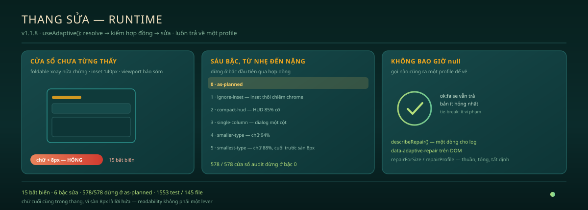
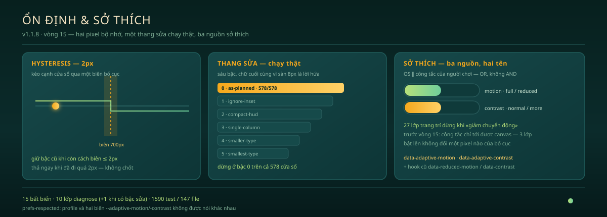
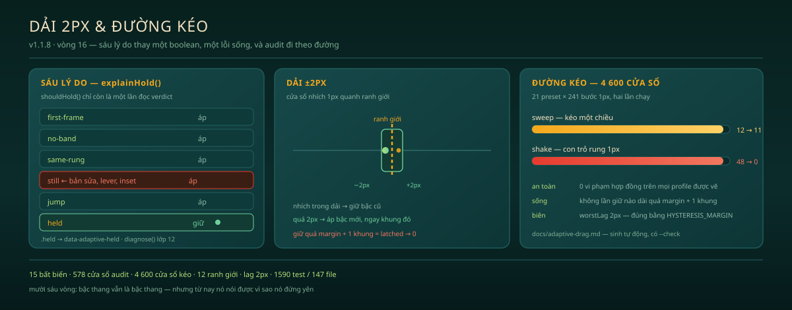
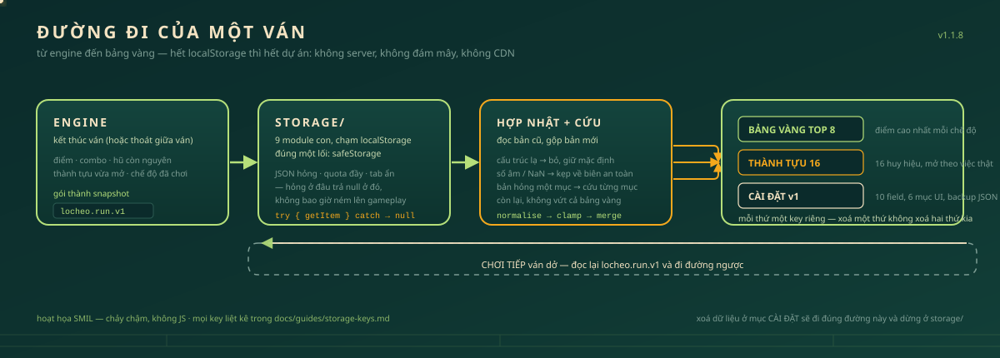
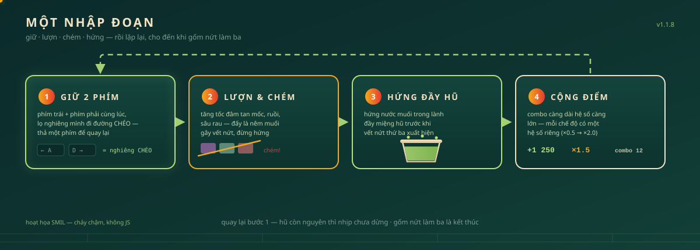

<div align="center">


# LỌ CHÉO — LA GRANDE GUERRE DU BOCAL

### 🫙 L'arcade de pickles vietnamienne qui tourne à 100% dans le navigateur — un seul HTML, offline-first
### 🌐 UI en jeu en 7 langues — Tiếng Việt · English · 中文 · 日本語 · 한국어 · Español · Français

[🇻🇳 Tiếng Việt](README.md) · [🇬🇧 English](README.en.md) · [🇨🇳 中文](README.zh.md) · [🇯🇵 日本語](README.ja.md) · [🇰🇷 한국어](README.ko.md) · [🇪🇸 Español](README.es.md) · [🇫🇷 Français](README.fr.md) · [🇹🇭 ไทย](README.th.md) · [🇩🇪 Deutsch](README.de.md) · [🇵🇹 Português](README.pt.md)

[](docs/releases/v1.1.8.md)
[]
[]
[](https://github.com/standardizeparadigm/LoCheoIO/actions/workflows/ci.yml)
[](LICENSE)
[](#-installation--exécution)
[](#build-de-production)
[](#-changer-de-langue)
[](CONTRIBUTING.md)




</div>

---

## 🥒 À propos du projet

> Lọ Chéo — La Grande Guerre du Bocal : un arcade de pickles qui tourne à 100% dans le navigateur, emballé dans un unique fichier HTML auto-suffisant, offline-first — aucun CDN, aucun serveur. Le bocal en céramique ne sait se déplacer qu'en **diagonale** : maintenez deux touches pour slalomer, accélérer et lacérer moisissures, mouches et chenilles ; remplissez le bocal avant que la céramique ne se fende en trois. **9 modes · 14 ingrédients · 16 succès · classement TOP 8 · UI en 7 langues.**

C'est un **arcade d'action mono-écran** inspiré des pickles populaires vietnamiens. Pas de niveaux linéaires ni de menus surchargés — juste le bocal, une pluie infinie de pickles et vos réflexes en feu.


## 🆕 Nouveautés de v1.1.8

> Le **dernier correctif** avant 1.2.0. Pas de nouveau mode, pas de changement d'équilibrage, pas de changement de format de sauvegarde. Cette dernière passe fait une chose : **le hero mesure la fenêtre et choisit sa propre disposition** — à toutes les tailles qui ont une solution (à partir de 356px), sans défilement ni coupure. La bande du deck disparaît ; les 33 SVG comptent les schémas de bandes du HUD (tour neuf), le rapport d'audit (tour douze) et la figure de stabilité (tour quinze), plus un quatrième corpus d'incidents et une échelle de réparation à six barreaux.

### 📐 Une addition que personne ne surveillait — et quatre bugs à la fois

La capture signalait quatre problèmes, mais ils n'avaient qu'**une** cause. La rangée des panneaux d'angle et le ticker étaient des frères flex en `shrink-0` : ils prenaient leur hauteur d'abord et seul le reste revenait au hero :

```
fenêtre de 720px
├── 415px   rangée des panneaux GAME/INFO  (hauteur selon le contenu, shrink-0)
├──  55px   ticker                         (hauteur selon le texte, shrink-0)
└── 250px   hero                           ← le reste, pour ~430px nécessaires
```

| Symptôme sur la capture | Pourquoi |
| --- | --- |
| `LỌ` coupé au bord supérieur | hero de 250px, contenu de 430px |
| `CÀI ĐẶT` débordant du panneau | le panneau se dimensionnait sur son contenu, pas sur la fenêtre |
| Ligne de copyright coupée en deux | le ticker demandait 55px, il en recevait 48 |
| Le `×` du « Comment jouer » flottant au milieu de l'écran | l'accordéon qui le contenait avait déjà défilé hors de vue |

La correction n'est pas d'ajouter quelques pixels de marge, mais de **déclarer la hauteur une seule fois et de la faire relire partout** : `layout/metrics.ts` possède chaque nombre, `layout/fit.ts` renvoie un `MenuPlan` pur, `MenuChrome` est une seule bande `absolute inset-x-0 bottom-0`, et le hero réserve sa place avec un `padding-bottom` calculé par la **même** fonction.



### 🌀 Le bug de défilement : une zone de défilement dans une autre

Le bas restait immobile tandis que le haut continuait de monter et descendre — exactement comme décrit. v1.1.7 enveloppait le contenu du hero dans une boîte `overflow-y-auto` et le centrait avec `min-h-full` + `justify-center`. Cela ne marche que tant que le contenu est **plus court** que la boîte ; dès qu'il est **plus grand**, `justify-center` le pousse vers le haut et son sommet se retrouve *au-dessus de l'origine du défilement* — aucune position de défilement ne peut l'atteindre.

Désormais l'écran entier n'a **qu'une** zone de défilement (`.menu-scroll`), contenu ancré en haut, jamais centré verticalement. Les trois classes responsables — `flex-1 overflow-y-auto`, `min-h-full`, `justify-center` — sont interdites de retour par `tests/menu-layout.test.ts`.

### 🎯 Hero : `LỌ CHÉO` centré, remonté un peu

- Le logotype est **centré horizontalement** puis **remonté**, comme demandé, avec une taille bornée à la fois par la largeur et la hauteur, pour qu'une fenêtre basse ne fasse pas déborder le glyphe.
- Le bocal en céramique passe à droite, entouré de **trois anneaux de halo à 18s / 26s / 34s** — l'anneau unique de 14s se lisait comme un spinner de chargement.
- **Quatorze décorations** (étoiles, étincelles, anneaux, bulles, piments, feuilles de citron vert, mouches, gouttes de sauce de poisson) en deux bandes au-dessus et au-dessous du titre, chacune avec sa durée et son retard — la réponse à *« la seule écriture et le bocal, c'est trop peu »*.
- Les coordonnées sont des **données** dans `scene/decor.ts` avec une fonction de collision, donc `tests/menu-decor.test.ts` fixe position et quantité.

### 📖 Le « Comment jouer » entre dans le menu GAME

Les six règles et le tableau des touches ne vivent plus dans le hero — les ouvrir poussait le `LỌ` hors de l'écran. Elles forment maintenant **une ligne du panneau GAME** qui ouvre une modale (`HowToModal`) : la mise en page ne bouge ni ouverte ni fermée. Le `×` égaré a disparu avec l'accordéon qui le produisait.

### 🗂️ Le projet gagne encore des dossiers

```
src/components/menu/
├── layout/          metrics.ts · fit.ts · useMenuPlan.ts       ← NOUVEAU : chaque nombre au même endroit
├── scene/           decor.ts · DecorGlyph · HeroDecor · JarHalo ← NOUVEAU : le hero décoré
├── ticker/          keys.ts · MenuTicker           ← NOUVEAU : la bande en module
├── howto/           rules.ts                                    ← NOUVEAU : 6 règles + tableau des touches
├── background/      layers.ts · MenuBackground                  ← 8 couches de fond en données
└── MenuChrome.tsx · HowToModal.tsx                              ← NOUVEAU : la bande du bas + la modale
```

### 🐛 Corrections

| # | Bug | Correction |
| --- | --- | --- |
| 1 | Le haut défilait encore alors que le bas restait fixe | plus de boîte imbriquée : **un** `.menu-scroll` ancré en haut |
| 2 | `LỌ` coupé au bord supérieur | le hero garde une scène de 342px au lieu d'être comprimé à 250px |
| 3 | `CÀI ĐẶT` débordant du panneau GAME | `CornerPanel.height` devient **obligatoire** : 318px (compact) / 458px (riche) |
| 4 | Ligne de copyright coupée en deux | ticker fixe de 48px, copyright dans le bloc du marquee |
| 5 | Le `×` du « Comment jouer » flottant | accordéon → modale, plus rien d'`absolute` sur une boîte déjà défilée |
| 6 | Hauteur du panneau dépendante de la traduction (allemand et thaï débordaient avant l'anglais) | hauteur déclarée, indépendante du contenu |
| 7 | Un anneau de 14s lu comme un spinner | trois anneaux à 18s / 26s / 34s qui ne coïncident presque jamais |
| 8 | Docs/SVG/lanceurs en retard sur la version | balayage des 10 README + docs + 19 SVG → 1.1.8 |

→ Détails complets : [docs/releases/v1.1.8.md](docs/releases/v1.1.8.md) · Version précédente : [docs/releases/v1.1.7.md](docs/releases/v1.1.7.md)

### 🪟 Deux captures, une fenêtre, 260 pixels d'écart

Les deux dernières captures de cette passe montrent **la même application** : `1920×1080` en plein écran et `1920×820` en fenêtre. La largeur n'a pas changé d'un pixel. Pourtant, dans la seconde, la moitié basse du hero passe **sous** les deux panneaux d'angle et la puce `CHẾ ĐỘ CHƠI` est coupée en deux.

La cause n'est pas un manque de hauteur, c'est la mauvaise question :

| Ce qui décide de la mise en page | Sait | Ignore |
| --- | --- | --- |
| `sm:` · `lg:` en CSS | la **largeur** | la **hauteur** |
| `plan.minimal` | la **hauteur** (sous 220px) | la largeur, et seulement trop tard |
| `heroLayout()` (nouveau) | **les deux**, depuis le même nombre que le chrome | — |

Une décision qui dépend de *deux axes* ne s'écrit pas en media query d'un seul axe. La mise en page du hero sort donc du CSS et devient une fonction pure : `heroLayout({ scene, width, minimal })`.

`scene` est la hauteur que `planMenuLayout()` a attribuée au hero — **exactement** le nombre que le chrome réserve. Impossible de dériver : les deux lisent la même fonction.

#### Trois seuils, tous les trois dérivés

| Constante | Valeur | Dérivée de |
| --- | --- | --- |
| `HEIGHT_FOR_BADGE_ROW` | **232** | wordmark 150 + badge 40 + live badge 22 = 212, plus 20px d'air |
| `HEIGHT_FOR_HALO` | **300** | lockup 150 + anneau 240 − chevauchement 90 |
| `HEIGHT_FOR_SIDE_BY_SIDE` | **300** | la colonne la plus haute : mascotte 192 + puce 24 + marge |

`232` est un **bug attrapé** : le premier jet valait `210`, sous le lockup de 212 qu'il conditionne. Une bande de 210 dessinait un lockup de 212 et la ligne de record était rognée. Exactement la classe de bug que cette passe corrige, produite par la correction elle-même.

`tests/menu-adaptive.test.ts` balaie **1 682 viewports** et vérifie `heroContentHeight(layout) ≤ scene` à chaque échantillon.

#### Le quatrième événement manquant

L'utilisateur a produit ces deux captures en **appuyant sur la touche plein écran**. L'application écoutait `resize` et `orientationchange`. Firefox n'en déclenche aucun au passage en plein écran ; Safari ancien ne déclenche que `webkitfullscreenchange`. Donc la fenêtre changeait de hauteur, le hero gardait son ancien plan, et la puce restait coupée.

`VIEWPORT_EVENTS` regroupe les six orthographes en un seul endroit, parce que `useMenuPlan()` et `useViewportWidth()` en ont **toutes les deux** besoin — chacune enregistrait sa propre copie, soit deux copies qui peuvent décrire deux fenêtres différentes.

### 🗑️ La bande séparatrice de l'image 12 — et le deck parti avec elle

La troisième image est une bande de `1443×180` découpée au milieu de l'écran : un repère `🎮`, un filet doré, puis trois titres `GAME / DÉFI DU JOUR / RÈGLE DU JOUR`. C'est le **deck** — trois colonnes de prose dans une bande de hauteur fixe.

Il ne peut pas y vivre, et les deux autres captures disent pourquoi : en `1920×1080` sa colonne droite était coupée **en pleine phrase**, en `1920×820` toute la rangée passait sous les panneaux. Une bande assez haute pour un wordmark de 200px ne l'est pas aussi pour trois paragraphes.

Rien de ce que disait le deck n'est perdu :

| Ce que disait le deck | Où cela vit maintenant |
| --- | --- |
| le mode à jouer | la puce sous la mascotte ; la liste complète est dans GAME |
| **le défi du jour** | une ligne du panneau INFO — `mode · objectif` |
| la règle du jour | une ligne du modal des règles, qui en a toujours été la version complète |

Les calculs de date ne sont **pas** partis avec lui : `challengeFor()` et `tipIndexFor()` ont déménagé dans `src/game/daily/`, avec leurs 21 tests et leurs noms.

La bande vide sous le wordmark est désormais **volontaire**. C'est le prix d'un hero qui tient à toutes les tailles.

### 🏷️ Changelog par niveaux — une couleur par niveau

| Niveau | Étiquette | Couleur | Sens | Exemple |
| --- | --- | --- | --- | --- |
| `major` | **MAJOR** | 🩷 rose `#ff5fb0` | grande version — nouveaux systèmes | 1.0.0 |
| `minor` | **UPDATE** | 🟡 or `#f5a81c` | montée en gamme — nouveau contenu | 1.1.0 |
| `patch` | **PATCH** | 🟣 violet `#9d6bff` | correctifs et rangement | 1.1.1 → **1.1.8** |

Le niveau est **déduit du SemVer** par `tierFor(version)`, jamais tapé à la main. Le panneau ajoute un **filtre** : TOUT · MAJOR · UPDATE · PATCH avec le décompte par niveau.






### 🔟 Neuvième tour : le HUD devient un plan — et `diagnose()` dit *pourquoi*

Le tour 8 a donné un profil à tout le menu. Il restait **une** chose dessinée à la
main : le HUD de `engine.ts`, une chaîne de `fillText` aux coordonnées cumulées,
juste en 1280×720 et fausse partout ailleurs.

`planHud()` donne à chaque indicateur une **bande** (la boîte réelle du glyphe,
`baseline − 0.72 × size`), fixe les colonnes gauche et droite, fait **couler** la
colonne centrale depuis l'horloge et, si ça ne rentre pas, retire d'abord le moins
informatif (`chips → barre de combo → jars → best`), puis compresse par pas de 0,02
jusqu'à un plancher de 0,55.

Balayage de 1 500 plateaux : l'ancienne formule produisait **4 004** chevauchements ;
le plan en produit **0** sur tout plateau jouable. Sous `playable()`, ceux qui restent
sont **signalés** (`traceHud().collisions`), pas masqués.

Aussi : **21 presets** classés par taille (320×480 → 3840×2160), **12 invariants**
dans `constraints.ts` — une seule liste pour la suite, `check:adaptive` et la doc —
et `diagnose()`.


### 1️⃣1️⃣ Dixième tour : le chip de mode garde son côté droit

La capture disait que le mode classique « perd son côté droit ». La cause n'était
pas un chiffre faux mais une **supposition** fausse : le chip était `absolute;
left: 50%; translateX(-50%)` dans la colonne de la mascotte, sans `max-width`.

```
disposition en COLONNE  mascotte centrée  →  chip centré dessus  →  correct
disposition en LIGNE    mascotte à droite →  la moitié du chip hors de la bande
                                             .menu-hero { overflow: hidden }  →  COUPÉ
```

Le nom le plus long — «MUỐI DƯA CỔ ĐIỂN», 19 caractères — était le seul assez long
pour être visiblement coupé : d'où l'impression que « le mode classique est cassé »
alors que tous les noms perdaient un peu.

Le chip a maintenant **deux garanties séparées** : le CSS tient la boîte (aligner au
bord intérieur en ligne, `max-width` dure) et `planModeChip()` tient l'échelle
(`full → label-dropped → name-shrunk → ellipsis`). Une erreur de 6 % sur l'estimation
ne choisit qu'un chip plus petit, jamais un chip coupé.

Aussi : `heroBandWidth()`, **deux nouveaux invariants** (12 → **14**) et un
**troisième corpus** — 189 instantanés (21 presets × 9 modes).


### Tour 11 — les accents vietnamiens ne sont plus rognés

Cette capture ne disait pas « il manque la moitié droite » mais **« il manque les
accents »** : le chip affichait « MUỐI DƯA CỔ ĐIÊN », le **Ể** avait perdu son
circonflexe alors que le **Ổ** gardait le sien. C'était une **régression du tour
10** : `truncate` ne coupe pas qu'horizontalement — `overflow: hidden` rogne la
**boîte de ligne**, et le vietnamien empile un accent tonal sur un circonflexe
(`Ố Ổ Ể Ấ Ự`) à environ **0,35em** au-dessus de la hauteur de capitale.

Trois couches ont été corrigées, sans se chevaucher :

| Couche | Avant | Après |
| --- | --- | --- |
| Chaîne | ellipse CSS | `planModeChip()` coupe la chaîne et ajoute `…` |
| Boîte de ligne | 1,2em | **1,5em** (`MODE_CHIP_LINE_HEIGHT`) |
| Boîte de rognage | `truncate` sur le span du nom | **aucun `overflow`** |

Et **`.clip-safe`** — le remplaçant de `truncate` pour tout texte traduisible :
`padding-block: .24em` éloigne la boîte de rognage de l'encre, `margin-block: -.24em`
rend cet espace à la mise en page ; rien ne bouge et les accents survivent. Six
endroits l'utilisent. Enfin `chipBoxHeight()` remplace une constante devinée : le
chip a grandi de 3,3px, ce qui regarde `heroContentHeight()`, qui lit désormais une
mesure au lieu d'un souvenir.

Détails : [docs/releases/v1.1.8.md §18](docs/releases/v1.1.8.md#18-vòng-11--dấu-tiếng-việt-bị-css-cắt).



### Tour 12 — tout l'espace de fenêtres, audité — et une échelle de réparation

Chacun des trois tours précédents a ajouté **un** corpus. Aucun ne répondait à la
question qu'on se pose avant de publier : *sur **toutes** les fenêtres jouables,
que fait la mise en page, à quelle fréquence, et y a-t-il quelque chose de cassé ?*

Désormais `npm run audit:adaptive` répond : **578** fenêtres (21 presets plus une
grille 25 × 23 autour de chaque point de rupture, dédoublonnée), résolues une fois
et réunies en un seul `AuditReport`.

| | |
| --- | --- |
| Fenêtres | **578** |
| Violations du contrat | **0** — chaque fenêtre exécute les 14 invariants |
| LỌ CHÉO seul | 101 (17 %) |
| Hero ligne / colonne | 170 / 408 |
| Scene | 140px (320×320) … 1 642px (3840×2160) |

`docs/adaptive-audit.md` est la copie **générée** de ce rapport, et
`audit:adaptive --check` tourne dans `npm run check` : déplacer un point de rupture
ou un plancher typographique **apparaît en diff** dans le commit qui l'a causé.
C'est la règle « améliorer une chose, c'est vérifier son entourage », confiée à une
machine.

À côté, une **échelle de réparation** dans `repair/` : six barreaux —
`as-planned → ignore-inset → compact-hud → single-column → smaller-type →
smallest-type`. L'ordre est le principe : **le texte en dernier**, car le plancher
de 8px est une promesse. L'application s'arrête au barreau 0 sur les 578 fenêtres ;
l'échelle existe pour *pouvoir* servir, et le test lui confie un contrat plus strict
pour prouver qu'elle descend vraiment.

Et un **quatrième corpus** : 14 fenêtres qui ont chacune fait l'objet d'un rapport
avec capture, du tour 1 au tour 12, chaque fichier portant `symptom` et `guard`,
pour qu'un échec se lise comme une phrase sur la boutique et non comme deux nombres.

Détails : [docs/releases/v1.1.8.md §19](docs/releases/v1.1.8.md#19-vòng-12--kiểm-toán-cả-không-gian-và-thang-tự-sửa) ·
guide : [docs/guides/adaptive-audit.md](docs/guides/adaptive-audit.md).




### Tour 13 — pas seulement *juste*, mais *le moins cher*

Le tour 12 a construit un audit qui répond par oui/non : **un invariant est-il cassé ?**
Mais à chaque capture envoyée, une deuxième question reste sans réponse : **existe-t-il
une disposition moins chère ?**

Ce tour y répond. `select/` donne à chaque profil **sept termes** et les compare
**lexicographiquement** — pas en somme pondérée, car une somme pondérée laisserait
40px de marge « racheter » une mascotte perdue si les poids s'additionnaient ainsi :

| # | Terme | Ce que le joueur perd |
| --- | --- | --- |
| 1 | `violations` | rien — une disposition cassée n'est pas candidate |
| 2 | `hidden` | mascotte, deck, accroche |
| 3 | `cropped` | px sous son propre plancher |
| 4 | `hudLost` | part de l'échelle du HUD |
| 5 | `typeDrop` | px de texte, cumulés |
| 6 | `levers` | combien de choses ont bougé — invisible |
| 7 | `slack` | marge — pas une perte, seulement un départage |

Deux détails séparent « un tableau de scores » d'« une comparaison réellement juste » :

- **`hidden` et `cropped` se mesurent contre le profil de base.** Une fenêtre 320×320
  *est* déjà wordmark seul et *est* déjà recadrée avant tout levier — c'est la fenêtre,
  pas un sacrifice. Des drapeaux bruts signaleraient « hidden 1 » pour le profil que
  l'app dessine déjà.
- **`levers` compte depuis le profil, pas depuis les overrides.** `ignoreInset` sur une
  fenêtre sans inset ne change rien, donc ne compte pas — d'où des **égalités réelles**,
  départagées par la position dans l'échelle, pas par l'ordre vu par `sort`.

L'affirmation que ce tour achète, et peut vérifier :

```
npm run audit:adaptive -- --select
  shipped profile wins   578 / 578
```

> sur toute fenêtre jouable, le profil livré est le moins cher des six.

Le tour 12 disait « rien n'est cassé » ; le tour 13 dit « rien n'est moins cher ». Une
affirmation plus forte se trompe plus facilement, d'où son **cinquième corpus** :
`tests/fixtures/selection/` — 12 fenêtres, chaque fichier consignant la *décision* et
non la disposition : le classement complet des six barreaux, le second, et pourquoi
chacun a perdu. Quand un seuil bouge, le diff montre une **décision** qui change — ce
qu'un relecteur doit réellement approuver.

Détails : [docs/releases/v1.1.8.md §20](docs/releases/v1.1.8.md#20-vòng-13--không-chỉ-đúng-mà-rẻ-nhất) ·
guide : [docs/guides/adaptive-selection.md](docs/guides/adaptive-selection.md).


Un troisième endroit, même forme : **le barreau `crop` était un cul-de-sac.** 25 des 578
fenêtres de l'audit donnent `fit: "crop"` (les 25 à 320px de haut). Trois invariants
exemptent ce barreau — à raison, aucune disposition ne tient — mais `.menu-pane` est
`overflow: clip`, donc la partie de la colonne qui dépasse était **inatteignable** : le bas
des deux panneaux et le bouton START, sans qu'aucun invariant ne dise mot. Désormais
`[data-adaptive-fit="crop"] .menu-pane` est le seul conteneur de défilement vertical du
menu ; toute fenêtre de **356px** ou plus s'ajuste encore au pixel.

### Tour 14 — correction de bugs : le contrat du chip doit compter les sept langues

Ce tour n'ajoute rien. Il est allé chercher un endroit où une promesse était énoncée plus
largement que ce qui la vérifiait.

Le chip était mesuré avec des littéraux vietnamiens à **quatre** endroits
(`CHIP_LABEL = "CHẾ ĐỘ CHƠI"`, `CHIP_NAME = "MUỐI DƯA CỔ ĐIỂN"`) — et le vietnamien est
la **plus courte** des sept langues :

| | libellé | nom de mode le plus long |
| --- | --- | --- |
| vi | `CHẾ ĐỘ CHƠI` (11) | `MUỐI DƯA CỔ ĐIỂN` (19) |
| es | `MODOS DE JUEGO` (14) | `60 SEGUNDOS DE LOCURA` (21) |
| fr | `MODES DE JEU` (12) | `FESTIVAL DES COMBOS` (19) |

Donc `chip-labelled` affirmait *« le libellé survit sur toute fenêtre jouable »* alors que
l'espagnol le perd à 320px et 360px et le français à 320px — et l'audit annonçait
**0 violation**.

Désormais `chip/probes.ts` dérive les sondes de `localeTable()` + `MODE_LIST`, et
`chip-labelled` énonce quelque chose de vérifiable : **le chip ne perd jamais deux
barreaux à la fois**. L'audit annonce ce qui se passe : **439 full · 101 hidden ·
38 label-dropped**.

Trois bugs mineurs de la même forme suivent : `scoreProfile()` renvoyait sa liste de
violations non triée (le départage final dépendait de l'ordre d'insertion),
`isFiniteProfile()` ne regardait jamais `playfield`/`modal`, et `slackOf()` arrondissait
différemment de `constraints.ts` sur la même boîte. Et `--select` a cessé d'imprimer un
nombre qui n'existe pas : il multipliait 18 × 36 et appelait le produit « 648 fenêtres »
alors que l'audit en parcourt 578 — maintenant `578 / 578`, la même liste.

Aucune fonctionnalité nouvelle, aucun changement de disposition, pas de montée de version.
Seulement **1618 tests sur 149 fichiers** au lieu de 1398, et un contrat qui dit ce
qu'il vérifie.


## 📐 Mise en page adaptative — comment le hero choisit sa forme

L'écran d'accueil n'utilise pas de media queries pour décider sa disposition. Il **mesure** la fenêtre et choisit parmi cinq capacités : `sideBySide`, `halo`, `badgeRow`, `mascot`, `liveBadge`.

```
planMenuLayout(viewport) → { scene, reserve, … }    scene + reserve = hauteur
            │
            └─ scene est exactement le nombre que le chrome réserve
                        │
    heroLayout({ scene, width }) → 5 booléens
```

| Indicateur | Actif quand | Ce qui disparaît sinon |
| --- | --- | --- |
| `sideBySide` | largeur ≥ 1024 **et** hero ≥ 300px | la mascotte passe sous le wordmark |
| `halo` | hero ≥ 300px | l'anneau autour du bocal |
| `badgeRow` | hero ≥ 232px | la plaque « HŨ DƯA ĐẠI CHIẾN » et la ligne de record |
| `mascot` | presque toujours | — (masquée uniquement en économie minimale) |
| `liveBadge` | hero ≥ 232px | la ligne EN DIRECT DES CUISINES et la version |

Les trois seuils ne sont **pas des nombres ronds** — chacun vaut la hauteur réelle de ce qu'il conditionne :

```ts
HEIGHT_FOR_BADGE_ROW    = 232  // 150 wordmark + 40 plaque + 22 live + 20 air
HEIGHT_FOR_HALO         = 300  // 150 lockup + 240 anneau − 90 chevauchement
HEIGHT_FOR_SIDE_BY_SIDE = 300  // colonne la plus haute : 192 mascotte + 24 puce
```

`tests/menu-adaptive.test.ts` balaie **1 682 viewports** et vérifie `heroContentHeight(layout) ≤ scene` à chaque échantillon. Au redimensionnement, les deux hooks écoutent **six** événements et se mettent à jour dans une seule frame.

### 🧠 Tour quinze : le système s'ajuste seul, et ne tremble plus

Aucune fenêtre nouvelle. Il ferme quatre trous laissés par le tour quatorze — des endroits
où la promesse existait dans la doc et où aucun code ne la portait :

| | avant le tour 15 | après le tour 15 |
| --- | --- | --- |
| Interrupteur « Réduire les animations » | n'atteignait que le canvas — **3** couches CSS s'arrêtaient | résolu dans `profile.prefs`, atteint le menu — **27** couches s'arrêtent |
| `prefers-contrast: more` | lu par `App.tsx` pour poser un attribut | le sixième signal d'`Environment` ; bordures et en-têtes de panneau relevés |
| L'échelle de réparation à six barreaux | une bibliothèque testée **que personne n'appelait** | `useAdaptive()` l'exécute au runtime ; `data-adaptive-repair` nomme le barreau |
| Glisser un bord sur un point de rupture | refaisait la mise en page à chaque mouvement | `stabilize()` retient le barreau **2px** — 60px de glissement le changent ≤ 2 fois |

- **Trois sources, deux noms.** `preferencesFor()` combine en **OU** le système et
  l'interrupteur du joueur, jamais en ET : une app n'annule pas avec un défaut ce que le
  système déclare.
- **La quinzième invariante, `prefs-respected`**, interdit un profil qui dit « réduit »
  pendant que ses variables CSS disent « complet ».
- **`diagnose()` gagne deux lignes** : `10 · prefs` toujours, `11 · repair` seulement sur
  un profil peint par le hook — un `resolveAdaptive()` pur ne parcourt pas l'échelle.

Activer les deux préférences **ne change pas un pixel** : 578 / 578 fenêtres restent
`as-planned` avec 0 violation, et un test compare `plan` / `type` / `density` entre les
deux profils pour tenir cette promesse.

Détails : [docs/releases/v1.1.8.md §24](docs/releases/v1.1.8.md#24-vòng-15--hệ-tự-chỉnh-và-hai-pixel-bộ-nhớ) ·
dossiers : [`adaptive/preferences/`](src/components/menu/adaptive/preferences/README.md) ·
[`adaptive/hysteresis/`](src/components/menu/adaptive/hysteresis/README.md).



### 🎚️ Tour seize : la bande de deux pixels peut dire *pourquoi* elle reste immobile

Aucun mécanisme de stabilisation nouveau. Trois choses sur celui que le tour quinze a
laissé : l'expliquer, le mesurer, et corriger un défaut qu'il dissimulait.

| | avant le tour 16 | après le tour 16 |
| --- | --- | --- |
| « Pourquoi ce profil est-il en retard de 2px ? » | coller cinq conditions dans un REPL | `explainHold()` renvoie **six raisons nommées** ; `shouldHold()` n'en est qu'une lecture |
| Le barreau change et la fenêtre **ne bouge pas** | retenu — et *toujours*, le cadre suivant étant identique | raison propre, `still`, appliquée aussitôt : l'échelle de réparation peint son correctif au premier cadre |
| Un retard volontaire | invisible pour les gens comme pour les outils | `data-adaptive-held` dans le DOM · `diagnose()` couche `12 · hold` |
| L'audit | un tableau de 578 fenêtres, chaque ligne vraie à tout instant | plus un **audit de glissement** : 21 × 241 pas, 4 600 fenêtres, deux relectures |

- **Six raisons :** `first-frame` · `no-band` · `same-rung` · `still` · `jump` · `held`.
  Seul `held` retient ; les cinq autres sont cinq façons dont un changement de barreau
  n'est *pas* une secousse.
- **`still` est un vrai défaut :** l'ancienne condition — « les deux boîtes à moins de
  2px » — est aussi vraie quand les boîtes sont *identiques*. Un profil réparé change
  `plan.fit` sur la même boîte : il était retenu, et `last.current` n'avançait jamais —
  *le correctif n'était jamais peint*.
- **L'audit parcourt un chemin, pas seulement des points.** `docs/adaptive-drag.md` :

| geste | raw | held | ce que la bande achète |
| --- | --- | --- | --- |
| **sweep** — glissement à sens unique de ±120px (4 600 fenêtres) | 12 | 11 | 1 (8 %) — chaque bordure n'est franchie qu'une fois |
| **shake** — le pointeur bouge de 1px à chaque bordure | 48 | **0** | **48 (100 %)** — c'est pour cela que la bande existe |

Trois propriétés du glissement : **sûreté** (0 violation sur tout profil peint),
**vivacité** (aucune rétention au-delà de `margin + 1` cadres), **borne** (`worstLag` = 2px).

Et une chose hors de l'adaptatif, même tour : la porte des comptes en prose (« 26 SVGs »
dans quatre fichiers) tourne désormais **dans** `npm run check`, pas seulement en CI — les
règles ont déménagé dans `scripts/lib/prose-counts.mjs` et le test exécute *ces* règles,
pas une copie.



### 🧱 Huitième tour : six couches, un profil

Le tour six a appris au hero à mesurer sa fenêtre. Le reste devinait encore : la modale était `86vh` **sans plafond**, le titre de fin de partie un `text-6xl` fixe, les panneaux appelaient `cornerRowHeight()` eux-mêmes et `engine.resize()` calculait seul le rayon du bocal. **Six lecteurs, six lectures** — et deux lectures peuvent tomber sur deux images différentes.

v1.1.8 les réunit en **une fonction pure d'une boîte** :


| | | |
| --- | --- | --- |
| 1 · Box | `adaptive/viewport.ts` | `w · h · inset · dpr` |
| 2 · Tier | `adaptive/tiers.ts` | `xs`…`xxl` |
| 3 · Plan | `layout/fit.ts` | `scene · reserve · fit` |
| 4 · Density | `adaptive/density.ts` | 54/34/26px · 318/458→234 |
| 5 · Hero | `adaptive/hero.ts` | row / stack · lockup |
| 6 · Type | `adaptive/typeScale.ts` | 17 × `--type-*` |
| 7 · Modal | `ui/modalPlan.ts` | w × h × columns |
| 8 · Board | `game/adaptive/playfield.ts` · `game/adaptive/hud.ts` | `itemScale` · `hudScale` · băng HUD |

Le nouvel invariant `panneau + marge ≤ réserve` échoue à **844×390** — un iPhone à l'horizontale, la taille du rapport. `reserveFor()` retire 30px quand le panneau ne dessine pas de pied, mais `panelHeightForPlan()` ne regardait que la densité et dessinait toute la hauteur : un panneau de 234px dans une bande de 216px, **18px de sa base hors de l'écran**.

**Un corpus de 1 620 instantanés** le verrouille : `tests/fixtures/adaptive-matrix/` (1 110 fenêtres, un fichier par fenêtre) et `tests/fixtures/hero-bands/` (510 paires « largeur × bande »). `npm run check:adaptive` imprime 21 lignes et affirme six invariants, sans navigateur.

### 🌍 La seconde couche : l'environnement, pas seulement la taille

La hauteur de la fenêtre n'est pas la hauteur utilisable. Sur un iPhone, la barre
d'adresse et l'indicateur d'accueil en mangent une partie ; en zoom, `visualViewport`
est plus petit que `innerHeight`. D'où une couche à part, pure et sans React
(`src/components/menu/adaptive/environment.ts`) :

```ts
type Environment = {
  dpr: number;            // borné à [1, 4]
  landscape: boolean;
  coarse: boolean;        // un doigt, pas une souris
  insetTop / Right / Bottom / Left: number;
  reducedMotion: boolean;
};
```

Quatre choses faciles à rater, et ce qui a été fait à la place :

1. **`env()` n'est pas lisible via `getComputedStyle`.** Il faut un élément qui
   *utilise* `env(safe-area-inset-*)` pour que son padding calculé veuille dire
   quelque chose. La première version créait **quatre** sondes (une par bord) —
   quatre mises en page forcées à chaque redimensionnement. C'est maintenant
   **une** sonde à quatre paddings, retirée dans un bloc `finally` pour qu'une
   exception ne la laisse pas traîner.
2. **`pointer: coarse` peut changer sans aucun `resize`.** Un portable hybride
   alterne sans cesse souris et doigt. Le hook écoute **les deux** media queries,
   pas seulement `resize`.
3. **Un inset `0` est légitime.** L'assistant `sane()` des autres champs
   numériques a un plancher de 1 — le réutiliser pour l'inset transforme « pas
   d'encoche » en « encoche de 1px ».
4. **L'inset se soustrait de la hauteur utilisable, jamais de la scène.**
   `usableHeight(h, inset) = clamp(h − inset, 1, ∞)`, et `planFits` comme
   `occupiesExactly` passent par là : ils ne peuvent pas se contredire.

`tests/environment.test.ts` couvre `saneDpr` (y compris `NaN`, `−1`, `7`),
`parseInset`, `verticalInset` et `isHandheld` ; `tests/use-environment.test.ts`
construit de faux objets `window` et `document` (sans jsdom) et couvre donc aussi
un `matchMedia` qui **lève** et un document **sans body**.

### ⚠️ Une limite connue — consignée, pas cachée

En **844×600**, une fenêtre sans inset donne 222px au hero ; avec un inset de
10px elle lui en donne **268px**. Une fenêtre plus petite reçoit un hero 46px plus
haut. La cause : la hauteur totale se répartit par seuils discrets, et un petit
inset fait franchir un seuil à la somme, ce qui change l'économie.

C'est un défaut **réel, petit et préexistant**. Une recherche sur huit économies
maximisant `scene` a été tentée — elle **échoue** : à 1920×1080 elle supprime le
ticker et les lignes hautes, c'est-à-dire exactement ce que le joueur voit. Elle a
été annulée. À la place, `tests/layout-inset.test.ts` **affirme les nombres
mesurés** (222 → 268, +46) comme un test vert : qui le corrige cassera le test et
devra le mettre à jour ; en attendant, c'est au moins écrit. À côté se trouve
l'invariant qui tient : dans *une* économie, `scene + reserve === usableHeight`
(252 combinaisons vérifiées).

## ✨ Points forts

| Groupe | Détails |
| --- | --- |
| 🎮 **9 modes de jeu** | **PICKLE CLASSIQUE** (équilibré) · **ZEN** (sans dangers, ×0.5) · **ENFER DU PIMENT** (+35% vitesse, ×1.5) · **60 SECONDES** (contre-la-montre 60 s, ×1.25) · **RUÉE VERS L'OR** (butin doré ×2.6) · **Averse de pickles** (~1.4× plus dense, ×0.75) · **Céramique fine** (une fissure suffit, ×2.0) · **FESTIVAL DES COMBOS** (fenêtre ×2, ×1.15) · **GRAND FESTIN** (densité ~×2, bocal ×2.5, ×0.6) |
| 🌐 **i18n en jeu** | Tiếng Việt · English · 中文 · 日本語 · 한국어 · Español · Français — `src/i18n/` (module pur + pont React), `t()` avec interpolation, synchronise `<html lang>`, nombres par locale (vi-VN / en-US / zh-CN / ja-JP / ko-KR / es-ES / fr-FR) |
| 🕹️ **Mécanique LA DIAGONALE signature** | Maintenez 2 touches/axes en diagonale — le bocal accélère, brille et lacère les dangers. Barre de stamina dédiée avec hystérésis anti-scintillement |
| 🥬 **14 ingrédients** | Aubergine, piment, ail, gingembre, sel, moutarde, **MOUTARDE DORÉE** (remplit le bocal vite) · SEL/AIL DORÉ · PIMENT INFERNAL · GLACE · MOISISSURE, MOUCHE, **CHENILLE** (dangers) |
| 🧄 **Bouclier d'Ail Doré** | Power-up : accumulez jusqu'à **2 charges** absorbant les fissures ; un halo rotatif orbite autour du bocal |
| 🏆 **16 succès** | Sauvegardés **entre les parties** (localStorage), avec un toast « NOUVEAU SUCCÈS ! » sur l'écran de fin |
| 🔊 **Audio artisanal** | 11 effets synthétisés en Web Audio API (zéro fichier) + pentatonique qui module avec le niveau ; couper le son avec `M` |
| 💾 **TOP 8** | Sauvegarde locale, validée et normalisée à la lecture, noms en majuscules automatiques, surbrillance pour le record tout frais |
| 🎨 **60fps** | Canvas 2D, budget de 460 particules, DPR plafonné à 2, sol à carreaux pré-rendu offscreen, scintillement d'étoiles + aurore dans le menu |
| 📴 **Vraiment offline-first** | Polices auto-hébergées (sous-ensembles latin + vietnamien, woff2), aucun CDN ni API — ouvrez `dist/index.html` et jouez |
| 🧪 **Qualité** | 1618 tests unitaires (vitest) pour modes / achievements / storage / i18n / settings — `npm run check` est la porte CI |


### 💾 Sauvegarde & tableau d'honneur — le voyage d'une partie

Les données ne quittent jamais la machine : le moteur emballe la partie en un snapshot, `storage/` (9 modules) touche localStorage par l'unique porte `safeStorage`, une sauvegarde cassée est secourue entrée par entrée, et seulement arrivent le TOP 8, 16 succès et les réglages — « CONTINUER » parcourt ce même chemin à l'envers.



## 🌐 Changer de langue

Lọ Chéo embarque **7 langues d'interface**, appliquées instantanément — sans recharger, sans perdre ta partie :


| Langue | Où | Stocké dans |
| --- | --- | --- |
| 🇻🇳 Tiếng Việt | bouton **VI** (par défaut ; suit la langue du navigateur) | `locheo.lang.v1` |
| 🇬🇧 English | **EN** bouton | `locheo.lang.v1` |
| 🇨🇳 中文 | **中** bouton | `locheo.lang.v1` |
| 🇯🇵 日本語 | **日** bouton | `locheo.lang.v1` |
| 🇰🇷 한국어 | **한** bouton | `locheo.lang.v1` |
| 🇪🇸 Español | **ES** bouton | `locheo.lang.v1` |
| 🇫🇷 Français | **FR** bouton | `locheo.lang.v1` |

- Change de langue dans **Réglages → LANGUE** (grille de 7 boutons drapeau) — un seul endroit, plus de sélecteur flottant sur le menu.
- Toutes les chaînes visibles vivent dans `src/i18n/locales/{vi,en,zh,ja,ko,es,fr}.ts` — moteur canvas, écrans, HUD, popups, ticker, astuces.
- Une clé manquante ? `t()` retombe sur le vietnamien — les sept jeux de clés (et leurs placeholders) sont garantis par les tests.

## 🕹️ Contrôles

| Action | Clavier | Tactile |
| --- | --- | --- |
| Se déplacer | `W` `A` `S` `D` ou `← ↑ ↓ →` | Glissez n'importe où (joystick flottant) |
| **Diagonale (CHÉO)** | Maintenez **2 touches en même temps** (ex. `A`+`W`) | Glissez en **45°** — l'anneau du joystick vire à l'or |
| Choc du bocal (onde + aspiration) | `Space` | Bouton rouge **SLAM**, en bas à droite |
| Pause / reprise | `P` ou `Esc` | Bouton pause, en haut à droite |
| Recommencer aussitôt | `R` (même en pause/game over) | Bouton « Encore une fournée » |
| Démarrer / confirmer | `Enter` | Bouton **AUX FOURNEAUX** |
| Muet / son | `M` | Bouton haut-parleur, en haut à droite |
| Changer de langue | — (boutons VI/EN/中/日/한/ES/FR) | Boutons VI/EN/中/日/한/ES/FR sur le menu / la pause |



Un cycle vu par la machine : garder deux touches est l'étape 1, tout le reste se répète — tant que le pot tient, le rythme ne s'arrête pas ; trois fissures y mettent fin.

## 🚀 Installation & exécution

### Jouer tout de suite (sans build)

```bash
# chaque release embarque un unique fichier auto-suffisant :
open dist/index.html      # macOS
xdg-open dist/index.html  # Linux
start dist/index.html     # Windows
```

### Build de production

```bash
npm install        # installe les dépendances (Node ≥ 20.19)
npm run build      # → dist/index.html (un seul fichier auto-suffisant)
```

> `vite-plugin-singlefile` inline tout le JS/CSS/polices/images dans **un** `dist/index.html` (~952 Ko, gzip ~430 Ko). Ni serveur, ni réseau.

### Développement

```bash
npm run dev        # serveur de dev avec HMR (http://localhost:5173)
npm run preview    # sert le build de production en local
npm run typecheck  # tsc --noEmit (strict, noUnusedLocals…)
npm run test       # vitest — 1618 tests unitaires (modes / achievements / storage / i18n / settings)
npm run check      # typecheck + test + build (porte qualité CI)
```

## 🗂️ Structure du projet

```
lo-cheoio/
├─ index.html              # entrée, meta SEO/OG (sans CDN)
├─ package.json            # lo-cheoio v1.1.8, scripts dev/build/test/check
├─ .gitattributes          # *.bat/*.cmd → CRLF · posix → LF · binaries
├─ vite.config.ts          # vite + react + tailwind v4 + singlefile
├─ tsconfig.json           # strict ; inclut src + tests
├─ favicon.ico             # web icon (multi-size 16→256)
├─ public/                 # favicon.ico/png/svg served at web root
├─ assets/
│  ├─ banner.svg           # bannière du README (animation SMIL)
│  ├─ demo.svg             # simulation de gameplay (animation SMIL)
│  ├─ items.svg            # les 14 ingrédients (animation SMIL)
│  ├─ modes.svg            # les 9 modes (animation SMIL)
│  ├─ languages.svg        # 7 in-game languages (SMIL animation)
│  ├─ new-modes.svg        # the 2 new v1.1.4 modes (SMIL animation)
│  ├─ corner-menu.svg     # corner GAME/INFO panels (SMIL animation)
│  ├─ settings-sections.svg # 6-section settings tour (SMIL, v1.1.6)
│  ├─ wordmark-crop.svg    # LỌ nặng dấu — crop trước/sau (SMIL, v1.1.8)
│  ├─ menu-anatomy.svg     # hero anatomy: 14 món trang trí (SMIL, v1.1.8)
│  ├─ diagonal-motion.svg  # chuyển động chéo của hero (SMIL, v1.1.8)
│  ├─ no-scroll-steps.svg  # bốn bậc vá lỗi cuộn (SMIL, v1.1.8)
│  ├─ layout-fix.svg       # trước/sau vá bố cục 250→342px (SMIL, v1.1.8)
│  ├─ test-matrix.svg      # ma trận test + 9 cổng (SMIL, v1.1.8)
│  ├─ mode-chip.svg        # chip chế độ trước/sau (SMIL, v1.1.8 r10)
│  ├─ adaptive-layers.svg  # sáu lớp adaptive một profile (SMIL, v1.1.8 r8)
│  ├─ hud-bands.svg        # HUD thành kế hoạch (SMIL, v1.1.8 r9)
│  ├─ diacritics-clip.svg  # dấu Việt dưới overflow (SMIL, v1.1.8 r11)
│  ├─ adaptive-audit.svg   # kiểm toán 578 cửa sổ (SMIL, v1.1.8 r12)
│  ├─ adaptive-repair.svg  # thang sửa sáu bậc runtime (SMIL, v1.1.8 r12)
│  ├─ adaptive-select.svg  # chọn bậc rẻ nhất (SMIL, v1.1.8 r13)
│  ├─ adaptive-stability.svg # ổn định + sở thích (SMIL, v1.1.8 r15)
│  ├─ adaptive-hold.svg    # dải 2px + drag audit (SMIL, v1.1.8 r16)
│  ├─ divider.svg          # sparkle divider (SMIL animation)
│  ├─ license.svg          # sceau copyleft AGPL-3.0 animé (animation SMIL)
│  └─ favicon.svg          # favicon (SMIL animation)
├─ scripts/
│  ├─ play-mac.command     # lanceur macOS — double-clic, menu coloré
│  ├─ play-windows.bat     # lanceur Windows — double-clic, menu coloré
│  ├─ play-linux.sh        # lanceur Linux — double-clic, menu coloré
│  └─ README.md            # guide des lanceurs pour novices du terminal
├─ docs/
│  ├─ README.md            # index de la documentation (v1.1.5)
│  ├─ DESCRIPTION.md       # descriptions multilingues (vi/en/zh + SEO)
│  ├─ design/              # specs menu-corners / save-format / settings-format
│  ├─ guides/              # vue d'ensemble engine · a11y · perf · storage keys · playbook release…
│  └─ releases/
│     ├─ v1.0.0.md         # notes de la première release
│     ├─ v1.1.0.md         # notes v1.1.0
│     ├─ v1.1.1.md         # notes v1.1.1
│     ├─ v1.1.2.md         # v1.1.2
│     ├─ v1.1.3.md         # v1.1.3 release notes
│     ├─ v1.1.4.md         # release notes (1.1.4)
│     ├─ v1.1.5.md         # release notes (1.1.5)
│     ├─ v1.1.6.md         # release notes (1.1.6)
│     └─ v1.1.8.md         # current release notes (1.1.8)
├─ README.md               # 🇻🇳 Tiếng Việt
├─ README.en.md            # 🇬🇧 English
├─ README.zh.md            # 🇨🇳 中文
├─ README.ja.md            # 🇯🇵 日本語
├─ README.ko.md            # 🇰🇷 한국어
├─ README.es.md            # 🇪🇸 Español
├─ README.fr.md            # 🇫🇷 Français (ce fichier)
├─ README.th.md            # 🇹🇭 ไทย
├─ README.de.md            # 🇩🇪 Deutsch
├─ README.pt.md            # 🇵🇹 Português
├─ src/
│  ├─ main.tsx             # racine React, StrictMode
│  ├─ App.tsx              # machine à phases menu/playing/paused/gameover
│  ├─ version.ts           # APP_VERSION = "1.1.8" (source unique de vérité)
│  ├─ index.css            # thème tailwind v4 + toutes les animations/dégradés
│  ├─ assets/fonts/        # sous-ensembles woff2 (Be Vietnam Pro ×6, Bungee)
│  ├─ styles/fonts.css     # @font-face + unicode-range, 100% offline
│  ├─ i18n/
│  │  ├─ i18n.ts           # module pur : détection, persistance, t() + interpolation
│  │  ├─ useI18n.ts        # hook React : useI18n/useLanguage
│  │  └─ locales/          # vi.ts (source des clés) · en · zh · ja · ko · es · fr
│  ├─ components/
│  │  ├─ GameCanvas.tsx    # canvas + joystick flottant + clavier + visibilité
│  │  ├─ StartScreen.tsx   # menu : hero + scène en couches + panneaux d'angle
│  │  ├─ menu/              # panneaux GAME/INFO + modales + icons/
│  │  │  └─ background/     # 8 background layers as data (v1.1.8)
│  │  ├─ ModeSelector.tsx  # 9 cartes de mode (classic/zen/inferno/blitz/goldrush/storm/hardcore · combo · feast)
│  │  ├─ AchievementsPanel.tsx  # mur de badges verrouillés/déverrouillés
│  │  ├─ GameOverScreen.tsx     # BOCAL BRISÉ ! + score + nouveaux succès
│  │  ├─ PauseScreen.tsx        # PAUSE + stats de la partie
│  │  ├─ settings/           # réglages en 6 sections + contrôles (v1.1.6)
│  │  └─ ui/               # huit primitives, un fichier chacune (v1.1.8 — extraites de ui.tsx)
│  ├─ game/
│  │  ├─ engine.ts         # toute la simulation + rendu canvas (~2260 lignes)
│  │  ├─ modeTypes.ts      # ModeId · ModeConfig (types-only, v1.1.8)
│  │  ├─ modes/            # 9 balance records — classic.ts … feast.ts (v1.1.8)
│  │  ├─ modesIndex.ts     # MODES · MODE_LIST · isModeId (v1.1.8)
│  │  ├─ modeMath.ts       # multiplierForCombo · jarBonus · comboWindowFor… (v1.1.8)
│  │  ├─ modes.ts          # barrel — keeps every old import working
│  │  ├─ achievements.ts   # 16 badges + checker pur (pur)
│  │  ├─ storage.ts        # localStorage : top 8, progrès, succès
│  │  ├─ audio.ts          # synthèse Web Audio : sfx + musique pentatonique
│  │  ├─ changelog/          # in-game changelog (v1.1.8 — split from one file)
│  │  │  ├─ types.ts        #   ChangelogEntry · ReleaseTier · copyFor()
│  │  │  ├─ tiers.ts        #   tierFor() · TIER_ORDER · TIER_LABEL_KEY
│  │  │  ├─ entries/        #   1 file per release — v1_0_0.ts … v1_1_7.ts
│  │  │  └─ index.ts        #   ordered list + 5 helpers
│  │  ├─ runSave.ts         # sauvegarde de partie suspendue
│  │  ├─ settings.ts        # schéma des réglages, défauts, normalisation
│  │  ├─ settingsIO.ts      # codec de sauvegarde/restauration (v1.1.6)
│  │  ├─ settingsPresets.ts # quatre préréglages rapides (v1.1.6)
│  │  └─ audioLevels.ts     # calcul pur des gains (v1.1.6)
│  └─ utils/
│     ├─ cn.ts             # clsx + tailwind-merge
│     └─ useFocusTrap.ts   # confinement du focus (v1.1.6)
└─ tests/                  # vitest — 149 fichiers · 1618 tests (modes · achievements · storage · i18n · runSave · settings · presets · audio…)
```

## 🧱 Architecture & performance


- **Boucle de jeu** sur `requestAnimationFrame`, delta-temps clampé à `1/20s`, multiplié par `timeScale` (slow-mo GLACE) avec un court **hit-stop** à chaque capture pour ce petit « thunk ».
- **HUD canvas** dessiné directement chaque frame ; React ne rend que les écrans selon `phase` — aucun re-render dans la boucle chaude ; au changement de langue, le HUD lit le nouveau dictionnaire dès le frame suivant.
- **i18n en couches** : `src/i18n/i18n.ts` est un module pur (sans React), `useI18n` ne fait que relayer les re-renders via l'événement `locheo:languagechange` ; `t()` gère l'interpolation `{param}` et retombe sur le vietnamien.
- **Sol à carreaux** pré-rendu une fois dans un canvas offscreen (avec vignette + nappes de lumière) ; le scintillement des étoiles et les bulles sont calculés en temps réel — très léger.
- **Budget** : ≤460 particules, ≤70 items, ≤34 popups, DPR ≤ 2 ; collisions par hitbox ; les taches de pickles au sol s'effacent d'elles-mêmes.
- **localStorage** avec validation/normalisation des entrées — un enregistrement corrompu ne casse jamais le tableau ; si le stockage est bloqué (Safari privé), le jeu continue en mémoire ; la langue vit à part dans `locheo.lang.v1`.
- **Motion douce** : `prefers-reduced-motion` coupe aurore/shimmer/rotation ; étoiles de fond et screen shake respectent aussi les media queries.

## ❓ FAQ

**Le lanceur Windows se plaint des caractères vietnamiens ?**
Corrigé en v1.1.4 : `play-windows.bat` est désormais en CRLF + UTF-8 BOM avec `chcp 65001` et les diacritiques vietnamiens intacts — l'erreur `'Ọ' is not recognized...` appartient au passé. Si tu modifies le .bat avec un autre éditeur, conserve CRLF et BOM (`.gitattributes` l'impose automatiquement).


**Peut-on jouer sans réseau ?**
Oui — 100% : ouvre `dist/index.html` et tout fonctionne, polices et audio inclus. Pas une seule requête réseau.

**Des pubs ou de la télémétrie ?**
Aucune. Pas de tracking, pas d'analytics — tes scores ne quittent jamais ton localStorage.

**Changer de langue efface ma progression ?**
Non. Scores, succès, progrès et mode sont indépendants de `locheo.lang.v1`.

**Où est stocké le TOP 8 ?**
`locheo.scores.v1` (scores), `locheo.progress.v1` (parties/bocaux/lacérés cumulés), `locheo.achievements.v1` (badges) — effacer le stockage les efface, alors ménagez le bocal !

**Envie d'ajouter une langue ?**
Ajoute `src/i18n/locales/xx.ts` en miroir des clés de `vi.ts`, mets à jour `LANGUAGES` + les tests, ouvre une PR — voir [CONTRIBUTING.md](CONTRIBUTING.md).

**Le terminal te rebute ?**
Double-clique sur [`scripts/play-mac.command`](scripts/play-mac.command) (macOS), [`scripts/play-windows.bat`](scripts/play-windows.bat) (Windows) ou [`scripts/play-linux.sh`](scripts/play-linux.sh) (Linux) — un menu coloré s'ouvre ; choisis `1` pour compiler et jouer aussitôt, `2` pour le serveur de dev. Détails : [scripts/README.md](scripts/README.md).

**Ma sauvegarde survit-elle à une mise à jour ?**
Oui. Les clés de stockage restent les mêmes d'une version à l'autre ; à la lecture, les données sont fusionnées et secourues entrée par entrée — une entrée cassée n'entraîne pas tout le tableau.

**Joue-t-on différemment sur grand écran ?**
Les règles ne changent pas. Un seul profil adaptatif choisit la mise en page pour chaque viewport (578 fenêtres auditées, 0 violation) — HUD, héros et dialogues se réorganisent, le jeu reste un jeu.

## 📦 Releases & changelog

| Version | Tier | Date | Notes |
| --- | --- | --- | --- |
| [v1.1.8](docs/releases/v1.1.8.md) | 🟣 **PATCH** | 2026-11-18 | **L'écran de départ ne déborde plus** : une addition de hauteurs ratée laissait 250px au hero et coupait `LỌ` · **bug de défilement** (boîte imbriquée + `justify-center`) réglé par **un seul** `.menu-scroll` ancré en haut · **« Comment jouer » dans le menu GAME** en modale · panneaux déclarés à **318px/458px** au lieu de suivre le contenu · ticker de 48px · **14 décorations du hero** + **3 anneaux de halo** · `src/components/menu/{layout,scene,ticker,howto}/` · **1618 tests / 149 fichiers** |
| [v1.1.7](docs/releases/v1.1.7.md) | 🟣 **PATCH** | 2026-11-12 | **Fond du menu débrumé** (quatre couches : `blur 64→22px`, vignette de coins au lieu du plein écran, cadre CRT 140→90px, sol 45→70%) · **changelog par niveaux colorés** · **96 puces neuves** pour 8 versions · dates réordonnées · `src/game/changelog/` découpé · 10 READMEs refaits · **256 tests** |
| [v1.1.6](docs/releases/v1.1.6.md) | 🟣 **PATCH** | 2026-11-10 | **Réglages en 6 sections** (rapides · audio · affichage · langue · sauvegarde · données) · volumes 0–100 · intensité des secousses · qualité visuelle · pause au changement d'onglet · langue dans les Réglages · 4 préréglages · export/import JSON · menu multicouche animé · dégradé sur la carte auteur · focus piégé dans les modales · fix musique après rechargement · **150 tests** |
| [v1.1.5](docs/releases/v1.1.5.md) | 🟣 **PATCH** | 2026-11-09 | **Menus d'angle GAME/INFO** (Jouer · Reprendre · Modes · Classement · Succès · Réglages / À propos · Changelog · Quitter) · **sauvegarde & reprise de partie** (`locheo.run.v1`) · réglages en jeu (SFX/musique/tremblement/animations) · fix raccourcis à travers les modales · prefers-reduced-motion partout · **113 tests** |
| [v1.1.4](docs/releases/v1.1.4.md) | 🟣 **PATCH** | 2026-11-06 | **9 modes** (Festival des Combos · Grand Festin) · **16 succès** · **7 langues** (ES/FR ajoutées) · fix play-windows.bat (CRLF+BOM) · lanceurs en 7 langues · 61 tests |
| [v1.1.3](docs/releases/v1.1.3.md) | 🟣 **PATCH** | 2026-11-04 | 7 modes (Averse de pickles · Céramique fine) · 14 succès · 5 langues · favicon · lanceurs multilingues · 55 tests |
| [v1.1.2](docs/releases/v1.1.2.md) | 🟣 **PATCH** | 2026-11-02 | 5 modes (60 Secondes · Ruée vers l'or) · 12 succès · combo en feu · lanceurs à double-clic · README en 10 langues · 49 tests |
| [v1.1.1](docs/releases/v1.1.1.md) | 🟣 **PATCH** | 2026-10-30 | i18n en jeu VI/EN/ZH · README en 7 langues · grand ménage de bugs · 49 tests |
| [v1.1.0](docs/releases/v1.1.0.md) | 🟡 **UPDATE** | 2026-10-29 | 3 modes · Bouclier d'Ail Doré · Chenille · Moutarde Dorée · 10 succès · polices auto-hébergées |
| [v1.0.0](docs/releases/v1.0.0.md) | 🩷 **MAJOR** | 2026-10-26 | Première release : moteur complet, 11 ingrédients, CHOC DU BOCAL, combo ×9 |

Voir aussi [CHANGELOG.md](CHANGELOG.md).

## 🗺️ Feuille de route (brouillon — susceptible de changer selon les retours)

| Étape | ETA | Idées |
| --- | --- | --- |
| **v1.2.0** | 2026 Q1 | Bande-son procédurale par mode · tests de régression visuelle (Playwright) dans la CI · sous-ensemblage de polices plus poussé pour alléger le bundle |
| **v1.3.0** | 2026 Q1–Q2 | 10e mode de jeu (candidat : **TEMPÊTE DE MOUCHES** — uniquement des mouches, survis en tranchant) · mode seedé pour les défis quotidiens |
| **v1.4.0** | 2026 Q2 | Tableau d'élite en ligne **opt-in** (serverless, chiffré) — le hors-ligne reste le défaut |
| Backlog | — | Ghost replay de votre meilleure run · mode photo (masquez le HUD, exportez en PNG) · locale thaï (ไทย) à l'étude |

*Une feuille de route n'est pas une promesse — la priorité est toujours : stabilité → plus facile à jouer → plus de contenu.*

## 📚 Pour aller plus loin & docs dev

Notes de conception et documentation technique approfondie :

| Doc | What it covers |
| --- | --- |
| [docs/releases/v1.1.8.md](docs/releases/v1.1.8.md) | Version v1.1.8 — quatre bugs de mise en page issus d'une seule addition de hauteurs, le défilement imbriqué, le « Comment jouer » dans le menu GAME, 14 décorations du hero |
| [docs/releases/v1.1.7.md](docs/releases/v1.1.7.md) | Version v1.1.7 — fond du menu débrumé (diagnostic en quatre couches), changelog par niveaux, 96 puces neuves |
| [docs/releases/v1.1.6.md](docs/releases/v1.1.6.md) | Release v1.1.6 — réglages en 6 sections, préréglages, sauvegarde, menu multicouche |
| [docs/releases/v1.1.5.md](docs/releases/v1.1.5.md) | Release v1.1.5 — menus d'angle, sauvegarde/reprise, réglages, fixes |
| [docs/design/menu-corners.md](docs/design/menu-corners.md) | Design du menu d'angle GAME/INFO — principes, a11y, responsive |
| [docs/design/save-format.md](docs/design/save-format.md) | Spec `locheo.run.v1` — snapshot de partie en pause (schema + cycle de vie) |
| [docs/design/settings-format.md](docs/design/settings-format.md) | Spec `locheo.settings.v1` — réglages du jeu (schema + wiring) |
| [docs/guides/troubleshooting.md](docs/guides/troubleshooting.md) | Problèmes fréquents — écran noir · audio · Reprendre · launcher |
| [scripts/smoke-ssr.tsx](scripts/smoke-ssr.tsx) | Smoke test de rendu headless (tout l'arbre menu/modales) |
| [.github/workflows/ci.yml](.github/workflows/ci.yml) | CI: npm ci → npm run check (Node 22) |
| [docs/decisions/README.md](docs/decisions/README.md) | Registres de décisions d'architecture — pourquoi un fichier, pourquoi SMIL, pourquoi `modeConfigFor()` |

## 🤝 Contribuer

1. Fork le repo, branche avec la convention `arena/<nom>` ou `feat/<nom>`.
2. `npm run check` doit être au vert avant d'ouvrir une PR (typecheck + 1618 tests + build).
3. Évite les nouvelles dépendances runtime sauf nécessité réelle — philosophie : **un seul fichier, hors réseau, jouable pour toujours**.
4. Dans la PR, indique les écrans/modes touchés et joins un clip si le gameplay change.

## 📄 Licence & auteur


- **AGPL-3.0-only** © 2026 [Standardize Paradigm](mailto:standardizeparadigm@donuco.com) — voir [LICENSE](LICENSE) et [assets/license.svg](assets/license.svg).
- Polices : [Be Vietnam Pro](https://fonts.google.com/specimen/Be+Vietnam+Pro) & [Bungee](https://fonts.google.com/specimen/Bungee) — SIL Open Font License 1.1 (sous-ensembles woff2 auto-hébergés).
- À chaque bocal de pickles sur chaque table vietnamienne — santé. 🫙🇻🇳
