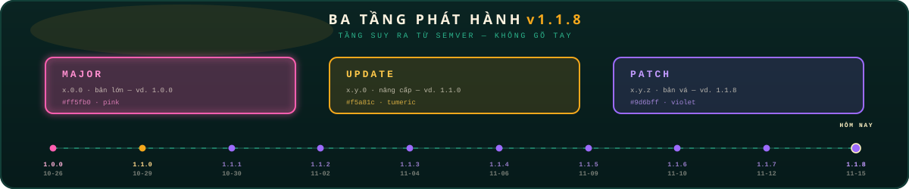

<div align="center">


# LỌ CHÉO — 절임항아리 대격전

### 🫙 브라우저에서 100% 동작하는 베트남식 절임 아케이드 — 단일 HTML 파일, 오프라인 우선
### 🌐 게임 내 7개 언어 — Tiếng Việt · English · 中文 · 日本語 · 한국어 · Español · Français

[🇻🇳 Tiếng Việt](README.md) · [🇬🇧 English](README.en.md) · [🇨🇳 中文](README.zh.md) · [🇯🇵 日本語](README.ja.md) · [🇰🇷 한국어](README.ko.md) · [🇪🇸 Español](README.es.md) · [🇫🇷 Français](README.fr.md) · [🇹🇭 ไทย](README.th.md) · [🇩🇪 Deutsch](README.de.md) · [🇵🇹 Português](README.pt.md)

[](docs/releases/v1.1.8.md)
[]
[]
[](https://github.com/standardizeparadigm/LoCheoIO/actions/workflows/ci.yml)
[](LICENSE)
[](#-설치--실행)
[](#프로덕션-빌드)
[](#-언어-전환)
[](CONTRIBUTING.md)


</div>

---

## 🥒 프로젝트 소개

> Lọ Chéo — 절임항아리 대격전: 브라우저에서 100% 실행되는 절임 아케이드. 하나의 자기완결적 HTML 파일에 담긴 오프라인 우선 설계 — CDN 없음, 서버 없음. 이 도자기 항아리는 **대각선**으로만 움직일 수 있습니다. 두 개의 키를 눌러 대각선으로 질주하고, 가속하고, 곰팡이·파리·배추벌레를 잘게 썰며, 항아리가 세 조각 나기 전에 가득 채워보세요! **9가지 모드 · 14가지 재료 · 16개 업적 · TOP 8 랭킹 · 게임 내 7개 언어.**

베트남의 소박한 절임 음식에서 영감을 받은 **단일 화면 액션 아케이드**입니다. 선형 레벨도, 복잡한 메뉴도 없습니다 — 오직 항아리와 끝없이 쏟아지는 절임 재료, 그리고 불꽃 같은 반사신경만 있을 뿐.


## 🆕 v1.1.8 새로운 점

> 1.2.0 전 **마지막 패치**. 새 모드 없음, 밸런스 변경 없음, 저장 형식 변경 없음. 이번 마지막 라운드가 하는 일은 하나 —— **히어로가 창을 측정해 스스로 레이아웃을 고른다**. 레이아웃이 성립하는 모든 크기에서(356px 이상) 스크롤도 잘림도 없이. 덱 띠는 사라지고, SVG는 모두 26개(9라운드 HUD 밴드 도해, 12라운드 감사 보고서, 13라운드 선택 도해)이며, 네 번째 코퍼스(사건)와 6단계 자동 수리 사다리를 더했다.

### 📐 아무도 관리하지 않던 덧셈 하나——그리고 동시에 네 개의 버그

스크린샷은 네 가지 문제를 보고했지만 원인은 **하나**였습니다. 코너 패널 행과 티커는 `shrink-0` 플렉스 형제라 먼저 자기 높이를 가져가고, 남은 것만 히어로에게 돌아갔습니다:

```
720px 창
├── 415px   GAME/INFO 패널 행   (내용에 따라 높이 결정, shrink-0)
├──  55px   티커               (글자에 따라 높이 결정, shrink-0)
└── 250px   히어로             ← 남은 공간. 필요한 양은 약 430px
```

| 스크린샷의 증상 | 원인 |
| --- | --- |
| `LỌ`가 위쪽 가장자리에서 잘림 | 히어로 250px, 내용 430px |
| `CÀI ĐẶT`가 패널 밖으로 넘침 | 패널이 창이 아니라 내용으로 높이를 정함 |
| 저작권 줄이 두 동강 | 티커는 55px 필요하지만 48px만 배정 |
| 「플레이 방법」의 `×`가 화면 가운데에 뜸 | 그것을 담은 아코디언이 이미 화면 밖으로 스크롤됨 |

해결은 몇 픽셀의 여유를 더 주는 것이 아니라, **높이를 한 번만 선언하고 모두가 그것을 다시 읽게** 하는 것이었습니다: `layout/metrics.ts`가 모든 숫자를 갖고, `layout/fit.ts`가 순수 `MenuPlan`을 돌려주며, `MenuChrome`은 `absolute inset-x-0 bottom-0` 한 줄이 되고, 히어로는 **같은** 함수가 계산한 `padding-bottom`으로 자리를 확보합니다.


### 🌀 스크롤 버그: 스크롤 영역 안의 스크롤 영역

아래는 고정인데 위는 여전히 위아래로 끌린다——설명 그대로였습니다. v1.1.7은 히어로 내용을 `overflow-y-auto`로 감싸고 `min-h-full` + `justify-center`로 가운데 정렬했습니다. 이는 내용이 상자보다 **낮을 때만** 맞습니다. 내용이 **높아지면** `justify-center`가 위로 밀어 올리고 그 꼭대기는 *스크롤 원점 위*에 놓입니다——어떤 스크롤 위치도 닿지 못합니다.

이제 화면 전체에 **하나**의 스크롤 영역(`.menu-scroll`)만 있고, 내용은 위쪽에 고정되며 세로 가운데 정렬은 하지 않습니다. 원인이 된 세 클래스——`flex-1 overflow-y-auto`, `min-h-full`, `justify-center`——는 `tests/menu-layout.test.ts`가 재발을 금지합니다.

### 🎯 히어로: `LỌ CHÉO`를 가운데로, 조금 위로

- 제목은 **가로 가운데**에 놓인 뒤 **조금 위로** 올라갑니다. 글자 크기는 너비와 높이 **모두**로 제한되어 낮은 창에서도 글리프가 넘치지 않습니다.
- 도자기 항아리는 오른쪽으로 옮겨졌고 주위에 **18s / 26s / 34s 세 개의 광환**——예전의 14s 단일 링은 로딩 스피너로 읽혔습니다.
- 제목 위아래 두 띠에 **장식 14개**(별, 불꽃, 고리, 방울, 고추, 라임 잎, 파리, 액젓 방울)가 각자의 주기와 지연을 갖고 배치됩니다——"LỌ CHÉO와 항아리만으로는 너무 적다"는 지적에 대한 답입니다.
- 좌표는 `scene/decor.ts`의 **데이터**이고 충돌 판정 함수가 있어, `tests/menu-decor.test.ts`가 위치와 개수를 모두 고정합니다.

### 📖 「플레이 방법」을 GAME 메뉴로

여섯 규칙과 키 표는 더 이상 히어로에 없습니다——열면 `LỌ`가 화면 밖으로 밀려났기 때문입니다. 이제 **GAME 패널의 한 행**이 되어 모달(`HowToModal`)을 엽니다. 열든 닫든 레이아웃은 움직이지 않습니다. 화면 가운데에 뜨던 `×`는 그것을 낳은 아코디언과 함께 사라졌습니다.

### 🗂️ 프로젝트에 또 새 폴더

```
src/components/menu/
├── layout/          metrics.ts · fit.ts · useMenuPlan.ts       ← 신규: 모든 숫자를 한곳에
├── scene/           decor.ts · DecorGlyph · HeroDecor · JarHalo ← 신규: 장식된 히어로
├── ticker/          keys.ts · MenuTicker           ← 신규: 띠를 독립 모듈로
├── howto/           rules.ts                                    ← 신규: 6 규칙 + 키 표
├── background/      layers.ts · MenuBackground                  ← 8겹 배경을 데이터로 선언
└── MenuChrome.tsx · HowToModal.tsx                              ← 신규: 하단 띠 + 모달
```

### 🐛 수정

| # | 버그 | 수정 |
| --- | --- | --- |
| 1 | 아래는 고정인데 위는 여전히 스크롤됨 | 중첩 스크롤 상자를 제거, 위쪽 고정 `.menu-scroll` **하나**로 |
| 2 | `LỌ`가 위쪽 가장자리에서 잘림 | 히어로가 342px 씬을 유지, 250px로 눌리지 않음 |
| 3 | `CÀI ĐẶT`가 GAME 패널 밖으로 넘침 | `CornerPanel.height`를 **필수 인자**로: 318px(컴팩트) / 458px(리치) |
| 4 | 저작권 줄이 두 동강 | 티커 고정 48px, 저작권은 마키와 같은 블록에 |
| 5 | 「플레이 방법」의 `×`가 화면 가운데에 뜸 | 아코디언 → 모달, 흘러간 상자에 `absolute` 없음 |
| 6 | 패널 높이가 번역 길이를 따름(독일어·태국어가 먼저 넘침) | 높이를 선언, 내용과 무관 |
| 7 | 14s 단일 링이 스피너로 읽힘 | 18s / 26s / 34s 세 링, 거의 동위상이 되지 않음 |
| 8 | 문서/SVG/런처가 버전보다 뒤처짐 | 10 README + docs + 19 SVG 전수 점검 → 1.1.8 |

→ 전체 내용: [docs/releases/v1.1.8.md](docs/releases/v1.1.8.md) · 이전 버전: [docs/releases/v1.1.7.md](docs/releases/v1.1.7.md)

### 🪟 스크린샷 두 장, 같은 창, 260픽셀 차이

이번 라운드의 마지막 두 장은 **같은 앱**입니다. `1920×1080` 전체 화면과 `1920×820` 창 모드. 너비는 1픽셀도 바뀌지 않았습니다. 그런데 두 번째에서는 히어로의 아래 절반이 두 모서리 패널 **아래로** 들어가고 `CHẾ ĐỘ CHƠI` 칩이 반으로 잘려 있습니다.

원인은 높이 부족이 아니라 **잘못된 질문**입니다:

| 레이아웃을 결정하는 것 | 아는 것 | 모르는 것 |
| --- | --- | --- |
| CSS의 `sm:` · `lg:` | **너비** | **높이** |
| `plan.minimal` | **높이** (220px 미만) | 너비, 그리고 이미 늦은 뒤에야 |
| `heroLayout()` (신규) | **둘 다**, 크롬이 쓰는 같은 숫자에서 | — |

*두 축*에 의존하는 결정은 한 축 미디어 쿼리로 쓸 수 없습니다. 그래서 히어로 레이아웃이 CSS를 떠나 순수 함수가 되었습니다: `heroLayout({ scene, width, minimal })`.

`scene`은 `planMenuLayout()`이 히어로에 배정한 높이 —— **크롬이 예약하는 바로 그 숫자**입니다. 둘 다 한 함수에서 읽으므로 어긋날 수 없습니다.

#### 세 개의 임계값, 모두 유도됨

| 상수 | 값 | 유도 원천 |
| --- | --- | --- |
| `HEIGHT_FOR_BADGE_ROW` | **232** | 워드마크 150 + 배지 40 + 라이브 배지 22 = 212, + 여백 20 |
| `HEIGHT_FOR_HALO` | **300** | 록업 150 + 헤일로 링 240 − 겹침 90 |
| `HEIGHT_FOR_SIDE_BY_SIDE` | **300** | 더 높은 열: 마스코트 192 + 칩 24 + 여백 |

`232`는 **잡아낸 버그**입니다. 첫 초안은 `210`이었습니다 —— 자기가 제어하는 212px 록업보다 아래. 210px 띠가 212px 록업을 그려 기록 줄이 잘렸습니다. 이 라운드가 고치는 바로 그 종류의 버그를 수정 자체가 만들어낸 셈입니다.

`tests/menu-adaptive.test.ts`는 **1,682개 뷰포트**를 훑고 각 샘플에서 `heroContentHeight(layout) ≤ scene`을 확인합니다.

### 🧱 여덟 번째 라운드: 여섯 층, 하나의 프로필

히어로가 자기 창을 재게 된 뒤에도 나머지는 여전히 추측했습니다. 모달은 **상한 없는** `86vh`, 게임오버 제목은 고정 `text-6xl`, 패널은 스스로 `cornerRowHeight()` 를 호출했고 `engine.resize()` 는 병 반지름을 직접 계산했습니다. **여섯 곳이 여섯 번 읽는** 구조 — 두 번의 읽기가 서로 다른 프레임에 떨어질 수 있습니다.

v1.1.8 은 이것을 **하나의 상자에 대한 하나의 순수 함수**로 모았습니다:


| | | |
| --- | --- | --- |
| 1 · Box | `adaptive/viewport.ts` | `w · h · inset · dpr` |
| 2 · Tier | `adaptive/tiers.ts` | `xs`…`xxl` |
| 3 · Plan | `layout/fit.ts` | `scene · reserve · fit` |
| 4 · Density | `adaptive/density.ts` | 54/34/26px · 318/458→234 |
| 5 · Hero | `adaptive/hero.ts` | row / stack · lockup |
| 6 · Type | `adaptive/typeScale.ts` | 17 × `--type-*` |
| 7 · Modal | `ui/modalPlan.ts` | w × h × columns |
| 8 · Board | `game/adaptive/playfield.ts` · `game/adaptive/hud.ts` | `itemScale` · `hudScale` · băng HUD |

새 불변식 `panel + 여백 ≤ reserve` 는 **844×390**(가로 iPhone, 보고서 스크린샷의 크기)에서 빨개집니다. `reserveFor()` 는 푸터를 그리지 않을 때 30px 을 빼지만, `panelHeightForPlan()` 은 밀도만 보아 전체 높이를 그렸습니다 — 216px 대역에 234px 패널, **아래 18px 이 화면 밖**.

**1 620장의 숫자 스냅샷**이 이를 고정합니다: `tests/fixtures/adaptive-matrix/`(1 110개 창, 창마다 파일 하나)와 `tests/fixtures/hero-bands/`(510개의 「너비 × 대역」). `npm run check:adaptive` 는 21행 표와 여섯 불변식을 브라우저 없이 확인합니다.

### 🌍 두 번째 층 — 크기가 아니라 환경

창 높이는 곧 쓸 수 있는 높이가 아닙니다. iPhone에서는 주소창과 홈 인디케이터가
일부를 차지하고, 확대하면 `visualViewport`가 `innerHeight`보다 작아집니다.
그래서 순수하고 React에 의존하지 않는 층을 따로 두었습니다
(`src/components/menu/adaptive/environment.ts`).

```ts
type Environment = {
  dpr: number;            // [1, 4]로 제한
  landscape: boolean;
  coarse: boolean;        // 마우스가 아니라 손가락
  insetTop / Right / Bottom / Left: number;
  reducedMotion: boolean;
};
```

틀리기 쉬운 네 가지와, 대신 택한 처리:

1. **`env()`는 `getComputedStyle`로 읽을 수 없습니다.** `env(safe-area-inset-*)`를
   *사용하는* 요소가 있어야 계산된 패딩이 의미를 갖습니다. 첫 판은 **네 개**의
   프로브 요소(변마다 하나)를 만들어 리사이즈마다 네 번의 강제 레이아웃을
   일으켰습니다. 지금은 **하나**의 요소에 네 개의 패딩, 그리고 `finally`에서
   반드시 제거합니다.
2. **`pointer: coarse`는 `resize` 없이도 바뀝니다.** 하이브리드 기기는 마우스와
   손가락을 계속 오갑니다. 훅은 `resize`뿐 아니라 **두** 미디어 쿼리를 모두
   구독합니다.
3. **인셋 `0`은 정당한 값입니다.** 다른 숫자 필드용 `sane()`은 하한이 1이라,
   이것을 인셋에 쓰면 「노치 없음」이 「1px 노치」가 됩니다.
4. **인셋은 쓸 수 있는 높이에서 빼고, 장면에서는 빼지 않습니다.**
   `usableHeight(h, inset) = clamp(h − inset, 1, ∞)`이며 `planFits`와
   `occupiesExactly`가 모두 이 경로를 지나므로 둘이 어긋날 수 없습니다.

`tests/environment.test.ts`는 `saneDpr`(`NaN`·`−1`·`7` 포함), `parseInset`,
`verticalInset`, `isHandheld`를, `tests/use-environment.test.ts`는 가짜
`window`와 `document`(jsdom 없이)를 만들어 **예외를 던지는** `matchMedia`와
**body가 없는** 문서까지 덮습니다.

### ⚠️ 알려진 한계 — 숨기지 않고 기록합니다

**844×600**에서 인셋이 없는 창은 hero에 222px를 주고, 인셋 10px를 더하면
**268px**를 줍니다. 더 작은 창이 hero는 46px 더 높아집니다. 원인은 전체 높이가
이산적인 임계값으로 나뉘고, 작은 인셋이 합계를 임계값 너머로 밀어 경제档을
바꾸기 때문입니다.

이것은 **실재하고, 작고, 이전부터 있던** 결함입니다. `scene`을 최대화하는 여덟
경제 탐색을 시도했지만 **실패**합니다. 1920×1080에서 티커와 높은 행을 잘라내는데,
그것이 바로 플레이어가 보는 것입니다. 되돌렸습니다. 대신
`tests/layout-inset.test.ts`가 **측정값 그대로**(222 → 268, +46)를 통과하는
테스트로 단언합니다. 고친 사람은 테스트를 깨뜨려 갱신을 강제받고, 그전까지는
적어도 기록으로 남습니다. 옆에는 실제로 성립하는 불변식이 있습니다. *하나의*
경제 안에서 `scene + reserve === usableHeight`(252가지 조합 검증).

#### 빠져 있던 네 번째 이벤트

사용자는 이 두 장을 **전체 화면 키를 눌러** 만들었습니다. 앱은 `resize`와 `orientationchange`를 듣고 있었습니다. Firefox는 전체 화면 전환에서 둘 다 발생시키지 않습니다. 구형 Safari는 `webkitfullscreenchange`만 발생시킵니다. 그래서 창 높이가 바뀌었고, 히어로는 옛 계획을 유지했고, 칩은 다음 리사이즈까지 잘린 채였습니다.

`VIEWPORT_EVENTS`는 여섯 가지 표기를 한곳에 모읍니다. `useMenuPlan()`과 `useViewportWidth()` **둘 다** 필요로 하기 때문입니다 —— 이전에는 각자 자기 복사본을 등록해서, 두 복사본이 서로 다른 창을 설명할 수 있었습니다.

### 🗑️ 이미지 12의 구분 띠 —— 그리고 함께 사라진 덱

세 번째 이미지는 화면 중앙에서 잘라낸 `1443×180` 띠입니다. `🎮` 마커, 금색 괘선, 그리고 `GAME / 오늘의 도전 / 오늘의 규칙` 세 제목. 이것이 **덱** —— 고정 높이 띠 안의 세 열 산문입니다.

거기 있을 수 없습니다. 다른 두 장이 이유를 보여줍니다: `1920×1080`에서는 오른쪽 열이 **문장 중간에서** 잘렸고, `1920×820`에서는 행 전체가 패널 아래였습니다. 200px 워드마크에 맞는 높이의 띠가 세 문단에도 맞지는 않습니다.

덱이 말하던 것 중 잃은 것은 없습니다:

| 덱의 내용 | 지금 있는 곳 |
| --- | --- |
| 플레이할 모드 | 마스코트 아래 칩. 전체 목록은 GAME 안 |
| **오늘의 도전** | INFO 패널의 한 줄 —— `모드 · 목표` |
| 오늘의 규칙 | 방법 모달의 한 줄. 원래부터 그 여섯 규칙의 완전판 |

날짜 계산은 **함께 가지 않았습니다**. `challengeFor()`와 `tipIndexFor()`는 `src/game/daily/`로 옮겼고, 21개 테스트와 이름도 그대로 따라갔습니다.

워드마크 아래의 빈 띠는 이제 **의도적**입니다. 그것이 모든 크기에서 맞는 히어로의 값입니다.

### 🏷️ 이력의 계층——계층마다 한 색

| 계층 | 라벨 | 색 | 의미 | 예 |
| --- | --- | --- | --- | --- |
| `major` | **MAJOR** | 🩷 핑크 `#ff5fb0` | 큰 버전——시스템 추가 | 1.0.0 |
| `minor` | **UPDATE** | 🟡 금색 `#f5a81c` | 업그레이드——내용 추가 | 1.1.0 |
| `patch` | **PATCH** | 🟣 보라 `#9d6bff` | 수정과 정리 | 1.1.1 → **1.1.8** |

계층은 `tierFor(version)`이 **SemVer에서 유도**하며 손으로 쓰지 않습니다. 패널에는 **필터**(전체 · MAJOR · UPDATE · PATCH)와 계층별 개수가 있습니다.




### 🔟 9라운드: HUD도 하나의 계획이 되고, `diagnose()`가 *왜*를 답합니다

8라운드에서 메뉴 전체가 하나의 profile을 갖게 되었습니다. 손으로 그리던 것은 단
하나, `engine.ts`의 HUD였습니다 — 좌표를 계속 더해 가는 `fillText` 연쇄로, 1280×720
에서만 맞았습니다.

`planHud()`는 각 표시에 **글리프 밴드**(`baseline − 0.72 × size`, 높이 `0.97 ×
size`)를 주고, 좌우 열을 고정하며, 가운데 열을 `clockY`에서 **흐르게** 배치합니다.
들어가지 않으면 정보가 적은 것부터 버리고(`chips → combo bar → jars → best`),
0.02 단위로 0.55 하한까지 압축합니다.

1 500개 보드 스윕: 옛 공식은 **4 004**쌍이 겹쳤고, 새 계획은 플레이 가능한 보드에서
**0**입니다. `playable()` 미만에서 남는 겹침은 `traceHud().collisions`로 **보고**
됩니다.

이번 라운드에는 크기순 **21개 프리셋**(320×480 → 3840×2160), `constraints.ts`의
**12개 불변식**(테스트·`check:adaptive`·문서가 같은 목록), 그리고 스크린샷의 질문에
답하는 `diagnose()`도 포함됩니다.


### 1️⃣1️⃣ 10라운드: 모드 칩이 오른쪽을 잃지 않습니다

스크린샷의 보고는 "클래식을 고르면 오른쪽이 사라진다"였습니다. 원인은 숫자가 아니라
**가정**이었습니다. 칩은 `absolute; left: 50%; translateX(-50%)`로 마스코트 열 안에
있었고 `max-width`가 없었습니다.

```
세로 배치  마스코트가 가운데  →  칩도 가운데  →  정상
가로 배치  마스코트가 오른쪽 끝  →  칩 절반이 화면 밖
                                  .menu-hero { overflow: hidden }  →  잘림
```

가장 긴 이름 «MUỐI DƯA CỔ ĐIỂN»(19자)만 눈에 띄게 잘려서 "클래식이 고장났다"로
보였지만, 실제로는 모든 이름이 조금씩 잘리고 있었습니다.

이제 칩에는 **두 개의 독립적인 보증**이 있습니다. CSS가 상자를 지키고(가로 배치에서
안쪽 가장자리에 정렬, 단단한 `max-width`), `planModeChip()`이 단계(`full →
label-dropped → name-shrunk → ellipsis`)를 지킵니다. 폭 추정이 6% 틀려도 더 작은
칩을 고를 뿐, 잘린 칩을 고르지는 않습니다.

이번 라운드에는 `heroBandWidth()`, **새 불변식 2개**(12 → **14**), **세 번째 코퍼스**
(189개 스냅샷, 21 프리셋 × 9 모드)도 포함됩니다.


### 11라운드 —— 베트남어 성조 부호가 더 이상 잘리지 않습니다

이번 스크린샷은 "오른쪽 절반이 사라짐"이 아니라 **"부호가 사라짐"**이었습니다.
칩이 «MUỐI DƯA CỔ ĐIÊN»로 읽혔고, **Ể**의 곡절 부호만 사라졌으며 앞의 **Ổ**는
그대로였습니다. 원인은 **10라운드의 회귀**입니다. `truncate`는 가로만 자르지
않습니다. `overflow: hidden`은 **줄 상자**를 자르고, 베트남어는 성조 부호를 곡절
위에 겹쳐 놓기 때문에(`Ố Ổ Ể Ấ Ự`) 대문자 높이보다 약 **0.35em** 위까지 잉크가
올라갑니다.

세 층을 각각 고쳤고, 서로 겹치지 않습니다.

| 층 | 이전 | 이후 |
| --- | --- | --- |
| 문자열 | CSS 말줄임 | `planModeChip()`이 문자열을 자르고 `…`를 붙임 |
| 줄 상자 | 1.2em | **1.5em** (`MODE_CHIP_LINE_HEIGHT`) |
| 자르는 상자 | 이름 span의 `truncate` | **하위 트리에 `overflow` 없음** |

여기에 **`.clip-safe`** —— 번역되는 모든 텍스트에서 `truncate`를 대신합니다.
`padding-block: .24em`이 자르는 상자를 잉크에서 떼어내고, `margin-block: -.24em`이
그 공간을 레이아웃에 돌려주므로 어떤 줄도 움직이지 않고 부호만 남습니다. 여섯
곳이 이 유틸리티로 바뀌었습니다. `chipBoxHeight()`는 추측 상수를 대체합니다.
칩이 3.3px 높아진 것은 `heroContentHeight()`의 일이므로, 기억이 아니라 측정값을
읽습니다.

자세히: [docs/releases/v1.1.8.md §18](docs/releases/v1.1.8.md#18-vòng-11--dấu-tiếng-việt-bị-css-cắt).


### 12라운드 —— 창 공간 전체 감사, 그리고 자동 수리 사다리

지난 세 라운드는 각각 **하나**의 코퍼스를 추가했습니다. 그러나 그 어느 것도 릴리스
전에 관리자가 묻는 질문에 답하지 못했습니다: *플레이 가능한 **모든** 창에서 레이아웃은
무엇을 얼마나 했고, 무엇이 깨졌는가?*

이제 `npm run audit:adaptive`가 답합니다: **578**개 창(21개 프리셋 + 모든 브레이크포인트
주변의 25 × 23 격자, 중복 제거). 한 번 해석하고 하나의 `AuditReport`로 모읍니다.

| | |
| --- | --- |
| 창 | **578** |
| 계약 위반 | **0** —— 각 창이 14개 불변식을 모두 실행 |
| LỌ CHÉO만 | 101 (17%) |
| Hero 가로 / 세로 | 170 / 408 |
| Scene | 140px (320×320) … 1 642px (3840×2160) |

`docs/adaptive-audit.md`는 그 보고서의 **자동 생성** 사본이고, `audit:adaptive --check`는
`npm run check` 안에서 실행됩니다. 그래서 브레이크포인트나 글자 크기 하한을 바꾸면
**그것을 일으킨 바로 그 커밋에서** diff로 드러납니다. "무언가를 개선하면 주변에 미치는
영향을 확인한다"는 원칙을 기계에 맡긴 셈입니다.

함께 **자동 수리 사다리** `repair/`가 있습니다: 여섯 단계 —— `as-planned → ignore-inset →
compact-hud → single-column → smaller-type → smallest-type`. 순서 자체가 원칙입니다:
**글자가 마지막**, 8px 하한은 약속이기 때문입니다. 앱은 578개 창 모두에서 0단계에
머물고, 사다리는 *쓸 수 있도록* 존재하며, 테스트는 더 엄격한 계약을 넘겨 실제로 내려가는
것을 증명합니다.

그리고 **네 번째 코퍼스**: 스크린샷 보고의 대상이 되었던 14개 창(1라운드 → 12라운드).
각 파일이 `symptom`과 `guard`를 지니므로, 실패는 두 숫자가 아니라 가게에 대한 한 문장
으로 읽힙니다.

자세히: [docs/releases/v1.1.8.md §19](docs/releases/v1.1.8.md#19-vòng-12--kiểm-toán-cả-không-gian-và-thang-tự-sửa) ·
가이드: [docs/guides/adaptive-audit.md](docs/guides/adaptive-audit.md).


### 13라운드 —— *맞는* 것을 넘어 *가장 싼* 것

12라운드는 "불변식이 깨졌는가"라는 예/아니오에 답하는 감사를 만들었습니다. 하지만
스크린샷이 올 때마다 두 번째 질문은 남습니다: **더 싼 레이아웃이 있는가?**

이번 라운드가 답합니다. `select/`는 각 프로필에 **일곱 항**을 주고 **사전순**으로
비교합니다. 가중 합을 쓰지 않는 이유는, 가중치가 우연히 그렇게 더해지면 40px 여유가
"잃어버린 마스코트를 되사는" 일이 될 수 있기 때문입니다.

| # | 항 | 플레이어가 잃는 것 |
| --- | --- | --- |
| 1 | `violations` | 없음 —— 계약 위반은 후보가 아님 |
| 2 | `hidden` | 마스코트 · 덱 · 태그라인 |
| 3 | `cropped` | 자기 하한보다 부족한 px |
| 4 | `hudLost` | HUD 배율의 비율 |
| 5 | `typeDrop` | 글자 px(전체 합) |
| 6 | `levers` | 움직인 개수 —— 플레이어는 못 봄 |
| 7 | `slack` | 남는 공간 —— 손실이 아니라 동점 처리용 |

"점수판"과 "정말 올바른 비교"를 가르는 두 가지:

- **`hidden` / `cropped`는 기준 프로필과의 차이로 잽니다.** 320×320 창은 레버를
  당기기 전부터 wordmark뿐이고 전부터 crop입니다 —— 그것은 창이지 희생이 아닙니다.
  원시 플래그로 재면 앱이 지금 그리는 프로필에 "hidden 1"을 보고합니다.
- **`levers`는 override가 아니라 프로필에서 셉니다.** inset이 없는 창에서
  `ignoreInset`은 아무것도 바꾸지 않으므로 당긴 것으로 치지 않습니다 —— 그래서
  **동점이 실재하고**, 동점 처리는 `sort`가 본 순서가 아니라 사다리 위치입니다.

이번 라운드가 얻고 검증할 수 있는 명제:

```
npm run audit:adaptive -- --select
  shipped profile wins   578 / 578
```

> 플레이 가능한 모든 창에서, 출시 중인 프로필이 여섯 단 중 가장 싸다.

12라운드는 "깨진 것이 없다"고 했고, 13라운드는 "더 싼 것이 없다"고 합니다. 더 강한
명제는 틀리기도 쉬우므로 전용 **다섯 번째 코퍼스**가 있습니다:
`tests/fixtures/selection/` —— 12개 창, 각 파일은 레이아웃이 아니라 *결정*을 기록합니다.
여섯 단 전체 순위, 차점, 그리고 각 단이 진 이유. 임계값이 움직이면 diff는 **결정**이
바뀌었다는 것을 보여 줍니다 —— 리뷰에서 정말 승인해야 하는 것.

자세히: [docs/releases/v1.1.8.md §20](docs/releases/v1.1.8.md#20-vòng-13--không-chỉ-đúng-mà-rẻ-nhất) ·
가이드: [docs/guides/adaptive-selection.md](docs/guides/adaptive-selection.md).


세 번째도 같은 모양입니다: **`crop` 단은 막다른 길이었습니다.** 감사의 578 창 중 25 창이
`fit: "crop"`(모두 높이 320px)입니다. 세 불변식이 이 단을 면제합니다 — 맞습니다, 들어맞는
배치가 없으니까요 — 하지만 `.menu-pane`은 `overflow: clip`이라 넘친 부분에 **닿을 수
없었습니다**: 두 패널의 아래쪽과 START 버튼, 그리고 그것을 알리는 불변식은 없었습니다.
이제 `[data-adaptive-fit="crop"] .menu-pane`이 메뉴의 유일한 세로 스크롤 영역이고,
**356px** 이상의 창은 여전히 픽셀 단위로 맞습니다.

### 14라운드 —— 버그 수정: chip 계약은 일곱 언어를 세어야 한다

이번 라운드는 아무것도 추가하지 않았습니다. 찾은 것은 "약속이 그것을 검사하는 것보다
넓게 말해진 곳"입니다.

chip은 **네 곳**에서 베트남어 리터럴로 측정되고 있었습니다(`CHIP_LABEL = "CHẾ ĐỘ CHƠI"`,
`CHIP_NAME = "MUỐI DƯA CỔ ĐIỂN"`) —— 그리고 베트남어는 일곱 언어 중 **가장 짧습니다**:

| | 라벨 | 가장 긴 모드 이름 |
| --- | --- | --- |
| vi | `CHẾ ĐỘ CHƠI` (11) | `MUỐI DƯA CỔ ĐIỂN` (19) |
| es | `MODOS DE JUEGO` (14) | `60 SEGUNDOS DE LOCURA` (21) |
| fr | `MODES DE JEU` (12) | `FESTIVAL DES COMBOS` (19) |

그래서 `chip-labelled`는 *"모든 플레이 가능한 창에서 라벨이 남는다"*고 주장했지만,
스페인어는 320px와 360px에서, 프랑스어는 320px에서 라벨을 잃고 — 감사는 **위반 0**을
보고했습니다.

이제 `chip/probes.ts`가 `localeTable()` + `MODE_LIST`에서 프로브를 만들고,
`chip-labelled`는 검사 가능한 명제가 되었습니다: **chip은 두 단을 동시에 잃지 않는다**.
감사는 실제로 일어나는 일을 보고합니다: **439 full · 101 hidden · 38 label-dropped**.

같은 형태의 작은 버그 셋도 함께 고쳤습니다: `scoreProfile()`의 위반 목록이 정렬되지
않았고(마지막 동점 판정이 삽입 순서에 의존), `isFiniteProfile()`은 `playfield`/`modal`을
보지 않았고, `slackOf()`는 `constraints.ts`와 같은 로크업 박스에 다른 반올림을 썼습니다.
그리고 `--select`는 존재하지 않는 수를 인쇄하지 않습니다: 18 × 36의 곱을 "648 창"이라
불렀지만 감사는 578을 훑습니다 —— 이제 `578 / 578`, 같은 목록입니다.

새 기능 없음, 레이아웃 변경 없음, 버전 변경 없음. **1 412 테스트 / 137 파일**(이전
1 398)과, 자기가 무엇을 검사하는지 말하는 계약뿐입니다.


## 📐 적응형 레이아웃 — 히어로가 자기 모양을 고르는 방법

시작 화면은 레이아웃을 미디어 쿼리로 결정하지 않습니다. 창을 **측정**하고 다섯 가지 능력 중에서 고릅니다: `sideBySide`·`halo`·`badgeRow`·`mascot`·`liveBadge`.

```
planMenuLayout(viewport) → { scene, reserve, … }    scene + reserve = 높이
            │
            └─ scene은 크롬이 예약하는 바로 그 숫자
                        │
    heroLayout({ scene, width }) → 5개의 불리언
```

| 플래그 | 켜지는 조건 | 꺼지면 사라지는 것 |
| --- | --- | --- |
| `sideBySide` | 너비 ≥ 1024 **그리고** 히어로 ≥ 300px | 마스코트가 워드마크 아래로 내려감 |
| `halo` | 히어로 ≥ 300px | 단지 주변의 링 |
| `badgeRow` | 히어로 ≥ 232px | 「HŨ DƯA ĐẠI CHIẾN」판과 기록 줄 |
| `mascot` | 거의 항상 | — (최소 경제에서만 숨김) |
| `liveBadge` | 히어로 ≥ 232px | 「주방에서 생중계」줄과 버전 |

세 임계값은 **둥근 숫자가 아닙니다** — 각각이 제어하는 대상의 실제 높이입니다:

```ts
HEIGHT_FOR_BADGE_ROW    = 232  // 150 워드마크 + 40 판 + 22 라이브 + 20 여백
HEIGHT_FOR_HALO         = 300  // 150 록업 + 240 링 − 90 겹침
HEIGHT_FOR_SIDE_BY_SIDE = 300  // 더 높은 열: 192 마스코트 + 24 칩
```

`tests/menu-adaptive.test.ts`는 **1,682개 뷰포트**를 훑고 각 샘플에서 `heroContentHeight(layout) ≤ scene`을 검증합니다. 크기 변경 시 두 훅이 **여섯** 이벤트를 듣고 한 프레임에 갱신합니다.

## ✨ 하이라이트

| 분류 | 세부 |
| --- | --- |
| 🎮 **9가지 게임 모드** | **클래식 절임**(균형형) · **ZEN**(위험물 없음, ×0.5) · **인페르노 칠리**(속도 +35%, ×1.5) · **60초 스프린트**(60초 타임어택, ×1.25) · **골드 러시**(황금 등장률 ×2.6) · **절임비 대폭풍**(~1.4배 밀도, ×0.75) · **얇은 도자기**(금 한 줄이면 종료, ×2.0) · **콤보 축제**(콤보 창 ×2, ×1.15) · **절임 대잔치**(밀도 ~×2, 항아리 ×2.5, ×0.6) |
| 🌐 **게임 내 i18n** | Tiếng Việt · English · 中文 · 日本語 · 한국어 · Español · Français — `src/i18n/`(pure 모듈 + React 브리지), 보간을 지원하는 `t()`, `<html lang>` 동기화, 로케일별 숫자 표기(vi-VN / en-US / zh-CN / ja-JP / ko-KR / es-ES / fr-FR) |
| 🕹️ **시그니처 “대각 베기(CHÉO)”** | 2개의 키/대각 축을 동시에 누르면 — 항아리가 가속·발광하며 위험물을 잘라냅니다. 깜빡임 방지 히스테리시스가 적용된 전용 스태미나 바 |
| 🥬 **14가지 재료** | 가지, 고추, 마늘, 생강, 소금, 겨자채, **황금 겨자채**(항아리를 빠르게 채움) · 황금소금/황금마늘 · 불타는 고추 · 얼음 · 곰팡이, 파리, **배추벌레**(위험물) |
| 🧄 **황금마늘 실드** | 파워업: 최대 **2겹** 실드를 쌓아 금이 가는 것을 흡수. 항아리 주위를 도는 회전 후광 |
| 🏆 **16개 업적** | **판을 넘나드는** 누적 저장(localStorage), 게임 오버 화면에 “새 업적!” 토스트 |
| 🔊 **수제 오디오** | Web Audio API로 합성한 효과음 11종(파일 없음) + 레벨에 따라 변주되는 오음계 배경음, `M`으로 음소거 |
| 💾 **TOP 8 명예의 전당** | 로컬 저장, 읽기 시 검증·정규화, 이름 자동 대문자화, 신기록 하이라이트 |
| 🎨 **60fps 그래픽** | Canvas 2D, 파티클 상한 460, DPR 상한 2, 오프스크린에 사전 렌더링된 꽃문양 바닥, 별 반짝임 + 메뉴 오로라 |
| 📴 **진짜 오프라인 우선** | 셀프호스팅 폰트(latin + 베트남어 서브셋, woff2), CDN·API 없음 — `dist/index.html`을 더블클릭하기만 하면 끝 |
| 🧪 **품질 게이트** | modes / achievements / storage / i18n / settings을 커버하는 501개 단위 테스트(vitest) — `npm run check`가 CI 게이트 |


## 🌐 언어 전환

Lọ Chéo는 게임 내에서 **7개 언어 UI**를 지원합니다 — 새로고침 없이 즉시 적용, 진행 중인 판을 잃지 않습니다:


| 언어 | 위치 | 저장 위치 |
| --- | --- | --- |
| 🇻🇳 Tiếng Việt | **VI** 버튼 (기본값; 미설정 시 브라우저 언어를 따름) | `locheo.lang.v1` |
| 🇬🇧 English | **EN** 버튼 | `locheo.lang.v1` |
| 🇨🇳 中文 | **中** 버튼 | `locheo.lang.v1` |
| 🇯🇵 日本語 | **日** 버튼 | `locheo.lang.v1` |
| 🇰🇷 한국어 | **한** 버튼 | `locheo.lang.v1` |
| 🇪🇸 Español | **ES** 버튼 | `locheo.lang.v1` |
| 🇫🇷 Français | **FR** 버튼 | `locheo.lang.v1` |

- 언어 전환은 **설정 → 언어**(국기 버튼 7개 그리드)에서 — 단일 진입점, 메뉴 위 플로팅 스위처는 사라졌습니다.
- 사용자에게 보이는 모든 문자열은 `src/i18n/locales/{vi,en,zh,ja,ko,es,fr}.ts`에 있습니다 — Canvas 엔진, 화면, HUD, 팝업, 티커, 힌트.
- 키가 없으면? `t()`가 베트남어로 폴백 — 7개 locale의 키 집합과 플레이스홀더 일치는 테스트가 강제합니다.

## 🕹️ 조작 방법

| 동작 | 키보드 | 터치 |
| --- | --- | --- |
| 이동 | `W` `A` `S` `D` 또는 `← ↑ ↓ →` | 화면 아무 곳이나 드래그(플로팅 조이스틱) |
| **대각 베기 (CHÉO)** | **2개의 키를 동시에** 누르기(예: `A`+`W`) | **45° 대각선 드래그** — 조이스틱 링이 금색으로 |
| 항아리 내리치기 (충격파 + 흡인) | `Space` | 오른쪽 하단 빨간 **SLAM** 버튼 |
| 일시정지 / 계속 | `P` 또는 `Esc` | 오른쪽 상단 일시정지 버튼 |
| 즉시 재시작 | `R` (일시정지/게임 오버 중에도 가능) | “다시 절이기” 버튼 |
| 시작 / 확인 | `Enter` | **부엌으로** 버튼 |
| 음소거 / 해제 | `M` | 오른쪽 상단 스피커 버튼 |
| 언어 전환 | — (VI/EN/中/日/한/ES/FR 버튼 사용) | 메뉴 / 일시정지의 VI/EN/中/日/한/ES/FR 버튼 |

## 🚀 설치 · 실행

### 빌드 없이 바로 플레이

```bash
# 모든 릴리스에는 단일 자기완결 파일이 포함됩니다:
open dist/index.html      # macOS
xdg-open dist/index.html  # Linux
start dist/index.html     # Windows
```

### 프로덕션 빌드

```bash
npm install        # 의존성 설치 (Node ≥ 20.19)
npm run build      # → dist/index.html (단일 자기완결 파일)
```

> `vite-plugin-singlefile`이 모든 JS/CSS/폰트/이미지를 **하나의** `dist/index.html`(약 700 KB, gzip 약 355 KB)에 인라인합니다. 서버도 네트워크도 필요 없습니다.

### 개발

```bash
npm run dev        # HMR이 적용된 개발 서버 (http://localhost:5173)
npm run preview    # 프로덕션 빌드를 로컬에서 확인
npm run typecheck  # tsc --noEmit (strict, noUnusedLocals…)
npm run test       # vitest — 256개 단위 테스트 (modes / achievements / storage / i18n / settings)
npm run check      # typecheck + test + build (CI 품질 게이트)
```

## 🗂️ 프로젝트 구조

```
lo-cheoio/
├─ index.html              # 엔트리, SEO/OG 메타 (CDN 없음)
├─ package.json            # lo-cheoio v1.1.8, dev/build/test/check 스크립트
├─ .gitattributes          # *.bat/*.cmd → CRLF · posix → LF · binaries
├─ vite.config.ts          # vite + react + tailwind v4 + singlefile
├─ tsconfig.json           # strict; src + tests 포함
├─ favicon.ico             # web icon (multi-size 16→256)
├─ public/                 # favicon.ico/png/svg served at web root
├─ assets/
│  ├─ banner.svg           # README 배너 (SMIL 애니메이션)
│  ├─ demo.svg             # 게임플레이 시뮬레이션 (SMIL 애니메이션)
│  ├─ items.svg            # 14가지 재료 (SMIL 애니메이션)
│  ├─ modes.svg            # 9가지 모드 (SMIL 애니메이션)
│  ├─ languages.svg        # 7 in-game languages (SMIL animation)
│  ├─ new-modes.svg        # the 2 new v1.1.4 modes (SMIL animation)
│  ├─ corner-menu.svg     # corner GAME/INFO panels (SMIL animation)
│  ├─ settings-sections.svg # 6-section settings tour (SMIL, v1.1.6)
│  ├─ divider.svg          # sparkle divider (SMIL animation)
│  ├─ license.svg          # AGPL-3.0 copyleft 인장 (SMIL 애니메이션)
│  └─ favicon.svg          # favicon (SMIL animation)
├─ scripts/
│  ├─ play-mac.command     # macOS 런처 — 더블클릭, 풀 컬러 메뉴
│  ├─ play-windows.bat     # Windows 런처 — 더블클릭, 풀 컬러 메뉴
│  ├─ play-linux.sh        # Linux 런처 — 더블클릭, 풀 컬러 메뉴
│  └─ README.md            # 터미널 초보자를 위한 런처 가이드
├─ docs/
│  ├─ README.md            # 문서 색인 (v1.1.5)
│  ├─ DESCRIPTION.md       # 다국어 프로젝트 소개 (vi/en/zh + SEO)
│  ├─ design/              # menu-corners / save-format / settings-format 스펙
│  ├─ guides/              # engine 개요 · a11y · 성능 · storage keys · 릴리스 절차…
│  └─ releases/
│     ├─ v1.0.0.md         # 첫 릴리스 노트
│     ├─ v1.1.0.md         # v1.1.0 릴리스 노트
│     ├─ v1.1.1.md         # v1.1.1 릴리스 노트
│     ├─ v1.1.2.md         # v1.1.2
│     ├─ v1.1.3.md         # v1.1.3 release notes
│     ├─ v1.1.4.md         # release notes (1.1.4)
│     ├─ v1.1.5.md         # release notes (1.1.5)
│     ├─ v1.1.6.md         # release notes (1.1.6)
│     └─ v1.1.8.md         # current release notes (1.1.8)
├─ README.md               # 🇻🇳 Tiếng Việt
├─ README.en.md            # 🇬🇧 English
├─ README.zh.md            # 🇨🇳 中文
├─ README.ja.md            # 🇯🇵 日本語
├─ README.ko.md            # 🇰🇷 한국어 (이 파일)
├─ README.es.md            # 🇪🇸 Español
├─ README.fr.md            # 🇫🇷 Français
├─ README.th.md            # 🇹🇭 ไทย
├─ README.de.md            # 🇩🇪 Deutsch
├─ README.pt.md            # 🇵🇹 Português
├─ src/
│  ├─ main.tsx             # React 루트, StrictMode
│  ├─ App.tsx              # 페이즈 머신 menu/playing/paused/gameover
│  ├─ version.ts           # APP_VERSION = "1.1.8" (단일 진실 공급원)
│  ├─ index.css            # tailwind v4 테마 + 모든 애니메이션/그라디언트
│  ├─ assets/fonts/        # woff2 서브셋 (Be Vietnam Pro ×6, Bungee)
│  ├─ styles/fonts.css     # @font-face + unicode-range, 100% 오프라인
│  ├─ i18n/
│  │  ├─ i18n.ts           # pure 모듈: 감지, 저장, t() + 보간
│  │  ├─ useI18n.ts        # React 훅: useI18n/useLanguage
│  │  └─ locales/          # vi.ts (키 소스) · en · zh · ja · ko · es · fr
│  ├─ components/
│  │  ├─ GameCanvas.tsx    # 캔버스 + 플로팅 조이스틱 + 키보드 + 가시성 처리
│  │  ├─ StartScreen.tsx   # 메뉴: 히어로 + 다층 애니메이션 + 코너 패널
│  │  ├─ menu/              # 코너 GAME/INFO 패널 + 모달 + icons/
│  │  │  └─ background/     # 8 background layers as data (v1.1.8)
│  │  ├─ ModeSelector.tsx  # 9개 모드 카드 (classic/zen/inferno/blitz/goldrush/storm/hardcore · combo · feast)
│  │  ├─ AchievementsPanel.tsx  # 잠김/해제 배지 벽
│  │  ├─ GameOverScreen.tsx     # 항아리가 깨졌다! + 점수 + 새 업적
│  │  ├─ PauseScreen.tsx        # 일시정지 + 판 통계
│  │  ├─ settings/           # 6개 섹션 설정 모듈 + 공용 컨트롤 (v1.1.6)
│  │  └─ ui/               # 8개 프리미티브, 파일 하나씩 (v1.1.8 — ui.tsx에서 분리)
│  ├─ game/
│  │  ├─ engine.ts         # 시뮬레이션과 캔버스 렌더링 전부 (약 2260줄)
│  │  ├─ modeTypes.ts      # ModeId · ModeConfig (types-only, v1.1.8)
│  │  ├─ modes/            # 9 balance records — classic.ts … feast.ts (v1.1.8)
│  │  ├─ modesIndex.ts     # MODES · MODE_LIST · isModeId (v1.1.8)
│  │  ├─ modeMath.ts       # multiplierForCombo · jarBonus · comboWindowFor… (v1.1.8)
│  │  ├─ modes.ts          # barrel — keeps every old import working
│  │  ├─ achievements.ts   # 배지 14개 + pure 체커 (pure)
│  │  ├─ storage.ts        # localStorage: TOP 8, 진행도, 업적
│  │  ├─ audio.ts          # Web Audio 신스: 효과음 + 오음계 음악
│  │  ├─ changelog/          # in-game changelog (v1.1.8 — split from one file)
│  │  │  ├─ types.ts        #   ChangelogEntry · ReleaseTier · copyFor()
│  │  │  ├─ tiers.ts        #   tierFor() · TIER_ORDER · TIER_LABEL_KEY
│  │  │  ├─ entries/        #   1 file per release — v1_0_0.ts … v1_1_7.ts
│  │  │  └─ index.ts        #   ordered list + 5 helpers
│  │  ├─ runSave.ts         # 중단한 판 저장
│  │  ├─ settings.ts        # 설정 스키마·기본값·정규화
│  │  ├─ settingsIO.ts      # 백업/복원 코덱 (v1.1.6)
│  │  ├─ settingsPresets.ts # 빠른 프리셋 4종 (v1.1.6)
│  │  └─ audioLevels.ts     # 순수 게인 계산 (v1.1.6)
│  └─ utils/
│     ├─ cn.ts             # clsx + tailwind-merge
│     └─ useFocusTrap.ts   # 모달 포커스 가둠 (v1.1.6)
└─ tests/                  # vitest — 51개 파일 · 256개 테스트(modes · achievements · storage · i18n · runSave · settings · presets · audio…)
```

## 🧱 아키텍처 & 성능


- **게임 루프** `requestAnimationFrame`, 델타 타임을 `1/20초`로 클램프, `timeScale`(얼음 슬로모) 곱셈, 캐치마다 수십 ms의 **히트 스톱**으로 타격감.
- **Canvas HUD**를 매 프레임 직접 그립니다. React는 `phase`에 따라 화면만 그립니다 — 핫 루프에서 React 재렌더 없음. 언어를 바꾸면 HUD는 다음 프레임부터 새 사전을 읽습니다.
- **계층형 i18n**: `src/i18n/i18n.ts`는 pure 모듈(React 무의존), `useI18n`은 `locheo:languagechange` 이벤트로 재렌더만 중계. `t()`는 `{param}` 보간과 베트남어 폴백을 지원.
- **꽃문양 바닥**은 오프스크린 캔버스에 한 번만 사전 렌더링(비네팅 + 빛 웅덩이 포함). 별 반짝임과 기포는 실시간 계산 — 매우 저렴.
- **예산**: 파티클 ≤460, 아이템 ≤70, 팝업 ≤34, DPR ≤ 2. 히트박스 충돌 스윕. 바닥에 떨어진 절임 자국은 저절로 사라집니다.
- **localStorage**는 입력 검증/정규화 — 잘못된 레코드 하나가 보드를 망가뜨리지 않습니다. 저장소 차단(Safari 시크릿 모드) 시에도 메모리에서 계속 플레이. 언어 설정은 `locheo.lang.v1`에 별도 저장.
- **모션 배려**: `prefers-reduced-motion`이면 오로라/시머/회전을 끕니다. 배경 별과 화면 흔들림도 미디어 쿼리를 따릅니다.

## ❓ 자주 묻는 질문

**Windows 런처가 베트남어에서 오류를 내나요?**
v1.1.4에서 수정: `play-windows.bat`은 CRLF + UTF-8 BOM과 `chcp 65001`, 베트남어 성조 완전 보존 — `'Ọ' is not recognized...` 오류는 완전히 해결되었습니다. 다른 에디터로 .bat를 편집할 경우 CRLF와 BOM을 유지하세요(`.gitattributes`가 자동 강제).


**네트워크 없이 플레이할 수 있나요?**
네 — 100%: `dist/index.html`을 열면 폰트와 오디오까지 전부 동작합니다. 네트워크 요청은 단 하나도 없습니다.

**광고나 추적이 있나요?**
없습니다. 트래킹도 애널리틱스도 없습니다 — 점수는 로컬 localStorage에만 있습니다.

**언어를 바꾸면 진행 상황이 사라지나요?**
아닙니다. 점수, 업적, 진행도, 모드 선택은 모두 `locheo.lang.v1`과 무관하게 유지됩니다.

**TOP 8 순위는 어디에 저장되나요?**
`locheo.scores.v1`(점수), `locheo.progress.v1`(누적 판수/항아리/잘라낸 수), `locheo.achievements.v1`(배지) — 저장소를 지우면 사라지니 항아리를 아껴주세요!

**새 언어를 추가하고 싶다면?**
`src/i18n/locales/xx.ts`에 `vi.ts`의 키 집합을 미러링한 파일을 추가하고, `LANGUAGES`와 테스트를 갱신한 뒤 PR을 — [CONTRIBUTING.md](CONTRIBUTING.md) 참조.

**터미널이 어려운가요?**
[`scripts/play-mac.command`](scripts/play-mac.command)(macOS), [`scripts/play-windows.bat`](scripts/play-windows.bat)(Windows), [`scripts/play-linux.sh`](scripts/play-linux.sh)(Linux)를 더블클릭하세요 — 컬러 메뉴가 열리고 `1`을 고르면 빌드 후 바로 플레이, `2`는 개발 서버입니다. 자세한 내용: [scripts/README.md](scripts/README.md).

## 📦 릴리스 & 변경 이력

| 버전 | Tier | 날짜 | 노트 |
| --- | --- | --- | --- |
| [v1.1.8](docs/releases/v1.1.8.md) | 🟣 **PATCH** | 2026-11-15 | **시작 화면 넘침 해결**: 높이 덧셈 하나의 실수로 히어로가 250px만 남아 `LỌ`가 잘리던 문제 · **스크롤 버그**(중첩 스크롤 상자 + `justify-center`)를 위쪽 고정 **단일** `.menu-scroll`로 · **「플레이 방법」을 GAME 메뉴로**(모달) · 패널이 내용이 아닌 **318px/458px**를 선언 · 티커 48px · **히어로 장식 14개** + **광환 3개** · `src/components/menu/{layout,scene,ticker,howto}/` · **495 테스트 / 48 파일** |
| [v1.1.7](docs/releases/v1.1.7.md) | 🟣 **PATCH** | 2026-11-12 | **메뉴 배경 안개 제거**(네 겹 중첩: `blur 64→22px`, 전체 화면 비네트를 모서리만으로, CRT 프레임 140→90px, 바닥 45→70%) · **계층별 컬러 이력** · 예전 8개 버전에 **설명 96개** · 날짜 재정렬 · `src/game/changelog/` 분리 · README 10개 재작성 · **256 테스트** |
| [v1.1.6](docs/releases/v1.1.6.md) | 🟣 **PATCH** | 2026-11-10 | **6개 섹션 설정**(프리셋 · 사운드 · 화면 · 언어 · 백업 · 데이터) · 0–100 음량 · 흔들림 세기 · 그래픽 품질 · 탭 전환 자동 일시정지 · 언어를 설정으로 이동 · 프리셋 4종 · JSON 내보내기/가져오기 · 다층 애니메이션 메뉴 · 제작자 카드 그라데이션 · 모달 포커스 가둠 · 새로고침 후 음악 버그 수정 · **150개 테스트** |
| [v1.1.5](docs/releases/v1.1.5.md) | 🟣 **PATCH** | 2026-11-09 | **모서리 GAME/INFO 메뉴**（플레이 · 이어하기 · 모드 · 랭킹 · 업적 · 설정 / 제작자 · 변경 이력 · 종료）· **중단한 판 저장 & 이어하기**（`locheo.run.v1`）· 게임 내 설정（효과음/음악/흔들림/동작 줄이기）· 모달 단축키 누출 수정 · prefers-reduced-motion 전면 적용 · **113개 테스트** |
| [v1.1.4](docs/releases/v1.1.4.md) | 🟣 **PATCH** | 2026-11-06 | **9가지 모드**(콤보 축제 · 절임 대잔치 추가) · **16개 업적** · **7개 언어**(ES/FR 추가) · play-windows.bat 수정(CRLF+BOM) · 7개 언어 런처 · 61개 테스트 |
| [v1.1.3](docs/releases/v1.1.3.md) | 🟣 **PATCH** | 2026-11-04 | 7가지 모드(절임비 대폭풍 · 얇은 도자기) · 14개 업적 · 5개 언어 · favicon · 다국어 런처 · 55개 테스트 |
| [v1.1.2](docs/releases/v1.1.2.md) | 🟣 **PATCH** | 2026-11-02 | 5가지 모드(60초 스프린트 · 골드 러시) · 12개 업적 · 콤보 불꽃 · 더블클릭 런처 · 10개 언어 README · 테스트 49개 |
| [v1.1.1](docs/releases/v1.1.1.md) | 🟣 **PATCH** | 2026-10-30 | 게임 내 i18n VI/EN/ZH · 7개 언어 README · 버그 전수 수정 · 테스트 45개 |
| [v1.1.0](docs/releases/v1.1.0.md) | 🟡 **UPDATE** | 2026-10-29 | 3가지 모드 · 황금마늘 실드 · 배추벌레 · 황금 겨자채 · 10 업적 · 셀프호스팅 폰트 |
| [v1.0.0](docs/releases/v1.0.0.md) | 🩷 **MAJOR** | 2026-10-26 | 첫 릴리스: 완성된 엔진, 11가지 재료, 항아리 내리치기, 콤보 ×9 |

[CHANGELOG.md](CHANGELOG.md)도 참고하세요.

## 🗺️ 로드맵 (초안 — 피드백에 따라 바뀔 수 있음)

| 마일스톤 | 시기 | 아이디어 |
| --- | --- | --- |
| **v1.2.0** | 2026 Q1 | 모드별 프로시저럴 배경음악 · CI의 시각 회귀 테스트 (Playwright) · 폰트 서브셋 심화로 번들 축소 |
| **v1.3.0** | 2026 Q1–Q2 | 10번째 모드 (후보: **파리 폭풍** — 파리만 등장, 베어내며 생존) · 일일 챌린지용 시드 모드 |
| **v1.4.0** | 2026 Q2 | **opt-in** 온라인 리더보드 (serverless, 암호화) — 오프라인 우선은 그대로 기본값 |
| Backlog | — | 최고 기록 고스트 리플레이 · 포토 모드 (HUD 숨기고 PNG 내보내기) · 태국어(ไทย) 로캘 검토 중 |

*로드맵은 약속이 아닙니다 — 우선순위는 항상: 안정성 → 더 재미있게 → 더 많은 콘텐츠.*

## 📚 더 읽기 & 개발 문서

설계 노트와 더 깊은 기술 문서:

| Doc | What it covers |
| --- | --- |
| [docs/releases/v1.1.8.md](docs/releases/v1.1.8.md) | 릴리스 v1.1.8 —— 덧셈 하나에서 나온 네 가지 레이아웃 버그, 중첩 스크롤 버그, 「플레이 방법」의 GAME 메뉴 이동, 히어로 장식 14개 |
| [docs/releases/v1.1.7.md](docs/releases/v1.1.7.md) | 릴리스 v1.1.7 —— 메뉴 배경 안개 제거(네 겹 진단), 계층별 컬러 이력, 96개 항목 신규 설명 |
| [docs/releases/v1.1.6.md](docs/releases/v1.1.6.md) | 릴리스 v1.1.6 — 6개 섹션 설정, 프리셋, 백업, 다층 메뉴 |
| [docs/releases/v1.1.5.md](docs/releases/v1.1.5.md) | 릴리스 v1.1.5 — 모서리 메뉴, 저장/이어하기, 설정, 수정 |
| [docs/design/menu-corners.md](docs/design/menu-corners.md) | 모서리 GAME/INFO 메뉴 설계 — 원칙, a11y, 반응형 |
| [docs/design/save-format.md](docs/design/save-format.md) | Spec `locheo.run.v1` — 중단된 판 스냅샷 (schema + 라이프사이클) |
| [docs/design/settings-format.md](docs/design/settings-format.md) | Spec `locheo.settings.v1` — 게임 설정 (schema + wiring) |
| [docs/guides/troubleshooting.md](docs/guides/troubleshooting.md) | 자주 묻는 문제 — 검은 화면 · 소리 · 이어하기 · 런처 |
| [scripts/smoke-ssr.tsx](scripts/smoke-ssr.tsx) | 헤드리스 렌더 스모크 테스트 (전체 메뉴/모달) |
| [.github/workflows/ci.yml](.github/workflows/ci.yml) | CI: npm ci → npm run check (Node 22) |

## 🤝 기여하기

1. 리포지토리를 Fork하고 `arena/<이름>` 또는 `feat/<이름>` 규칙으로 브랜치를 만듭니다.
2. PR 전에 `npm run check`가 그린이어야 합니다 (typecheck + 테스트 256개 + build).
3. 정말 필요한 경우가 아니면 런타임 의존성을 추가하지 않습니다 — 철학: **단일 파일, 네트워크 없이, 영원히 플레이 가능**.
4. PR에 영향받는 화면/모드를 명시하고, 게임플레이 변경 시 클립을 첨부해 주세요.

## 📄 라이선스 & 만든 이


- **AGPL-3.0-only** © 2026 [Standardize Paradigm](mailto:standardizeparadigm@donuco.com) — [LICENSE](LICENSE) 및 [assets/license.svg](assets/license.svg) 참조.
- 폰트: [Be Vietnam Pro](https://fonts.google.com/specimen/Be+Vietnam+Pro) & [Bungee](https://fonts.google.com/specimen/Bungee) — SIL Open Font License 1.1 (셀프호스팅 woff2 서브셋).
- 베트남 밥상의 모든 절임 항아리에 건배. 🫙🇻🇳
