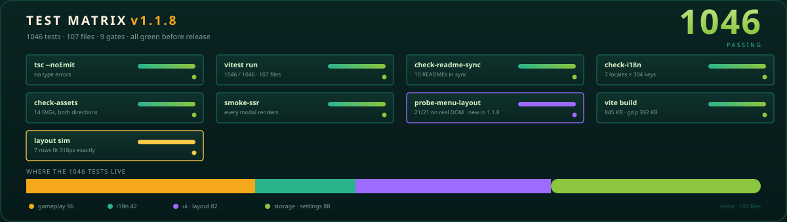
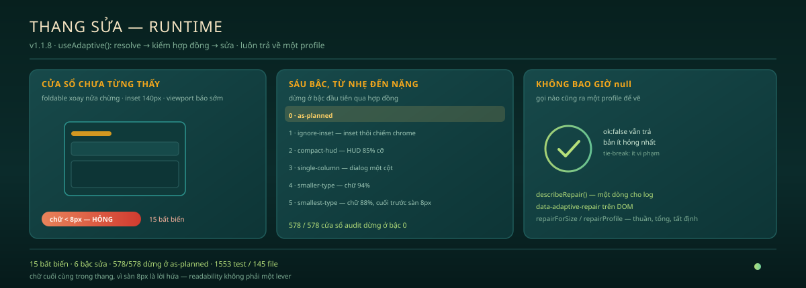
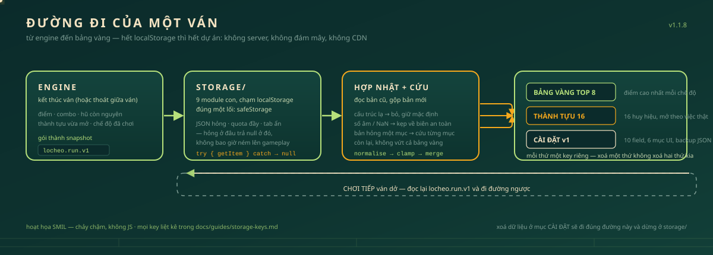
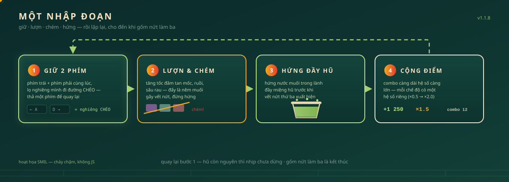
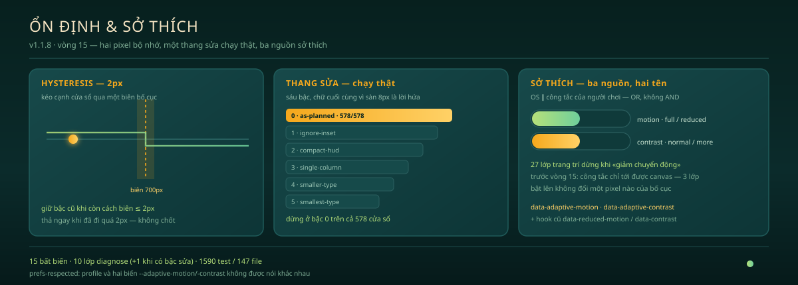
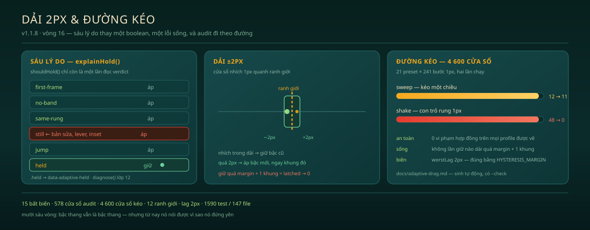

<div align="center">


# LỌ CHÉO — 酸菜腌罐大乱斗

### 🫙 100% 在浏览器中运行的越式腌大戏 — 单个 HTML 文件，离线优先
### 🌐 游戏内置 7 种语言 — Tiếng Việt · English · 中文 · 日本語 · 한국어 · Español · Français

[🇻🇳 Tiếng Việt](README.md) · [🇬🇧 English](README.en.md) · [🇨🇳 中文](README.zh.md) · [🇯🇵 日本語](README.ja.md) · [🇰🇷 한국어](README.ko.md) · [🇪🇸 Español](README.es.md) · [🇫🇷 Français](README.fr.md) · [🇹🇭 ไทย](README.th.md) · [🇩🇪 Deutsch](README.de.md) · [🇵🇹 Português](README.pt.md)

[](docs/releases/v1.1.8.md)
[]
[]
[](https://github.com/standardizeparadigm/LoCheoIO/actions/workflows/ci.yml)
[](LICENSE)
[](#-安装与运行)
[](#生产构建)
[](#-切换语言)
[](CONTRIBUTING.md)




</div>

---

## 🥒 关于本项目

> Lọ Chéo — 酸菜腌罐大乱斗：100% 在浏览器中运行的腌菜街机，打包进单个自包含 HTML 文件，离线优先 —— 无 CDN，无服务器。这只陶罐只懂走**斜线**：按住两个方向键斜冲、加速、斩碎霉菌、苍蝇与菜虫，赶在陶罐裂成三瓣之前把它装满！**9 种模式 · 14 种食材 · 16 项成就 · TOP 8 名人堂 · 游戏内 7 种语言。**

这是一款致敬越南家常腌菜的**单屏动作游戏**。没有线性关卡，没有繁杂菜单 —— 只有陶罐、无尽的腌菜雨，和你燃烧的反应速度。


## 🆕 v1.1.8 新特性

> 1.2.0 之前的**最后一个补丁**。没有新玩法、没有平衡性改动、没有存档格式变更。这最后一轮只做一件事：**首屏自己测量窗口并选择布局** —— 在有解的任何尺寸下（356px 起）都不滚动、不裁切。甲板横条被移除，SVG 共 29 张（第九轮的 HUD 分带示意图、第 12 轮的审计报告与修复阶梯图、第 13 轮的选阶图、第 15 轮的稳定图、第 16 轮的保持图），另加第四个语料库（事故窗口）与六层自动修复阶梯。

### 📐 一次没人管的加法——同时造成四个错误

截图里报了四个问题，但原因**只有一个**。角落面板行和滚动条原本是 hero 的 `shrink-0` 弹性兄弟，先拿走自己的高度，剩下的才轮到 hero：

```
720px 窗口
├── 415px   GAME/INFO 面板行   （高度随内容，shrink-0）
├──  55px   滚动字幕           （高度随文字，shrink-0）
└── 250px   hero               ← 剩下的空间，而它需要 ~430px
```

| 截图中的症状 | 原因 |
| --- | --- |
| `LỌ` 在上边缘被裁掉 | hero 只有 250px，内容要 430px |
| `CÀI ĐẶT` 溢出面板 | 面板按内容定高，而不是按窗口 |
| 版权行被切成两半 | 滚动字幕需要 55px，只分到 48px |
| 「玩法」的 `×` 浮在屏幕中间 | 容纳它的手风琴已经滚出视野 |

修法不是多给几像素余量，而是**把高度只声明一次，其余全部读回来**：`layout/metrics.ts` 保存所有数字，`layout/fit.ts` 返回纯函数 `MenuPlan`，`MenuChrome` 是单独一条 `absolute inset-x-0 bottom-0`，hero 用**同一个**函数算出的 `padding-bottom` 预留空间。


### 🌀 滚动错误：滚动容器里再套滚动容器

下面纹丝不动，上面却还能上下拖——与描述完全一致。v1.1.7 把 hero 内容包在 `overflow-y-auto` 里，再用 `min-h-full` + `justify-center` 居中。这在内容**比容器矮**时没问题；一旦内容**更高**，`justify-center` 会把它往上推，顶部就落在*滚动原点之上*——任何滚动位置都到不了。

现在整屏只有**一个**滚动容器（`.menu-scroll`），内容锚定在顶部，永不垂直居中。造成错误的三个类——`flex-1 overflow-y-auto`、`min-h-full`、`justify-center`——由 `tests/menu-layout.test.ts` 禁止回归。

### 🎯 主视觉：`LỌ CHÉO` 居中并上移

- 标题**水平居中**后**略微上移**，字号同时受宽度与高度限制，窗口再矮也不会溢出字形。
- 陶罐移到右侧，周围是**三道光环 18s / 26s / 34s**——旧版单环 14s 看起来像加载动画。
- 标题上下两带共 **14 件装饰**（星星、火花、圆环、气泡、辣椒、青柠叶、苍蝇、鱼露滴），每件各有自己的时长与延迟——回应"只有 LỌ CHÉO 和陶罐太少了"。
- 坐标是 `scene/decor.ts` 中的**数据**并带碰撞函数，因此 `tests/menu-decor.test.ts` 可以锁住位置与数量。

### 📖 「玩法」移进 GAME 菜单

六条规则和按键表不再放在 hero（打开就会把 `LỌ` 顶出屏幕），而是成为 **GAME 面板中的一行**，打开模态框（`HowToModal`）——无论开合，版面都不动。浮在屏幕中间的 `×` 随着手风琴一起消失。

### 🗂️ 项目又多了几个目录

```
src/components/menu/
├── layout/          metrics.ts · fit.ts · useMenuPlan.ts      ← 新增：所有数字集中一处
├── scene/           decor.ts · DecorGlyph · HeroDecor · JarHalo ← 新增：装饰后的 hero
├── ticker/          keys.ts · MenuTicker           ← 新增：字幕独立模块
├── howto/           rules.ts                                    ← 新增：6 条规则 + 按键表
├── background/      layers.ts · MenuBackground                  ← 8 层背景，用数据声明
└── MenuChrome.tsx · HowToModal.tsx                              ← 新增：底部条 + 模态框
```

### 🐛 修复

| # | 错误 | 修复 |
| --- | --- | --- |
| 1 | 下面不动，上面仍可滚动 | 去掉嵌套滚动框，只留**一个**顶端锚定的 `.menu-scroll` |
| 2 | `LỌ` 在上边缘被裁 | hero 保留 342px 场景，不再被压到 250px |
| 3 | `CÀI ĐẶT` 溢出 GAME 面板 | `CornerPanel.height` 改为**必填**：318px（紧凑）/ 458px（完整） |
| 4 | 版权行被切成两半 | 字幕固定 48px，版权行与跑马灯同一块 |
| 5 | 「玩法」的 `×` 浮在屏幕中间 | 手风琴 → 模态框，不再有 `absolute` 挂在已滚走的框上 |
| 6 | 面板高度随译文长度变化（德语/泰语先溢出） | 声明高度，与内容无关 |
| 7 | 单环 14s 看起来像加载动画 | 三环 18s / 26s / 34s，几乎永不同相 |
| 8 | 文档/SVG/启动器版本滞后 | 全量扫描 10 个 README + docs + 16 个 SVG → 1.1.8 |

→ 完整详情：[docs/releases/v1.1.8.md](docs/releases/v1.1.8.md) · 上一版：[docs/releases/v1.1.7.md](docs/releases/v1.1.7.md)

### 🪟 两张截图，同一个窗口，相差 260 像素

本轮最后两张截图是**同一个应用**：`1920×1080` 全屏和 `1920×820` 窗口。宽度一个像素都没变。但在第二张里，首屏的下半部分**躲到了**两个角面板下面，`CHẾ ĐỘ CHƠI` 标签被切成两半。

原因不是高度不够，而是**问题问错了**：

| 决定布局的东西 | 知道 | 不知道 |
| --- | --- | --- |
| CSS 的 `sm:` · `lg:` | **宽度** | **高度** |
| `plan.minimal` | **高度**（低于 220px） | 宽度，而且等到已经太晚 |
| `heroLayout()`（新增） | **两者**，来自边框所用的同一个数字 | — |

依赖*两个轴*的决定，写不成单轴的媒体查询。于是首屏布局离开 CSS，变成一个纯函数：`heroLayout({ scene, width, minimal })`。

`scene` 是 `planMenuLayout()` 分配给首屏的高度 —— **正是**边框保留的那个数。两者不可能错位，因为它们读同一个函数。

#### 三个阈值，全部是推导出来的

| 常量 | 值 | 推导自 |
| --- | --- | --- |
| `HEIGHT_FOR_BADGE_ROW` | **232** | wordmark 150 + 徽章 40 + 实时徽章 22 = 212，再加 20px 余量 |
| `HEIGHT_FOR_HALO` | **300** | 锁定区 150 + 光环 240 − 重叠 90 |
| `HEIGHT_FOR_SIDE_BY_SIDE` | **300** | 较高的一列：吉祥物 192 + 标签 24 + 内边距 |

`232` 是**被抓住的 bug**：初稿写的是 `210` —— 低于它自己所守护的 212px 锁定区。210px 的横条就画出了 212px 的锁定区，纪录那一行被裁掉。正是本轮在修的那类 bug，却是修复本身制造出来的。

`tests/menu-adaptive.test.ts` 扫描 **1,682 个视口**，并在每个样本上验证 `heroContentHeight(layout) ≤ scene`。

### 🧱 第八轮：六层，一个 profile

主视觉学会测量窗口之后，其余部分仍在各自猜测：模态框是**没有上限**的 `86vh`，结算标题是固定的 `text-6xl`，面板自己调用 `cornerRowHeight()`，`engine.resize()` 自己算坛子半径。**六个地方读六次** —— 两次读数可能落在两个不同的帧。

v1.1.8 把它们收拢成**一个盒子的一次纯函数**：


| | | |
| --- | --- | --- |
| 1 · Box | `adaptive/viewport.ts` | `w · h · inset · dpr` |
| 2 · Tier | `adaptive/tiers.ts` | `xs`…`xxl` |
| 3 · Plan | `layout/fit.ts` | `scene · reserve · fit` |
| 4 · Density | `adaptive/density.ts` | 54/34/26px · 318/458→234 |
| 5 · Hero | `adaptive/hero.ts` | row / stack · lockup |
| 6 · Type | `adaptive/typeScale.ts` | 17 × `--type-*` |
| 7 · Modal | `ui/modalPlan.ts` | w × h × columns |
| 8 · Board | `game/adaptive/playfield.ts` · `game/adaptive/hud.ts` | `itemScale` · `hudScale` · băng HUD |

新不变量 `panel + 边距 ≤ reserve` 在 **844×390**（横屏 iPhone，正是报告截图的尺寸）变红：`reserveFor()` 在没有页脚时省掉 30px，而 `panelHeightForPlan()` 只看密度，仍然画满 —— 216px 的带里放 234px 的面板，**底边 18px 在屏幕之外**。

**1 620 份数字快照**把它钉住：`tests/fixtures/adaptive-matrix/`（1 110 个窗口，每个窗口一个文件）与 `tests/fixtures/hero-bands/`（510 组「宽度 × 高度带」）。`npm run check:adaptive` 打印 21 行表格并断言六条不变量，无需浏览器。

### 🌍 第二层：环境，而不只是尺寸

窗口高度并不等于可用高度。在 iPhone 上，地址栏和 Home 指示条会占去一部分；
页面缩放时，`visualViewport` 比 `innerHeight` 更小。因此我们单独做了一层，
纯函数、不依赖 React（`src/components/menu/adaptive/environment.ts`）：

```ts
type Environment = {
  dpr: number;            // 限定在 [1, 4]
  landscape: boolean;
  coarse: boolean;        // 手指，而非鼠标
  insetTop / Right / Bottom / Left: number;
  reducedMotion: boolean;
};
```

四个容易出错的地方，以及实际的处理：

1. **`env()` 无法从 `getComputedStyle` 读取。** 必须有一个*使用*了
   `env(safe-area-inset-*)` 的元素，它的计算内边距才有意义。第一版创建了**四**
   个探测元素（每条边一个），每次缩放都要强制四次布局。现在只用**一个**元素、
   四条内边距，并在 `finally` 中移除，抛异常也不会留下节点。
2. **`pointer: coarse` 可以在没有任何 `resize` 的情况下改变。** 混合设备会不
   停在鼠标和手指之间切换。钩子订阅了**两个**媒体查询，而不只是 `resize`。
3. **内边距 `0` 是合法值。** 其它数值字段用的 `sane()` 下限是 1，拿来用在
   内边距上会把「没有刘海」变成「1px 刘海」。
4. **内边距只从可用高度里减，绝不动场景高度。**
   `usableHeight(h, inset) = clamp(h − inset, 1, ∞)`，而 `planFits` 与
   `occupiesExactly` 都走这条路径，所以两者不可能不一致。

`tests/environment.test.ts` 覆盖 `saneDpr`（包括 `NaN`、`−1`、`7`）、
`parseInset`、`verticalInset`、`isHandheld`；`tests/use-environment.test.ts`
构造了假的 `window` 与 `document`（无需 jsdom），因此也能覆盖**抛出异常**的
`matchMedia` 和**没有 body** 的文档。

### ⚠️ 一个已知限制 —— 记录下来，而不是藏起来

在 **844×600** 下，没有内边距的窗口给 hero 222px；加上 10px 内边距反而给
**268px**。窗口更小，hero 却高了 46px。原因是总高度按离散阈值分配，一个小小
的内边距把总和推过某个阈值，从而切换了经济档。

这是**真实的、微小的、早就存在的**缺陷。我们试过用八档经济搜索让 `scene`
最大——**失败**：在 1920×1080 下它会砍掉 ticker 和高行，而那正是玩家看到的
东西。已回退。改为让 `tests/layout-inset.test.ts` **断言实测数值**
（222 → 268，+46）作为一个通过的测试：谁修好了就会打破它并被迫更新，在修好
之前至少它被写下来了。旁边则是真正成立的不变量：在*同一个*经济档内，
`scene + reserve === usableHeight`（已验证 252 种组合）。

#### 缺失的第四个事件

用户是**按下全屏键**才拍出那两张的。应用监听 `resize` 和 `orientationchange`。Firefox 在切换全屏时两个都不触发；旧版 Safari 只触发 `webkitfullscreenchange`。于是窗口高度变了，首屏保留着旧方案，标签一直是被切的状态，直到下一次 resize。

`VIEWPORT_EVENTS` 把六种拼写收在一处，因为 `useMenuPlan()` 和 `useViewportWidth()` **都**需要它 —— 以前各自注册自己的副本，也就是两份副本可能描述两个不同的窗口。

### 🗑️ 图 12 里的分隔带 —— 以及随之消失的甲板

第三张是从屏幕中央裁出的 `1443×180` 条带：`🎮` 标记、一条金色横线，然后三个标题 `GAME / 今日挑战 / 今日规则`。那就是**甲板** —— 固定高度横条里的三栏文字。

它没法待在那儿，另外两张截图说明了原因：在 `1920×1080` 下右栏被**从句子中间**裁断，在 `1920×820` 下整行都在面板下面。一条能容下 200px wordmark 的横条，容不下三段文字。

甲板说过的内容没有丢：

| 甲板说什么 | 现在在哪 |
| --- | --- |
| 你要玩的模式 | 吉祥物下方的标签；完整列表在 GAME 里 |
| **今日挑战** | INFO 面板的一行 —— `模式 · 目标` |
| 今日规则 | 玩法弹窗的一行，它一直是那六条规则的完整版 |

日期计算**没有**跟着走：`challengeFor()` 和 `tipIndexFor()` 移到了 `src/game/daily/`，21 个测试和名字一并过去。

wordmark 下方的空带现在是**故意的**。那就是一个在任何尺寸都合适的首屏的代价。

### 🏷️ 分层更新日志——每层一种颜色

| 层级 | 标签 | 颜色 | 含义 | 例 |
| --- | --- | --- | --- | --- |
| `major` | **MAJOR** | 🩷 粉 `#ff5fb0` | 大版本——新增系统 | 1.0.0 |
| `minor` | **UPDATE** | 🟡 金 `#f5a81c` | 升级——新增内容 | 1.1.0 |
| `patch` | **PATCH** | 🟣 紫 `#9d6bff` | 修复与清理 | 1.1.1 → **1.1.8** |

层级由 `tierFor(version)` **从 SemVer 推导**，绝不手写。面板新增**筛选**：全部 · MAJOR · UPDATE · PATCH，并显示各层数量。





### 🔟 第九轮：HUD 也变成一份计划，`diagnose()` 回答*为什么*

第八轮让整个菜单共用一份 profile。仍有一件事是手绘的：`engine.ts` 里的 HUD ——
一串累加坐标的 `fillText`，只在 1280×720 正确。

`planHud()` 给每个读数一个**字形带**（`baseline − 0.72 × size`，高 `0.97 ×
size`），左右两列固定，中列从 `clockY` **顺势流动**；放不下时先丢掉信息最少的
项（`chips → combo bar → jars → best`），再以 0.02 为步长压缩到 0.55 的下限。

扫描 1 500 个棋盘：旧公式产生 **4 004** 对重叠，新计划在可玩棋盘上为 **0**；
低于 `playable()` 的部分通过 `traceHud().collisions` **如实报告**。

本轮还包括：按尺寸排序的 **21 个预设**（320×480 → 3840×2160）、
`constraints.ts` 里的 **12 条不变量**（测试、`check:adaptive` 与文档共用一份），
以及回答截图问题的 `diagnose()`。


### 1️⃣1️⃣ 第十轮：模式标签不再丢失右半边

截图报告"选择经典模式时右侧突然消失"。原因不是数字错误，而是**假设**错误：
标签是 `absolute; left: 50%; translateX(-50%)`，位于吉祥物列内且没有 `max-width`。

```
纵向布局  吉祥物居中  →  标签以它为中心  →  正确
横向布局  吉祥物在最右  →  半个标签超出画面
                          .menu-hero { overflow: hidden }  →  被裁切
```

最长的名称（「MUỐI DƯA CỔ ĐIỂN」，19 字符）是唯一被明显裁切的，所以看起来像
"经典模式坏了"，其实每个名称都少了一点。

现在标签有**两道独立保证**：CSS 守住盒子（横向布局下对齐内侧边缘、硬性
`max-width`），`planModeChip()` 守住阶梯（`full → label-dropped → name-shrunk →
ellipsis`）。文字宽度估算误差 6% 也没关系——真正守住像素的是 CSS。

本轮还包括：`heroBandWidth()`、**两条新不变量**（12 → **14**）和**第三个语料库**
——189 张快照（21 预设 × 9 模式）。


### 第 11 轮 —— 越南语声调符不再被裁掉

这次截图不是"少了右半边"，而是**"少了声调符"**：模式标签读作 «MUỐI DƯA CỔ
ĐIÊN»，**Ể** 的扬抑符消失，而前面的 **Ổ** 完好。这是**第 10 轮的回归**：
`truncate` 不只横向裁剪 —— `overflow: hidden` 裁的是**行框**，而越南语会把声调符
叠在扬抑符上（`Ố Ổ Ể Ấ Ự`），高出大写字母高度约 **0.35em**。

三层分别修好，互不重叠：

| 层 | 之前 | 之后 |
| --- | --- | --- |
| 字符串 | CSS 省略号 | `planModeChip()` 先截断字符串并加 `…` |
| 行框 | 1.2em | **1.5em**（`MODE_CHIP_LINE_HEIGHT`） |
| 裁剪框 | 名称 span 上的 `truncate` | **整棵子树没有 `overflow`** |

另有 **`.clip-safe`** —— 所有可翻译文本的 `truncate` 替代品：`padding-block: .24em`
把裁剪框撑开，`margin-block: -.24em` 把版面还原，所以一行都不动而声调符留下。六个
调用点已改用它。`chipBoxHeight()` 取代了猜出来的常数：标签高了 3.3px，那是
`heroContentHeight()` 的事，就必须读真实测量值。

详见：[docs/releases/v1.1.8.md §18](docs/releases/v1.1.8.md#18-vòng-11--dấu-tiếng-việt-bị-css-cắt)。


### 第 12 轮 —— 审计整个窗口空间，并加上自动修复阶梯

前三轮各加了**一个**语料库，但都没有回答维护者在发版前会问的问题：*在**所有**可玩
窗口中，布局做了什么、做了多少次、有没有坏的地方？*

现在用 `npm run audit:adaptive`：**578** 个窗口（21 个预设 + 围绕每个断点的 25 × 23
网格，去重），一次解析，汇总成一个 `AuditReport`。

| | |
| --- | --- |
| 窗口 | **578** |
| 违反契约 | **0** —— 每个窗口都跑完 14 条不变量 |
| 只剩 LỌ CHÉO | 101（17%） |
| Hero 横排 / 竖排 | 170 / 408 |
| Scene | 140px（320×320）… 1 642px（3840×2160） |

`docs/adaptive-audit.md` 是该报告的**自动生成**副本，`audit:adaptive --check` 已加入
`npm run check` —— 改动一个断点或字号下限，**会在造成它的同一个 commit 里**变成一份
diff。这就是“升级一处必须检查周围”的原则，交给机器提醒。

同时新增**自动修复阶梯** `repair/`：六层 —— `as-planned → ignore-inset →
compact-hud → single-column → smaller-type → smallest-type`。顺序就是原则：**字号最后**，
因为 8px 下限是承诺。应用在全部 578 个窗口都停在第 0 层；阶梯存在是为了**能够**用，
测试传入更严的契约来证明它真的会往下走。

还有**第四个语料库**：14 个曾经出现在截图报告里的窗口（第 1 轮到第 12 轮），每个文件
带 `symptom`（症状）与 `guard`（必须保持的东西），所以失败时读起来是一句关于游戏的
话，而不是两个数字。

详见：[docs/releases/v1.1.8.md §19](docs/releases/v1.1.8.md#19-vòng-12--kiểm-toán-cả-không-gian-và-thang-tự-sửa) ·
指南：[docs/guides/adaptive-audit.md](docs/guides/adaptive-audit.md)。




### 第 13 轮 —— 不只是**对**，还要**最省**

第 12 轮做了一件只能回答是/否的事：**有没有不变量被破坏？** 但每次收到截图，第二个
问题仍然没人回答：**有没有更省的布局？**

这一轮回答它。`select/` 给每个 profile **七个项**，并按**字典序**比较 —— 不用加权求和，
因为加权求和可能让 40px 余量"买回"一个已经失去的 mascot，只要权重刚好凑成那样：

| # | 项 | 玩家失去什么 |
| --- | --- | --- |
| 1 | `violations` | 什么也没失去 —— 破坏契约就不是候选 |
| 2 | `hidden` | mascot、deck、标语 |
| 3 | `cropped` | 比自身下限少多少 px |
| 4 | `hudLost` | HUD 缩放的比例 |
| 5 | `typeDrop` | 字号少了多少 px（全表求和） |
| 6 | `levers` | 动了几个东西 —— 玩家看不见 |
| 7 | `slack` | 多余空间 —— 不是损失，只用来破平 |

两个细节决定"记分板"和"真正正确的比较"之间的差别：

- **`hidden` / `cropped` 相对基准 profile 测量。** 320×320 窗口在拉动任何杠杆之前
  *本来*就只有 wordmark、*本来*就被裁剪 —— 那是窗口，不是牺牲。用原始标志会为应用
  正在绘制的 profile 报出 "hidden 1"。
- **`levers` 从 profile 计数，而不是从 override。** 没有 inset 的窗口上 `ignoreInset`
  什么都没改变，所以不算拉动过 —— 也正因如此**平局是真实存在的**，破平靠的是阶梯
  位置，而不是 `sort` 恰好看到的顺序。

这一轮换来的、并且可以检验的命题：

```
npm run audit:adaptive -- --select
  shipped profile wins   578 / 578
```

> 在所有可玩窗口上，正在发布的 profile 都是六层里最省的那一个。

第 12 轮说"没有东西坏"；第 13 轮说"没有更省的"。命题更强也更容易错，所以它有**第五个
语料库**：`tests/fixtures/selection/` —— 12 个窗口，每个文件记录的是*决策*而非布局：
完整六层排名、第二名，以及每一层为何落败。阈值一变，diff 显示的是一个**决策**变了 ——
这才是审阅时真正需要批准的东西。

详见：[docs/releases/v1.1.8.md §20](docs/releases/v1.1.8.md#20-vòng-13--không-chỉ-đúng-mà-rẻ-nhất) ·
指南：[docs/guides/adaptive-selection.md](docs/guides/adaptive-selection.md)。


第三处，同样的形状：**`crop` 台阶是一条死路。** 审计的 578 个窗口里有 25 个是
`fit: "crop"`（全部在 320px 高）。三条不变量豁免这一台阶——这是对的，没有任何排布
能放下——但 `.menu-pane` 是 `overflow: clip`，于是超出窗口的那部分**无法到达**：两个面板
的底部和 START 按钮，而没有一条不变量说话。现在 `[data-adaptive-fit="crop"] .menu-pane`
是菜单里唯一的纵向滚动容器；**356px** 及以上的每个窗口仍然逐像素吻合。

### 第 14 轮 —— 修 bug：chip 的契约必须数满七种语言

这一轮没有新增任何东西。它去找的是一个"承诺说得比检查做得更宽"的地方。

chip 在**四处**用越南语字面量来测量（`CHIP_LABEL = "CHẾ ĐỘ CHƠI"`、
`CHIP_NAME = "MUỐI DƯA CỔ ĐIỂN"`）—— 而越南语是七种语言里**最短**的：

| | 标签 | 最长的模式名 |
| --- | --- | --- |
| vi | `CHẾ ĐỘ CHƠI`（11） | `MUỐI DƯA CỔ ĐIỂN`（19） |
| es | `MODOS DE JUEGO`（14） | `60 SEGUNDOS DE LOCURA`（21） |
| fr | `MODES DE JEU`（12） | `FESTIVAL DES COMBOS`（19） |

所以 `chip-labelled` 声称*"每个可玩窗口都保留标签"*，而西班牙语在 320px 和 360px
丢掉标签、法语在 320px 丢掉 —— 审计却报告**0 处违约**。

现在 `chip/probes.ts` 从 `localeTable()` + `MODE_LIST` 生成探针，`chip-labelled`
改成一个可检验的承诺：**chip 永远不会同时失去两个台阶**。审计报告实际发生的事情：
**439 full · 101 hidden · 38 label-dropped**。

同时修掉三个同类型的小 bug：`scoreProfile()` 返回的违约列表没有排序（导致最后的
平局判定依赖插入顺序）、`isFiniteProfile()` 从不检查 `playfield`/`modal`、
`slackOf()` 与 `constraints.ts` 对同一个盒子做了不同的取整。另外 `--select` 不再
打印一个不存在的数字：它把 18 × 36 的乘积叫作"648 个窗口"，而审计扫的是 578 ——
现在 `578 / 578`，同一个列表。

没有新功能、没有改布局、没有升版本。只是 **1 412 个测试 / 137 个文件**（原先
1 398），以及一份说清楚自己在检查什么的契约。


## 📐 自适应布局 —— 首屏如何选择自己的形态

开始屏幕不用媒体查询决定布局。它**测量**窗口，从五种能力中挑选：`sideBySide`、`halo`、`badgeRow`、`mascot`、`liveBadge`。

```
planMenuLayout(viewport) → { scene, reserve, … }    scene + reserve = 高度
            │
            └─ scene 正是边框保留的那个数
                        │
    heroLayout({ scene, width }) → 5 个布尔
```

| 标志 | 何时开启 | 关闭后消失什么 |
| --- | --- | --- |
| `sideBySide` | 宽度 ≥ 1024 **且** 首屏 ≥ 300px | 吉祥物落到 wordmark 下方 |
| `halo` | 首屏 ≥ 300px | 坛子周围的环 |
| `badgeRow` | 首屏 ≥ 232px | 「HŨ DƯA ĐẠI CHIẾN」牌和纪录行 |
| `mascot` | 几乎始终 | ——（仅在最精简模式隐藏） |
| `liveBadge` | 首屏 ≥ 232px | 「厨房直播」行和版本号 |

三个阈值**都不是整数** —— 每一个都等于它所守护之物的真实高度：

```ts
HEIGHT_FOR_BADGE_ROW    = 232  // 150 wordmark + 40 牌 + 22 live + 20 余量
HEIGHT_FOR_HALO         = 300  // 150 锁定区 + 240 环 − 90 重叠
HEIGHT_FOR_SIDE_BY_SIDE = 300  // 较高的一列：192 吉祥物 + 24 标签
```

`tests/menu-adaptive.test.ts` 扫描 **1,682 个视口**，在每个样本上验证 `heroContentHeight(layout) ≤ scene`。窗口变化时，两个 hook 监听**六个**事件，在一帧内更新。

## ✨ 亮点功能

| 分类 | 详情 |
| --- | --- |
| 🎮 **9 种模式** | **经典腌制**（均衡）· **清心禅意**（无危险物，×0.5）· **辣椒火焰**（速度 +35%，×1.5）· **60秒冲刺**（限时 60s，×1.25）· **黄金丰收**（黄金掉落 ×2.6）· **腌菜暴雨**（密度 ~1.4×，×0.75）· **薄瓷**（一裂即碎，×2.0） · **连击节庆**（连击窗口 ×2，×1.15）· **腌菜盛宴**（密度 ~×2，满罐 ×2.5，×0.6） |
| 🌐 **游戏内 i18n** | Tiếng Việt · English · 中文 · 日本語 · 한국어 · Español · Français —— `src/i18n/`（纯模块 + React 桥接），`t()` 支持插值，同步 `<html lang>`，数字按 locale 分组（vi-VN / en-US / zh-CN / ja-JP / ko-KR / es-ES / fr-FR） |
| 🕹️ **专属“斜切”机制** | 同时按住两个方向键/斜向轴 —— 陶罐加速、发光并斩碎危险物。配有独立耐力条与防闪烁回滞 |
| 🥬 **14 种食材** | 小茄子、辣椒、大蒜、生姜、盐、芥菜、**金卷心菜**（快速装罐）· 黄金盐/黄金蒜 · 魔鬼辣椒 · 寒冰 · 霉菌、苍蝇、**菜虫**（危险物） |
| 🧄 **黄金蒜护盾** | 道具：最多叠加 **2 层护盾**吸收裂痕；陶罐周围环绕旋转光环 |
| 🏆 **16 项成就** | **跨局累计**存档（localStorage），结算画面弹出“新成就！” |
| 🔊 **手工音效** | 11 种 Web Audio API 合成音效（零音频文件）+ 随等级变调的五声音阶背景乐，`M` 键静音 |
| 💾 **TOP 8 名人堂** | 本地存档，读取时校验并归一化，姓名自动大写，新纪录高亮 |
| 🎨 **60fps 画质** | Canvas 2D，粒子上限 460，DPR 上限 2，离屏预渲染花砖地板，星光闪烁 + 菜单极光 |
| 📴 **真·离线优先** | 自托管字体（latin + 越南文子集，woff2），无 CDN、无接口 —— 双击 `dist/index.html` 即玩 |
| 🧪 **质量保障** | 1618 项单元测试（vitest）覆盖 modes / achievements / storage / i18n / settings —— `npm run check` 为 CI 关卡 |


### 💾 存储与荣誉榜 — 一局游戏的旅程

数据从不离开你的机器：引擎把结束的局打包成快照，`storage/`（9 个模块）经由唯一的门户 `safeStorage` 触到 localStorage，损坏的存档按条目逐项救援，然后才是 TOP 8 · 16 项成就 · 设置 — 「继续游戏」沿同一条路反向走一遍。



## 🌐 切换语言

Lọ Chéo 内置 **7 种界面语言**，即时生效 —— 无需刷新、不中断对局：


| 语言 | 入口 | 存储键 |
| --- | --- | --- |
| 🇻🇳 Tiếng Việt | **VI** 按钮（默认；未设置时跟随浏览器语言） | `locheo.lang.v1` |
| 🇬🇧 English | **EN** 按钮 | `locheo.lang.v1` |
| 🇨🇳 中文 | **中** 按钮 | `locheo.lang.v1` |
| 🇯🇵 日本語 | **日** 按钮 | `locheo.lang.v1` |
| 🇰🇷 한국어 | **한** 按钮 | `locheo.lang.v1` |
| 🇪🇸 Español | **ES** 按钮 | `locheo.lang.v1` |
| 🇫🇷 Français | **FR** 按钮 | `locheo.lang.v1` |

- 在**设置 → 语言**中切换（7 个国旗按钮的网格）—— 唯一入口，菜单上不再有浮动切换器。
- 所有用户可见文案都在 `src/i18n/locales/{vi,en,zh,ja,ko,es,fr}.ts` —— 画布引擎、各界面、HUD、弹字、跑马灯、提示。
- 缺少 key？`t()` 自动回退到越南语 —— 七套 locale 的 key 集合与占位符一致性由测试强制保证。

## 🕹️ 操作方式

| 操作 | 键盘 | 触屏 |
| --- | --- | --- |
| 移动 | `W` `A` `S` `D` 或 `← ↑ ↓ →` | 任意位置拖动（浮动摇杆） |
| **斜切（CHÉO）** | 同时按住**两个键**（如 `A`+`W`） | **45° 斜向拖动** —— 摇杆圆环变金色 |
| 拍罐（冲击波 + 吸附腌菜） | `Space` | 右下角红色**拍罐**按钮 |
| 暂停 / 继续 | `P` 或 `Esc` | 右上角暂停按钮 |
| 立即重开 | `R`（暂停/结算时也可） | “再腌一坛”按钮 |
| 开始 / 确认 | `Enter` | **进厨房**按钮 |
| 静音 / 取消静音 | `M` | 右上角扬声器按钮 |
| 切换语言 | —（使用 VI/EN/中/日/한/ES/FR 按钮） | 菜单 / 暂停界面的 VI/EN/中/日/한/ES/FR 按钮 |



从机器视角看一个回合：按住两键是第 1 步，其余只是重复 — 只要罐子不碎，节奏就不会停，三道裂纹才会终结它。
## 🚀 安装与运行

### 🧠 第 15 轮：自适应系统自己调，而且不再抖

这一轮没有新增窗口。它补上第 14 轮留下的四个缺口 —— 文档里有承诺、代码里没有路径：

| | 第 15 轮之前 | 第 15 轮之后 |
| --- | --- | --- |
| 「减少动效」开关 | 只到画布 —— 停 **3** 层 CSS | 进入 `profile.prefs`，到菜单 —— 停 **27** 层 |
| `prefers-contrast: more` | 只有 `App.tsx` 读，设一个属性 | 成为 `Environment` 的第六个信号；面板边框与标题提亮 |
| 六层修复阶梯 | 有测试的库，**没人调用** | `useAdaptive()` 在运行时执行；`data-adaptive-repair` 说明哪一层胜出 |
| 拖边框穿过断点 | 鼠标每动一次就重排 | `stabilize()` 保留旧层 **2px** —— 拖 60px 只换 ≤ 2 次 |

- **三个来源，两个名字**：`preferencesFor()` 用 **OR** 合并操作系统与玩家开关，而不是
  AND —— 应用无权用默认值推翻系统的声明。
- **第 15 条不变量 `prefs-respected`**：禁止 profile 说「减少动效」而 CSS 变量说「完整」。
- **`diagnose()` 增加两行**：`10 · prefs` 恒在，`11 · repair` 只在 hook 绘制的 profile
  上出现 —— 纯函数 `resolveAdaptive()` 不走阶梯，没有层可报。

两个偏好全开 **不改变一个像素**：578 / 578 窗口仍是 `as-planned`，0 违规，并且有测试
比较两种 profile 的 `plan` / `type` / `density`。

细节：[docs/releases/v1.1.8.md §24](docs/releases/v1.1.8.md#24-vòng-15--hệ-tự-chỉnh-và-hai-pixel-bộ-nhớ) ·
目录：[`adaptive/preferences/`](src/components/menu/adaptive/preferences/README.md) ·
[`adaptive/hysteresis/`](src/components/menu/adaptive/hysteresis/README.md)。



### 🎚️ 第 16 轮：两像素的带子终于能说出它*为什么*不动

这一轮没有新的稳定机制。只对第 15 轮留下的那一个做了三件事：解释它、测量它、修掉它
掩盖的一个 bug。

| | 第 16 轮之前 | 第 16 轮之后 |
| --- | --- | --- |
| 「这个 profile 为什么慢了 2px？」 | 把五个条件粘进 REPL | `explainHold()` 返回**六个有名字的理由**；`shouldHold()` 只是一次读取 |
| 窗口**没动**而层级变了 | 被保留 —— 而且*永久*保留，因为下一帧一模一样 | 独立理由 `still`，立刻应用：修复阶梯的成果在第一帧就被画出 |
| 有意的延迟 | 人和工具都看不见 | DOM 上的 `data-adaptive-held` · `diagnose()` 第 `12 · hold` 层 |
| 审计 | 578 个窗口的表格，每行在任何时刻都成立 | 再加一条**拖动路径**：21 × 241 步、4 600 个窗口、两次重放 |

- **六个理由：** `first-frame` · `no-band` · `same-rung` · `still` · `jump` · `held`。
  只有 `held` 会保留层级，其余五个是「层级变化**不是**抖动」的五种情形。
- **`still` 是真 bug：** 旧条件「两个盒子相距 2px 内」在两个盒子**完全相同**时也成立。
  修复阶梯画出的 profile 改了 `plan.fit` 而盒子没变，于是被保留，`last.current` 永不
  前进：*修复成果永远不会被画出*。
- **审计走的是路径，不只是点。** `docs/adaptive-drag.md`：

| 手势 | raw | held | 带子买到什么 |
| --- | --- | --- | --- |
| **sweep** —— 单向拖动 ±120px（4 600 个窗口） | 12 | 11 | 1（8%）—— 每个边界只穿一次 |
| **shake** —— 指针在每个边界抖动 1px | 48 | **0** | **48（100%）** —— 这才是带子真正的用处 |

拖动路径的三条性质：**安全**（每个被画的 profile 0 违规）、**活性**（没有一次保留
超过 `margin + 1` 帧）、**边界**（`worstLag` = 2px）。

同一轮还有一件不属于 adaptive 的事：文档计数闸门（四个文件里的 «26 SVGs»）现在在
`npm run check` **内部**运行，而不只在 CI —— 规则移到 `scripts/lib/prose-counts.mjs`，
测试跑的是**同一套**规则，不是副本。



### 免构建直接玩

```bash
# 每个发行版都附带单个自包含文件：
open dist/index.html      # macOS
xdg-open dist/index.html  # Linux
start dist/index.html     # Windows
```

### 生产构建

```bash
npm install        # 安装依赖（Node ≥ 20.19）
npm run build      # → dist/index.html（单个自包含文件）
```

> `vite-plugin-singlefile` 会把所有 JS/CSS/字体/图片内联进**一个** `dist/index.html`（约 952 KB，gzip 约 430 KB）。不需要服务器，不需要网络。

### 开发

```bash
npm run dev        # 带 HMR 的开发服务器（http://localhost:5173）
npm run preview    # 本地预览生产构建
npm run typecheck  # tsc --noEmit（strict，noUnusedLocals…）
npm run test       # vitest — 1618 项单元测试（modes / achievements / storage / i18n / settings）
npm run check      # typecheck + test + build（CI 质量关卡）
```

## 🗂️ 项目结构

```
lo-cheoio/
├─ index.html              # 入口，SEO/OG 元信息（无 CDN）
├─ package.json            # lo-cheoio v1.1.8，dev/build/test/check 脚本
├─ .gitattributes          # *.bat/*.cmd → CRLF · posix → LF · binaries
├─ vite.config.ts          # vite + react + tailwind v4 + singlefile
├─ tsconfig.json           # strict；包含 src + tests
├─ favicon.ico             # web icon (multi-size 16→256)
├─ public/                 # favicon.ico/png/svg served at web root
├─ assets/
│  ├─ banner.svg           # README 横幅（SMIL 动画）
│  ├─ demo.svg             # 实战演示（SMIL 动画）
│  ├─ items.svg            # 14 种食材（SMIL 动画）
│  ├─ modes.svg            # 9 种模式（SMIL 动画）
│  ├─ languages.svg        # 7 in-game languages (SMIL animation)
│  ├─ new-modes.svg        # the 2 new v1.1.4 modes (SMIL animation)
│  ├─ corner-menu.svg     # corner GAME/INFO panels (SMIL animation, v1.1.5)
│  ├─ settings-sections.svg # 6-section settings tour (SMIL, v1.1.6)
│  ├─ wordmark-crop.svg    # LỌ nặng dấu — crop trước/sau (SMIL, v1.1.8)
│  ├─ menu-anatomy.svg     # hero anatomy: 14 món trang trí (SMIL, v1.1.8)
│  ├─ diagonal-motion.svg  # chuyển động chéo của hero (SMIL, v1.1.8)
│  ├─ no-scroll-steps.svg  # bốn bậc vá lỗi cuộn (SMIL, v1.1.8)
│  ├─ layout-fix.svg       # trước/sau vá bố cục 250→342px (SMIL, v1.1.8)
│  ├─ test-matrix.svg      # ma trận test + 9 cổng (SMIL, v1.1.8)
│  ├─ mode-chip.svg        # chip chế độ trước/sau (SMIL, v1.1.8 r10)
│  ├─ adaptive-layers.svg  # sáu lớp adaptive một profile (SMIL, v1.1.8 r8)
│  ├─ hud-bands.svg        # HUD thành kế hoạch (SMIL, v1.1.8 r9)
│  ├─ diacritics-clip.svg  # dấu Việt dưới overflow (SMIL, v1.1.8 r11)
│  ├─ adaptive-audit.svg   # kiểm toán 578 cửa sổ (SMIL, v1.1.8 r12)
│  ├─ adaptive-repair.svg  # thang sửa sáu bậc runtime (SMIL, v1.1.8 r12)
│  ├─ adaptive-select.svg  # chọn bậc rẻ nhất (SMIL, v1.1.8 r13)
│  ├─ adaptive-stability.svg # ổn định + sở thích (SMIL, v1.1.8 r15)
│  ├─ adaptive-hold.svg    # dải 2px + drag audit (SMIL, v1.1.8 r16)
│  ├─ divider.svg          # sparkle divider (SMIL animation)
│  ├─ license.svg          # 动态 AGPL-3.0 copyleft 印章（SMIL 动画）
│  └─ favicon.svg          # favicon (SMIL animation)
├─ scripts/
│  ├─ play-mac.command     # macOS 启动器 — 双击弹出全彩菜单
│  ├─ play-windows.bat     # Windows 启动器 — 双击弹出全彩菜单
│  ├─ play-linux.sh        # Linux 启动器 — 双击弹出全彩菜单
│  └─ README.md            # 给不熟悉终端用户的启动器指南
├─ docs/
│  ├─ README.md            # 文档目录（v1.1.5）
│  ├─ DESCRIPTION.md       # 多语言项目简介（vi/en/zh + SEO）
│  ├─ design/              # menu-corners / save-format / settings-format 规范
│  ├─ guides/              # engine 概览 · a11y · 性能 · storage keys · 发布流程…
│  └─ releases/
│     ├─ v1.0.0.md         # 首发版本说明
│     ├─ v1.1.0.md         # v1.1.0 版本说明
│     ├─ v1.1.1.md         # v1.1.1 版本说明
│     ├─ v1.1.2.md         # v1.1.2
│     ├─ v1.1.3.md         # v1.1.3 release notes
│     ├─ v1.1.4.md         # release notes (1.1.4)
│     ├─ v1.1.5.md         # release notes (1.1.5)
│     ├─ v1.1.6.md         # release notes (1.1.6)
│     └─ v1.1.8.md         # current release notes (1.1.8)
├─ README.md               # 🇻🇳 Tiếng Việt
├─ README.en.md            # 🇬🇧 English
├─ README.zh.md            # 🇨🇳 中文（本文件）
├─ README.ja.md            # 🇯🇵 日本語
├─ README.ko.md            # 🇰🇷 한국어
├─ README.es.md            # 🇪🇸 Español
├─ README.fr.md            # 🇫🇷 Français
├─ README.th.md            # 🇹🇭 ไทย
├─ README.de.md            # 🇩🇪 Deutsch
├─ README.pt.md            # 🇵🇹 Português
├─ src/
│  ├─ main.tsx             # React 入口，StrictMode
│  ├─ App.tsx              # 阶段状态机 menu/playing/paused/gameover
│  ├─ version.ts           # APP_VERSION = "1.1.8"（唯一版本来源）
│  ├─ index.css            # tailwind v4 主题 + 全部动画/渐变
│  ├─ assets/fonts/        # woff2 子集（Be Vietnam Pro ×6，Bungee）
│  ├─ styles/fonts.css     # @font-face + unicode-range，100% 离线
│  ├─ i18n/
│  │  ├─ i18n.ts           # 纯模块：检测、持久化、t() + 插值
│  │  ├─ useI18n.ts        # React hook：useI18n/useLanguage
│  │  └─ locales/          # vi.ts（key 源）· en · zh · ja · ko · es · fr
│  ├─ components/
│  │  ├─ GameCanvas.tsx    # 画布 + 浮动摇杆 + 键盘 + 可见性处理
│  │  ├─ StartScreen.tsx   # 菜单：主视觉 + 多层动效 + 角落面板
│  │  ├─ menu/              # 角落 GAME/INFO 面板 + 弹窗 + icons/
│  │  │  └─ background/     # 8 background layers as data (v1.1.8)
│  │  ├─ ModeSelector.tsx  # 9 张模式卡（classic/zen/inferno/blitz/goldrush/storm/hardcore · combo · feast）
│  │  ├─ AchievementsPanel.tsx  # 已锁/已解锁徽章墙
│  │  ├─ GameOverScreen.tsx     # 罐子碎了！+ 分数 + 新成就
│  │  ├─ PauseScreen.tsx        # 暂停 + 本局数据
│  │  ├─ settings/           # 六个分区设置模块 + 控件（v1.1.6）
│  │  └─ ui/               # 八个基础组件，每个一个文件（v1.1.8——从 ui.tsx 拆出）
│  ├─ game/
│  │  ├─ engine.ts         # 全部模拟与画布渲染（约 2100 行）
│  │  ├─ modeTypes.ts      # ModeId · ModeConfig (types-only, v1.1.8)
│  │  ├─ modes/            # 9 balance records — classic.ts … feast.ts (v1.1.8)
│  │  ├─ modesIndex.ts     # MODES · MODE_LIST · isModeId (v1.1.8)
│  │  ├─ modeMath.ts       # multiplierForCombo · jarBonus · comboWindowFor… (v1.1.8)
│  │  ├─ modes.ts          # barrel — keeps every old import working
│  │  ├─ achievements.ts   # 16 枚徽章 + 纯校验器（纯函数）
│  │  ├─ storage.ts        # localStorage：TOP 8、进度、成就
│  │  ├─ audio.ts          # Web Audio 合成：音效 + 五声音阶音乐
│  │  ├─ changelog/          # in-game changelog (v1.1.8 — split from one file)
│  │  │  ├─ types.ts        #   ChangelogEntry · ReleaseTier · copyFor()
│  │  │  ├─ tiers.ts        #   tierFor() · TIER_ORDER · TIER_LABEL_KEY
│  │  │  ├─ entries/        #   1 file per release — v1_0_0.ts … v1_1_7.ts
│  │  │  └─ index.ts        #   ordered list + 5 helpers
│  │  ├─ runSave.ts         # 中断对局持久化
│  │  ├─ settings.ts        # 设置 schema、默认值、归一化
│  │  ├─ settingsIO.ts      # 备份/恢复编解码（v1.1.6）
│  │  ├─ settingsPresets.ts # 四个快速预设（v1.1.6）
│  │  └─ audioLevels.ts     # 纯音频增益计算（v1.1.6）
│  └─ utils/
│     ├─ cn.ts             # clsx + tailwind-merge
│     └─ useFocusTrap.ts   # 弹窗焦点捕获（v1.1.6）
└─ tests/                  # vitest — 149 个文件 · 1618 项测试（modes · achievements · storage · i18n · runSave · settings · presets · audio…）
```

## 🧱 架构与性能


- **游戏主循环** `requestAnimationFrame`，增量时间钳制到 `1/20s`，乘以 `timeScale`（寒冰慢动作），每次接住还有几十毫秒 **hit-stop** 停顿带来打击感。
- **画布 HUD** 每帧直绘；React 只按 `phase` 渲染界面 —— 热循环中不重渲染 React；切换语言后 HUD 下一帧即读取新词典。
- **分层 i18n**：`src/i18n/i18n.ts` 为纯模块（不依赖 React），`useI18n` 仅通过 `locheo:languagechange` 事件桥接重渲染；`t()` 支持 `{param}` 插值并回退到越南语。
- **花砖地板** 一次离屏预渲染（含暗角与光池），星光闪烁与气泡实时计算 —— 极其廉价。
- **预算**：≤460 粒子，≤70 物品，≤34 弹字，DPR ≤ 2；按 hitbox 扫描碰撞；落地的腌菜印记会自行消失。
- **localStorage** 输入校验/归一化 —— 一条脏记录不会毁掉整个榜；存储被禁用（Safari 无痕模式）时照常在内存中游玩；语言选择单独存放在 `locheo.lang.v1`。
- **动效关怀**：`prefers-reduced-motion` 关闭极光/流光/旋转；背景星光与屏幕震动同样遵循媒体查询。

## ❓ 常见问题

**Windows 启动器遇到越南文报错？**
v1.1.4 已修复：`play-windows.bat` 为 CRLF + UTF-8 BOM、`chcp 65001`，越南语声调完整 —— `'Ọ' is not recognized...` 错误彻底消失。若用其他编辑器修改 .bat，请保持 CRLF 与 BOM（`.gitattributes` 自动强制）。


**没有网络可以玩吗？**
可以 —— 100% 可以：打开 `dist/index.html` 即可完整游玩，包括字体与音效，没有任何网络请求。

**有广告或追踪吗？**
没有。无追踪、无分析 —— 你的分数只存在本机 localStorage 里。

**切换语言会丢档吗？**
不会。分数、成就、进度、模式选择都与 `locheo.lang.v1` 相互独立。

**TOP 8 名人堂存在哪里？**
`locheo.scores.v1`（分数）、`locheo.progress.v1`（累计局数/罐数/斩碎数）、`locheo.achievements.v1`（徽章）—— 清空存储就会丢失，所以请珍惜这只陶罐！

**想新增一种语言？**
添加 `src/i18n/locales/xx.ts` 并镜像 `vi.ts` 的 key 集合，更新 `LANGUAGES` 与测试，然后提交 PR —— 详见 [CONTRIBUTING.md](CONTRIBUTING.md)。

**不会敲命令？**
双击 [`scripts/play-mac.command`](scripts/play-mac.command)（macOS）、[`scripts/play-windows.bat`](scripts/play-windows.bat)（Windows）或 [`scripts/play-linux.sh`](scripts/play-linux.sh)（Linux）—— 全彩菜单会弹出；选 `1` 即构建并立刻游玩，选 `2` 进入开发模式。详见 [scripts/README.md](scripts/README.md)。

**更新版本后存档会丢吗？**
不会。存储键跨版本保持不变；读取时会合并并逐条救援 — 一条损坏的记录不会拖垮整张榜。

**大屏和小屏玩起来不一样吗？**
规则不变。单一的自适应档案为每个视口挑选布局（已审计 578 个窗口，0 违规）— HUD、主视觉和对话框自行重排，游戏仍是同一个游戏。

## 📦 发行版与更新日志

| 版本 | Tier | 日期 | 说明 |
| --- | --- | --- | --- |
| [v1.1.8](docs/releases/v1.1.8.md) | 🟣 **PATCH** | 2026-11-17 | **开始界面不再溢出**：一次高度加法失误让 hero 只剩 250px，`LỌ` 被裁 · **滚动错误**（嵌套滚动框 + `justify-center`）改为**单一**顶部锚定的 `.menu-scroll` · **「玩法」移入 GAME 菜单**（模态框）· 面板声明高度 **318px/458px** 而非随内容 · 字幕 48px · **14 件主视觉装饰** + **3 道光环** · `src/components/menu/{layout,scene,ticker,howto}/` · **1618 项测试 / 149 文件** |
| [v1.1.7](docs/releases/v1.1.7.md) | 🟣 **PATCH** | 2026-11-12 | **菜单背景去雾**（四层叠加：`blur 64→22px`、角落暗角替换全屏、CRT 边框 140→90px、地面 45→70%）· **分层彩色日志** · 8 个旧版 **96 条新描述** · 日期重排 · `src/game/changelog/` 拆分 · 10 个 README 重做 · **256 测试** |
| [v1.1.6](docs/releases/v1.1.6.md) | 🟣 **PATCH** | 2026-11-10 | **六分区设置**（预设 · 音频 · 画面 · 语言 · 备份 · 数据）· 0–100 音量 · 震动强度 · 画质 · 切标签自动暂停 · 语言移入设置 · 4 个预设 · JSON 导入导出 · 多层动态菜单 · 作者卡片渐变流动 · 弹窗焦点捕获 · 修复刷新后音乐 · **150 项测试** |
| [v1.1.5](docs/releases/v1.1.5.md) | 🟣 **PATCH** | 2026-11-09 | **双角 GAME/INFO 菜单**（开始 · 继续 · 模式 · 排行榜 · 成就 · 设置 / 关于 · 更新日志 · 退出）· **保存并恢复未完成对局**（`locheo.run.v1`）· 游戏内设置（音效/音乐/震动/减少动态）· 修复快捷键穿透弹窗 · prefers-reduced-motion 全覆盖 · **113 项测试** |
| [v1.1.4](docs/releases/v1.1.4.md) | 🟣 **PATCH** | 2026-11-06 | **9 种模式**（新增连击节庆 · 腌菜盛宴）· **16 项成就** · **7 种语言**（新增 ES/FR）· 修复 play-windows.bat（CRLF+BOM）· 7 语言启动器 · 61 项测试 |
| [v1.1.3](docs/releases/v1.1.3.md) | 🟣 **PATCH** | 2026-11-04 | 7 种模式（新增腌菜暴雨 · 薄瓷）· 14 项成就 · 5 种语言 · favicon · 多语言启动器 · 55 项测试 |
| [v1.1.2](docs/releases/v1.1.2.md) | 🟣 **PATCH** | 2026-11-02 | 5 种模式（60秒冲刺 · 黄金丰收）· 12 项成就 · 连击火焰 · 双击启动器 · README 10 种语言 · 49 项测试 |
| [v1.1.1](docs/releases/v1.1.1.md) | 🟣 **PATCH** | 2026-10-30 | 游戏内 i18n VI/EN/ZH · README 7 种语言 · 全面修 BUG · 45 项测试 |
| [v1.1.0](docs/releases/v1.1.0.md) | 🟡 **UPDATE** | 2026-10-29 | 3 种模式 · 黄金蒜护盾 · 菜虫 · 金卷心菜 · 10 项成就 · 自托管字体 |
| [v1.0.0](docs/releases/v1.0.0.md) | 🩷 **MAJOR** | 2026-10-26 | 首发：完整引擎，11 种食材，拍罐冲击波，×9 连击 |

另见 [CHANGELOG.md](CHANGELOG.md)。

## 🗺️ 路线图（草案 — 可能随反馈调整）

| 里程碑 | 预期 | 创意 |
| --- | --- | --- |
| **v1.2.0** | 2026 Q1 | 每种玩法的程序化配乐 · CI 中的视觉回归测试（Playwright）· 更深入的字体子集化以压缩体积 |
| **v1.3.0** | 2026 Q1–Q2 | 第 10 个玩法（候选：**蜂群风暴** —— 全是苍蝇，靠斩杀求生）· 每日挑战的 seed 玩法 |
| **v1.4.0** | 2026 Q2 | **可选（opt-in）** 在线排行榜（serverless，加密）—— 离线优先依然是默认 |
| Backlog | — | 最佳对局幽灵回放 · 摄影模式（隐藏 HUD，导出 PNG）· 泰语（ไทย）译本评估中 |

*路线图不是承诺 — 优先级永远是：稳定 → 更好玩 → 更多内容。*

## 📚 延伸阅读与开发文档

设计说明与更深入的技术文档：

| Doc | What it covers |
| --- | --- |
| [docs/releases/v1.1.8.md](docs/releases/v1.1.8.md) | 发行版 v1.1.8 —— 一次高度加法造成的四个版面错误、嵌套滚动错误、「玩法」移入 GAME 菜单、14 件主视觉装饰 |
| [docs/releases/v1.1.7.md](docs/releases/v1.1.7.md) | 发行版 v1.1.7 —— 菜单背景去雾（四层诊断）、分层彩色日志、96 条新描述 |
| [docs/releases/v1.1.6.md](docs/releases/v1.1.6.md) | 发行版 v1.1.6 —— 六分区设置、预设、备份、多层菜单场景 |
| [docs/releases/v1.1.5.md](docs/releases/v1.1.5.md) | 发行版 v1.1.5 — 四角菜单、保存/继续、设置、修复 |
| [docs/design/menu-corners.md](docs/design/menu-corners.md) | 四角 GAME/INFO 菜单设计 — 原则、a11y、响应式 |
| [docs/design/save-format.md](docs/design/save-format.md) | Spec `locheo.run.v1` — 暂停对局快照（schema + 生命周期） |
| [docs/design/settings-format.md](docs/design/settings-format.md) | Spec `locheo.settings.v1` — 游戏设置（schema + 接线） |
| [docs/guides/troubleshooting.md](docs/guides/troubleshooting.md) | 常见问题 — 黑屏 · 无声音 · 继续游戏 · 启动器 |
| [scripts/smoke-ssr.tsx](scripts/smoke-ssr.tsx) | 无头渲染冒烟测试（完整菜单/弹窗树） |
| [.github/workflows/ci.yml](.github/workflows/ci.yml) | CI: npm ci → npm run check (Node 22) |
| [docs/decisions/README.md](docs/decisions/README.md) | 架构决策记录 — 为什么单文件、为什么 SMIL、为什么 `modeConfigFor()` |

## 🤝 贡献

1. Fork 仓库，按 `arena/<名称>` 或 `feat/<名称>` 规范创建分支。
2. 提 PR 前 `npm run check` 必须全绿（typecheck + 1618 项测试 + build）。
3. 非必要不新增运行时依赖 —— 理念：**一个文件、不联网、永久可玩**。
4. PR 描述请注明受影响的界面/模式；若涉及玩法变更请附录屏。

## 📄 许可证与作者


- **AGPL-3.0-only** © 2026 [Standardize Paradigm](mailto:standardizeparadigm@donuco.com) —— 见 [LICENSE](LICENSE) 与 [assets/license.svg](assets/license.svg)。
- 字体：[Be Vietnam Pro](https://fonts.google.com/specimen/Be+Vietnam+Pro) 与 [Bungee](https://fonts.google.com/specimen/Bungee) —— SIL Open Font License 1.1（自托管 woff2 子集）。
- 致敬越南每一桌饭上的那坛腌菜。🫙🇻🇳
